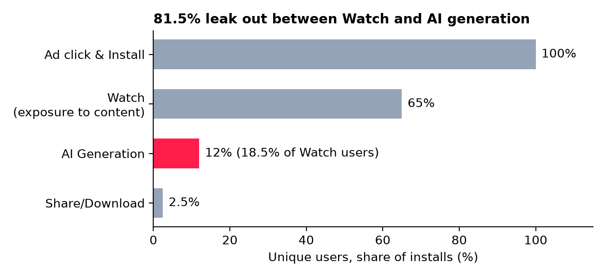
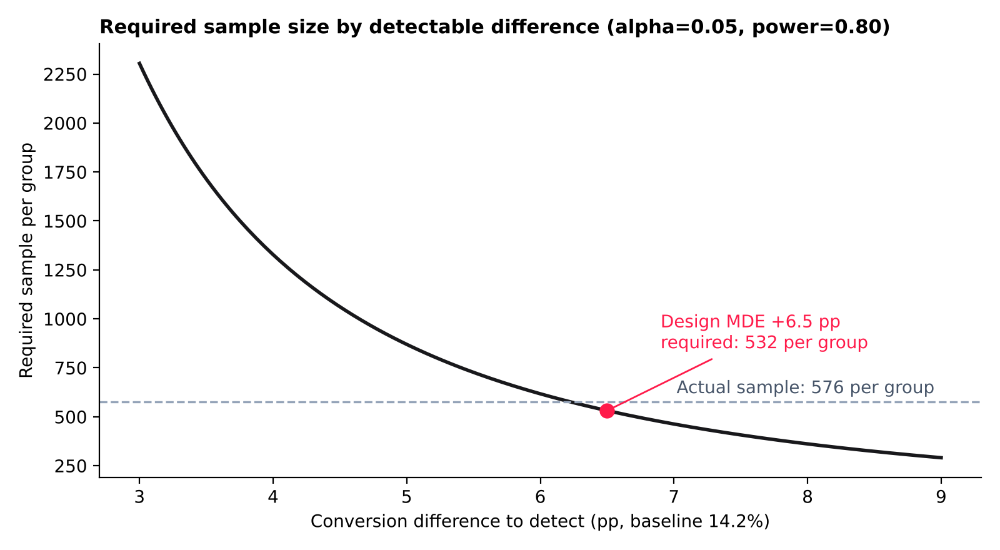
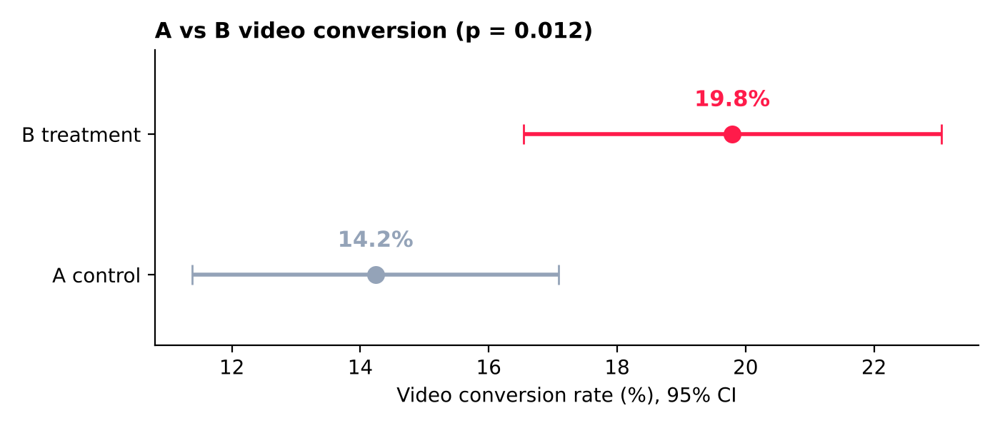

::: {.callout-note}
## Before you read
The design and result figures here match [Project A](../../projects/project-a.qmd). The per-group conversion counts (A: 82, B: 114 of 576 per group) are values arranged to match the reported conversion rates (14.2%, 19.8%) and p-value (0.012); replace them with values re-aggregated from the real logs if available.
:::

## 1. Background and objective

UA ads brought large inflow, but drop-off surged at the AI generation step right after Watch. We test the hypothesis that switching content exposure from **random content (A) to genre-curated content (B)** improves the video conversion rate.

* **H0:** The video conversion rates of the two groups are equal ($p_A = p_B$)
* **H1:** The video conversion rates differ ($p_A \neq p_B$), significance level $\alpha = 0.05$

## 2. Diagnosis: where users leak

{fig-alt="Funnel bar chart"}

Ad click & Install (100%) → Watch (exposure to content) (65%) → AI Generation (12%) → Share/Download (2.5%). The **Watch → AI generation** step loses 81.5% of users and is the largest leak, so the video conversion rate was chosen as the experiment metric. Each figure counts unique users as a share of installs. Users who attempt AI generation are 12% of installs and 18.5% of Watch users (12 ÷ 65).

The video conversion rate (baseline 14.2%) is a different metric from the 18.5% above. The 18.5% is the share of Watch users who **attempt** AI generation; the 14.2% is the share of content-exposed new users in the experiment who **successfully** generate a video.

## 3. Experiment design and sample sizing

| Item | Detail |
|---|---|
| Control (Group A) | Existing random content (80% user-uploaded, 20% in-house) |
| Treatment (Group B) | Genre-curated content (cinematic, Y2K, cartoon, meme, etc.) |
| Primary metric | Video conversion rate (users who successfully generate an AI video among exposed users), baseline 14.2% |
| Assignment / duration | New users randomly assigned 50:50 with Firebase Remote Config (A/B Testing), 14 days |
| Significance / power | $\alpha = 0.05$ / $1-\beta = 0.80$ |
| Minimum detectable effect (MDE) | +6.5 pp (14.2% → 20.7%) |

**How groups are assigned:** Remote Config serves a different content-exposure policy parameter per group. The group is recorded as a user property on the exposure event, logged when the app activates the value. These logs flow from Firebase into BigQuery and Amplitude, where per-group funnels and conversion are aggregated. Firebase randomizes per app installation (instance), so users who reinstall or use several devices may land in different groups and need to be checked in analysis.

The required sample size per group for comparing two proportions is:

$$n = \frac{(z_{1-\alpha/2}+z_{1-\beta})^2\,[p_1(1-p_1)+p_2(1-p_2)]}{(p_2-p_1)^2}$$

```python
from scipy import stats

def n_per_group(p1, p2, alpha=0.05, power=0.80):
    k = (stats.norm.ppf(1 - alpha/2) + stats.norm.ppf(power)) ** 2
    return k * (p1*(1-p1) + p2*(1-p2)) / (p2 - p1) ** 2

n_per_group(0.142, 0.142 + 0.065)   # 531.3 -> at least 532 per group
```

At least **532 per group**, or **38 per segment per day** over 14 days. The actual sample was 576 per group (about 41 per day), meeting the design requirement.



## 4. Test results

| Item | Control A | Treatment B |
|---|---|---|
| Sample size | 576 | 576 |
| Successful video generations | 82 | 114 |
| Video conversion rate | 14.2% | 19.8% |
| Difference | +5.6 pp (about +39% relative) | |

```python
import numpy as np
from scipy import stats

n, a, b = 576, 82, 114
chi2, p_chi, *_ = stats.chi2_contingency([[a, n-a], [b, n-b]], correction=False)
t, p_t = stats.ttest_ind(np.r_[np.ones(b), np.zeros(n-b)],
                         np.r_[np.ones(a), np.zeros(n-a)])
```

| Test | Statistic | p-value |
|---|---|---|
| Chi-square test | χ² = 6.30 (df=1) | 0.012 |
| Independent-samples t-test | t = 2.51 (df=1150) | 0.012 |

The 95% confidence interval of the difference is **+1.2 to +9.9 pp**, which excludes 0.



**Conclusion:** Since p = 0.012 < 0.05, we reject H0 and decided to roll out genre-curated content.

## 5. Key takeaways

* **Insight 1:** Video conversion for genre-curated content (B) is 19.8%, 5.6 pp (about +39% relative) above control (14.2%), and significant at the 5% level (p = 0.012).
* **Insight 2:** The observed difference (+5.6 pp) is smaller than the design MDE (+6.5 pp), so power on this sample is about 71%. The direction is reliable, but the confidence interval of the effect size (+1.2 to +9.9 pp) is wide, so it should be re-estimated through post-rollout monitoring.
* **Next actions:** Break down the effect by genre (cinematic, Y2K, etc.), and verify 7-day retention and proxy LTV/CAC ≥ 3.0 including GPU cost.

## 6. Limitations

* Assignment is per installation, so users who reinstall or use several devices may switch groups; check with the user_id mapping in the logs.
* This is a single-period, single-metric test, so novelty effects are to be checked through post-rollout monitoring.
* Subgroup effects by genre need multiple-comparison correction and were not covered in this test.
