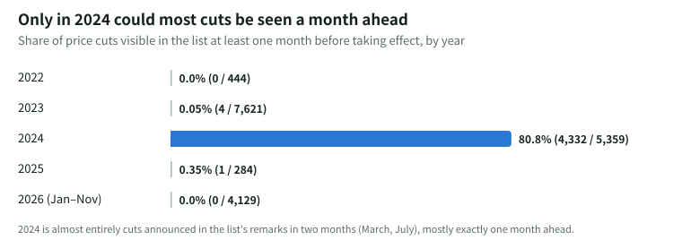

::: {.callout-note}
## About this page
Second edition (2026-11-27). The first edition was the reimbursement-change part of "Monitoring reimbursement changes and demand" (2026-11-24). This edition adds **how far ahead a reader of the list alone can see a price cut** and **the size of cuts**, computed in a new run. Realization rates were recounted with products that left the list after an injunction removed from the denominator; price changes without a note are unchanged from the first edition.

Demand forecasting is in the [demand report](../2026-11-drug-demand-forecast/index.qmd), and the whole series in the [series overview](../2026-11-pharm-data-series/index.qmd).
:::

::: {.report-meta}
**Edition** 2nd, November 27, 2026
**Data** HIRA reimbursement list 2022-01 to 2025-12 (main), 2026-01 to 11 (extension, reported separately); Ministry of Health and Welfare notices and association guidance for the reasons behind bulk cuts
**Full page (Korean)** [Read the Korean version](../../../ko/posts/2026-11-benefit-change-lead/index.qmd)
:::

## Why this question {#why}

The series sorts pharmacy pain points by the path a drug takes through a pharmacy: procuring, holding, dispensing, earning. This page is about holding stock whose value is cut by price reductions. The starting point is a pharmacist quoted in the trade press: cuts become known only days before they take effect, so pharmacies give up checking stock against them, and absorb 1-won cuts as a loss. Against the data, the first part holds: most cuts first appear in the list in the month they take effect, and notices and association guidance came 4–13 days ahead (the exception is the noted cuts of 2024, posted one month ahead). The second part held in 2026-01 (19.6% of bulk cuts were exactly 1 won) but not in every year (5 won or less was 10.2% across 2022–2025). Pharmacy-level losses need pharmacy stock records and are not computed.

## Questions

Will a drug's price or reimbursement status change next month? How often do the notes in the reimbursement list come true? How far ahead can a reader of the list alone see a price cut, and how small are the cuts?

## Four conclusions

1. **Price cuts announced in the reimbursement list almost always came true.** Of 4,659 products with a known outcome, 99.96% were cut. Among planned suspensions, 3 of 91 decisions were blocked by court injunctions.
2. **Seeing a cut at least a month ahead in the list happened almost only in 2024.** Of 13,708 cuts in 2022–2025, 31.6% were visible a month or more before taking effect, but nearly all came from two months in 2024 (80.8% that year; 0–0.35% in other years). Those cuts were mostly posted exactly one month ahead.
3. **Government bulk cuts first appear in the list in the month they take effect.** Notices and association guidance made them known 4–13 days earlier.
4. **Bulk cuts differed in size.** The 2023-09 base-requirement re-evaluation cuts were mostly 10–20%; 60% of the 2026-01 actual-transaction-price cuts were under 1%, and 19.6% were exactly 1 won.

| Do | Don't |
|---|---|
| Use price-cut notes in the remarks for alerts | Conclude "no price change this month" from the remarks alone |
| Compare each month's list with the previous month, and read notices and association guidance | Expect cuts to appear in the list in advance; most first appear in the month they take effect |
| Look at cut size in won and in percent | Present planned suspensions as certain |

## How often notes come true

The monthly snapshots were chained into a per-product change log. A future date in the remarks, such as "cut on 25.7.1", was recorded as an announcement, not as a change, and checked against later snapshots.

| Type of note | Products | Realized, among known outcomes | On the planned date | Median lead time |
|---|---|---|---|---|
| Price cut (remarks) | 4,683 | 99.96% | 98.5% | 30 days |
| New listing | 342 | 100.0% | 100.0% | 8 days |
| Planned suspension | 203 | 100.0% | 35.8% | 23 days |

- **Realized** includes changes that came slightly late, at a different amount, or as delisting instead of suspension. "Known outcomes" excludes notes still on hold under a court injunction and products that **left the list after an injunction** (nothing left to judge), the same rule as the injunction-outcome table.
- The first edition counted those delisted products (10 price-cut notes, 13 planned suspensions) as not realized, giving 99.7% and 89.3%.
- **Counted per decision** (one company's one decision, however many products), all 89 of the 91 planned suspensions with an outcome were realized. The 81 products still without an outcome belong to two companies' decisions under continuing injunctions (59 and 22).
- Notices of a planned suspension should say that a court decision may block it.

## Price changes without a note

**Of 14,041 product price changes, 9,370 (66.7%) had no note in the remarks.** They took effect through the list itself. This does not mean they were unannounced, only that the remarks column does not show them.

{fig-alt="Of 14,041 price changes, 4,671 (33.3%) were noted, 7,657 (54.5%) came without a note in three bulk-cut months, and 1,713 (12.2%) were other changes without a note."}

- 7,657 of them fall in three months of government-wide bulk cuts. The 2023-09 base-requirement re-evaluation alone accounts for 7,371; 2022-09 had 175 and 2024-05 had 111.
- Even outside the bulk-cut months, 26.8% changed without a note.
- Price alerts therefore need both the remarks and a month-on-month comparison of the list.

## How far ahead can a cut be seen? {#lead}

Lead time is the gap between the month a cut first appeared in the list and the month it took effect, counted in months because the actual release date of each file is unknown.

{fig-alt="2022 0.0%, 2023 0.05%, 2024 80.8%, 2025 0.35%, 2026 Jan–Nov 0.0%."}

- **Pooled over 2022–2025 the share is 31.6%** (4,337 of 13,708), but a single pooled figure misleads: almost all of it is the noted cuts of 2024-03 and 2024-07.
- All cuts visible in advance were noted in the remarks; 4,334 of 4,337 first appeared in the list of the month before (29–31 days ahead). Only 3 appeared two or more months ahead.
- Notes held by a court injunction were re-timed from the month the lifting of the injunction appeared in the list.

**Outside the list**, bulk cuts were known 4–13 days ahead: notice No. 2022-199 (7 days), Korean Hospital Association letter (6 days), notice No. 2023-166 (4 days), notice No. 2025-218 (8 days), and a Korean Pharmaceutical Association item table (13 days; shared on 2025-12-19, estimated). The same table listed voluntary cuts after the reimbursement-appropriateness re-evaluation that took effect 44 days later (2026-02). Hospital-route documents are guidance for hospitals; the pharmacy-route document exists only for 2026.

## How small are the cuts? {#size}

{fig-alt="2022-09 median 6.2%; 2023-09 median 15.0%, 90% between 10 and 20%; 2024-05 median 1.9%; 2026-01 median 0.6%, 60% under 1%."}

- **2023-09:** 7,231 of 7,363 cuts (98.2%) are on the list of "base-requirement re-evaluation, round 1" cuts; 92.0% of them were 10–20% (median 15.0%).
- **2026-01:** 2,405 of 3,865 (62.2%) are on the "actual-transaction-price adjustment" item table; 67.9% of them were under 1% (median 0.47%). The other 1,441 took effect under the same notice but are not on the item table.
- **2022-09 and 2024-05:** no reason is stated in the notices, and the cuts were not 10–20% (medians 6.2% and 1.9%).
- In won, 19.6% of the 2026-01 bulk cuts were exactly 1 won and 39.9% were 5 won or less (10.2% across 2022–2025). Won amounts are per unit (tablet, mL), so package sizes mix; percentages are less affected.

Reasons are taken only from the wording of documents; no reason was inferred. Products under flexible pricing contracts (from 2026-06) had no cuts, so they do not affect these figures. (Sources on flexible contracts: HIRA guidance and Ministry of Health and Welfare notices. Delisting reasons for injunction cases: Ministry of Food and Drug Safety drug information and Cashdoc.)

## How the classification was checked {#checks}

Of 11,509 bulk cuts in the four months, 11,460 (99.6%) matched the notices' change tables on product code and before/after price. The automated classification of notes was compared with 30 hand-labelled cases; the type matched in 83.3% (95% interval 66.4–92.7%, one labeller). In the Dong-A ST suspension case, the injunction date recorded in the list matched the court's decision date (2022-05-09).

## Limits

Injunctions not shown in the list are missed; only one was added from outside data. Suspensions for sanctions and for licensing reasons cannot be told apart from the remarks alone. Lead time is measured in months. 37.3% of the 2026-01 bulk cuts have no item-level reason. Some outside-list dates are estimates. Injunction outcomes come from a few companies' cases. This page does not look at price changes and prescription volume, and computes no savings or incentive amounts.
