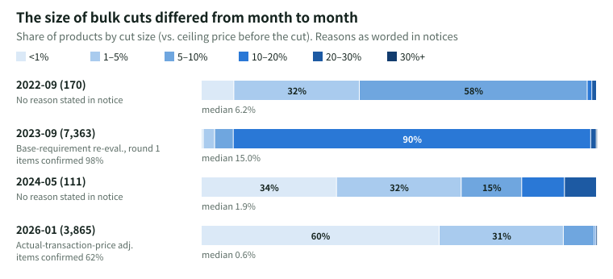

::: {.callout-note}
## About this page
Second edition (2026-11-27), rewritten to start from pharmacy case B-1. The first edition (2026-11-24) centred on how often notes in the list come true. Analyses and figures are reused; lead time, size of cuts and a match against government notices are new. Realization rates were recounted with products that left the list after an injunction removed from the denominator.

The whole series is in the [series overview](../2026-11-pharm-data-series/index.qmd); demand forecasting is in the [demand report](../2026-11-drug-demand-forecast/index.qmd).
:::

::: {.report-meta}
**Edition** 2nd, November 27, 2026
**Data** HIRA reimbursement list 2022-01 to 2025-12 (main), 2026-01 to 11 (extension, reported separately); four Ministry of Health and Welfare notices; Korean Hospital Association and Korean Pharmaceutical Association guidance
**Full page (Korean)** [Read the Korean version](../../../ko/posts/2026-11-benefit-change-lead/index.qmd)
:::

## Summary

**The field account mostly holds, but not always.**

| What pharmacists say | What the data show |
|---|---|
| "We learn of price cuts only days before" | **True.** In the list, most cuts first appear in the month they take effect; notices and association guidance came 4–13 days ahead. 31.6% of 2022–2025 cuts were visible a month or more ahead, almost all from noted cuts in two months of 2024 |
| "1-won cuts are a loss we just absorb" | **True in 2026-01.** 19.6% of that month's bulk cuts were exactly 1 won and 39.9% were 5 won or less. Across 2022–2025, 5 won or less was 10.2%, so it varies by year |
| (Can announced cuts be trusted?) | **Yes.** 99.96% of price cuts announced in the remarks came true, but only a third of price changes are announced there |
| (Why are some cuts large and others small?) | **Different reasons.** The 2023-09 base-requirement re-evaluation cuts were mostly 10–20%; the 2026-01 actual-transaction-price cuts were mostly under 1% |

## 1. Perspective and case {#perspective}

The page takes the view of those who could ease pharmacy burdens with ordering, stock and return information (distributors, pharmacy support services). Pharmacy pain points are sorted by the path a drug takes through a pharmacy: procuring (A), **holding stock (B)**, dispensing (C), earning (D). Stage B is expected to worsen fastest as listed drugs are re-evaluated from 2027, and it is the stage public data cover best.

**Case B-1** (trade press): a pharmacist learns of cuts only days ahead, gives up checking stock against them for settlement, and absorbs 1-won cuts. Two constraints can be measured with public data: **time** (when a cut first becomes visible) and **small amounts** (size of cuts). A third, shrinking compensation and return terms from manufacturers and wholesalers, is not in public data.

**Not in the data**: pharmacy purchases and stock, product sales, wholesale flows, compensation and return terms, planned delisting dates. Pharmacy-level losses are not computed.

## 2. When can a cut be known? {#lead}

{fig-alt="2022 0.0%, 2023 0.05%, 2024 80.8%, 2025 0.35%, 2026 Jan–Nov 0.0%."}

- Pooled, 31.6% (4,337 of 13,708) were visible a month or more ahead, but almost all of it is the noted cuts of 2024-03 and 2024-07. 4,334 of the 4,337 first appeared in the previous month's list (29–31 days ahead).
- Bulk cuts and other cuts without a note all first appeared in the list of the month they took effect. An alert built on the list catches 99.95% of cuts by that month (7 appeared only afterwards): the problem is lateness, not misses.
- 9,370 of 14,041 product price changes (66.7%) had no note in the remarks.
- **Outside the list**, bulk cuts were known 4–13 days ahead: notice No. 2022-199 (7 days), Korean Hospital Association letter (6), notice No. 2023-166 (4), notice No. 2025-218 (8), Korean Pharmaceutical Association item table (13; shared 2025-12-19, estimated). The same table listed voluntary cuts effective 44 days later (2026-02). Only one pharmacy-route document is available (2026).

## 3. How small are cuts? {#size}

- 19.6% of the 2026-01 bulk cuts were exactly 1 won and 39.9% were 5 won or less; 718 of the 759 1-won cuts are on the actual-transaction-price item table.
- Across 2022–2025, 5 won or less was 10.2%.
- Cuts visible a month ahead were smaller: 27.2% were 5 won or less, vs 2.2% for other cuts.
- Won amounts are per unit (tablet, mL), so package sizes mix; percentages are shown in §5.

## 4. Can announced cuts be trusted? {#realization}

| Type of note | Products | Realized, among known outcomes | On the planned date | Median lead time |
|---|---|---|---|---|
| Price cut (remarks) | 4,683 | 99.96% | 98.5% | 30 days |
| New listing | 342 | 100.0% | 100.0% | 8 days |
| Planned suspension | 203 | 100.0% | 35.8% | 23 days |

- Known outcomes exclude notes still held by a court injunction and products that left the list after an injunction. The first edition counted the latter (10 and 13 products) as not realized, giving 99.7% and 89.3%.
- Of 151 price-cut notes held by injunctions, followed to 2026-11, 75.0% of the 88 with an outcome came true as announced, 12.5% at a different amount and 12.5% not; the median time to outcome was 27 months. These are a few companies' cases.

## 5. Why are some cuts large and others small? {#reasons}

{fig-alt="2022-09 median 6.2%; 2023-09 median 15.0%, 90% between 10 and 20%; 2024-05 median 1.9%; 2026-01 median 0.6%, 60% under 1%."}

- **2023-09, base-requirement re-evaluation (round 1):** 7,231 of 7,363 bulk cuts (98.2%) are on the re-evaluation cut list; 92.0% of them were 10–20% (median 15.0%).
- **2026-01, actual-transaction-price adjustment:** 2,405 of 3,865 (62.2%) are on the item table; 67.9% of them were under 1% (median 0.47%). The other 1,441 took effect under the same notice but are not on the item table.
- **2022-09 and 2024-05:** no reason stated in the notices (medians 6.2% and 1.9%).
- Reasons are taken only from document wording. Whether the 2027 re-evaluation will resemble either pattern cannot be told from these data.

## 6. Implications {#implications}

Untested suggestions for alerts: noted cuts as one-month-ahead alerts; bulk cuts tracked through notice and association schedules (1–2 weeks ahead) with item tables turned into checklists; a monthly list-to-list comparison for other cuts; injunction cases flagged as possibly years from an outcome. Showing the size of each cut lets pharmacies decide which items are worth checking. Pharmacy-level expected losses need the pharmacy's own stock records.

## Checks and limits {#checks}

Of 11,509 bulk cuts in the four months, 11,460 (99.6%) matched the notices' change tables on product code and before/after price. Note classification matched 30 hand-labelled cases in 83.3%. Limits: the case and the ranking of pain points rest mainly on trade press and pharmacist surveys; lead time is measured in months; 37.3% of the 2026-01 bulk cuts have no item-level reason; some outside-list dates are estimates; injunction outcomes come from a few companies. Products under flexible pricing contracts (from 2026-06) had no cuts. No savings, settlement or incentive amounts are computed.

Sources: HIRA reimbursement lists; MOHW notices No. 2022-199, 2023-166, 2024-67, 2025-218; Korean Hospital Association letters (2022, 2023); Korean Pharmaceutical Association guidance (2025-12); delisting reasons from MFDS drug information and Cashdoc; flexible contracts from HIRA guidance and MOHW notices.
