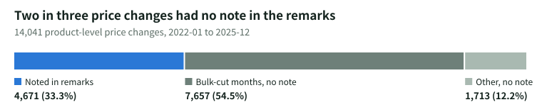
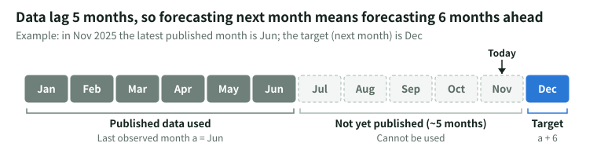

::: {.report-meta}
**Edition** November 24, 2026, with drug-class analysis and model specification
**Data** HIRA reimbursement list 2022-01 to 2025-12; NHIS drug usage statistics 2018-01 to 2025-12 (provisional evaluation 2026-01 to 06)  
**Full report (Korean)** [Read the full Korean version](../../../ko/posts/2026-11-drug-benefit-demand/index.qmd)
:::

This page summarizes the main findings in English. More tables, case studies, and the full list of limitations are in the Korean version.

## Questions

The analysis uses two public monthly datasets to answer three questions: Will a drug's price or reimbursement status change next month? Which way is prescription demand for each ingredient heading? Does using differences between drug classes make forecasts more accurate?

## Five conclusions

1. **Price cuts announced in the reimbursement list almost always came true.** Of 4,669 products with a known outcome, 99.7% were cut. Among planned suspensions, 3 of 91 decisions were blocked by court injunctions.
2. **The remarks column alone gives advance notice of only about a third of price changes.** 66.7% of products whose price changed had no advance note; most were government-wide price cuts published in the list itself.
3. **For 6-month-ahead demand forecasts, a simple statistical model (ETS) was enough.** Machine learning (LightGBM) beat "same month last year" but showed no evidence of beating ETS (6.46% vs 7.11% WAPE over 36 months; the gap could not be told apart from chance). The gain over "same month last year" was spread across 2023, 2024 and 2025, not concentrated in the post-COVID recovery.
4. **Adding reimbursement-list price information did not show an improvement.** Unit-price forecast error was about 15% lower in raw numbers, but the gap could not be told apart from chance; for prescription volume, the test could not measure an effect.
5. **Drug classes differ in error and in which method fits best, but adding class information did not help.** Error is 2.4% for lipid-lowering drugs and 19–22% for antibiotics (J01) and cough and cold drugs (R05), measured with machine learning. Both class-based approaches differed from the existing model by only 0.12 percentage points. A follow-up look at the high-error classes gave no reason to make the model more complex; it supports **keeping ETS as the default and monitoring each class's characteristics separately** (see "High-error drug classes").

{fig-alt="Of 14,041 price changes, 4,671 (33.3%) were noted, 7,657 (54.5%) came without a note in three bulk-cut months, and 1,713 (12.2%) were other changes without a note."}

## Demand forecasting six months ahead

**Why six months:** usage statistics are published about five months late. The latest month available today is five months back, so forecasting "next month" means forecasting six months past the data. In other words, "six months ahead" is not the distant future: it is **next month** as seen on the day of the forecast.

{fig-alt="Twelve cells from January to December 2025. January to June are published (last observed month a = June); July to November are not yet published and cannot be used; today is November; the target is December (a + 6)."}

Four methods were compared on 501 ingredients (93.8% of outpatient claimed amount), re-forecasting every month from 2023-01 to 2025-12.

| Method | Plain description | Average error (WAPE) | Verdict |
|---|---|---|---|
| Same month last year | "As much as last July, again this July" | 9.76% | Worse than machine learning (significant) |
| Last year × recent growth | Last year's value times the last 12 months' growth | 45.30% | One ingredient went badly wrong |
| ETS | Statistical model of recent trend and seasonal pattern | 7.11% | Not distinguishable from machine learning |
| Machine learning (LightGBM) | One model trained on all 501 ingredients | 6.46% | — |

"Significant" refers to a **monthly** test: the 36 monthly error differences were tested as one series; no per-ingredient test was used. The 2023–2025 evaluation used fully revised usage statistics (the November 2026 release). The 2026 actuals are a provisional release that may still rise; if they do, a model that forecast low looks better now than it really is, so 2026 will be re-scored on the final release.

{fig-alt="Line chart of forecast error from 1 to 12 months ahead. Machine learning is lower than ETS from 2 to 7 months ahead; the 6-month gap could not be told apart from chance. Same month last year stays around 9%."}

### Which years the gain came from

**The gain over "same month last year" is spread evenly across the three years.** The first half of 2023, right after the COVID-19 recovery, is when "same month last year" missed badly. If the gain had piled up there, the conclusion could reflect that one episode, so it was split by period. This was not pre-registered and is not used for any verdict.

{fig-alt="Two rows of 36 monthly bars. Top row (ML minus last year): 35 months below zero, total −3.26 pp. Bottom row (ML minus ETS): 23 months below zero, total −0.63 pp, with several months in 2023 H1 and 2024 where ETS was lower."}

- The share of the gain over last year was 40% in 2023, 31% in 2024 and 29% in 2025; the first half of 2023 alone was 23%.
- Against ETS the months were mixed; in the first half of 2023 machine learning was 0.13 pp worse.
- The model's COVID-19 indicators cover only 2020–2021. Forecasts for 2023, whose base year is the incompletely recovered 2022, are not flagged (see "Model specification"). In the previous edition (2026-11-19), most of the machine learning gain came from this period; in this edition it was 23%.
- The figure uses a slightly simplified set of ingredient-months, so its totals differ a little from the official values (−3.30 pp, −0.65 pp).

### Does reimbursement-list price information help?

**Adding the price changes visible in the list at forecast time did not show an improvement.** The criteria were fixed before results were seen.

| Question | Result | Verdict |
|---|---|---|
| Unit-price forecast: do list price changes beat the usage-statistics trend alone? | Error 0.0186 vs 0.0217 (about 15% lower), p = 0.252 | Inconclusive (not distinguishable from chance) |
| Is the gap due to matching the timing of price changes? | Not distinguishable from forecasts with timing shifted by 7 or 17 months | Cannot be credited to timing |
| Does it need the ingredient's own price information? | Using other ingredients' price changes made it worse, p = 0.001 | An ingredient's own price changes are associated with its unit price |
| Does a list-based correction improve volume forecasts? | Could not even detect a deliberately injected 20% effect | The test could not measure an effect |

- The median pass-through from list price change to actual claimed unit price was 0.55, so carrying list price changes over one-for-one overstates them.
- The list information is better suited to price and suspension alerts than to demand forecasting.

## What to do and not do

| Do | Don't |
|---|---|
| Use price-cut notes in the remarks for alerts | Conclude "no price change this month" from the remarks alone |
| Compare each month's list with the previous month to find price changes | Present planned suspensions as certain |
| Use ETS as the default for ingredient demand monitoring | Forecast with "last year × recent growth rate" |
| Watch respiratory and highly volatile ingredients separately | Use these forecasts directly as pharmacy order quantities |
| Use per-class error to decide how much to trust a forecast | Build a separate forecasting model for each class |

## High-error drug classes

{fig-alt="Error for eight classes, machine learning then ETS: C10 2.4%, 3.4%; B01 2.5%, 3.9%; C08 2.6%, 3.4%; C09 2.7%, 3.9%; S01 11.1%, 9.6%; R03 14.5%, 16.1%; J01 18.8%, 16.4%; R05 21.7%, 17.5%."}

*Among ATC level-2 classes with at least 10 ingredients, ranked by machine learning error. Post-hoc exploration: these are observed patterns and associations, not causes.*

### Respiratory drugs and antibiotics: winter height differed from year to year

::: {.wide-table}
| ATC class | Ingredients | Share of amount | Machine learning error | ETS error | Winter/summer ratio | Year-on-year swing |
|---|---|---|---|---|---|---|
| **R03** Drugs for obstructive airway diseases | 12 | 2.0% | 14.5% | 16.1% | 1.32 | ±33% |
| **J01** Antibacterials for systemic use | 38 | 6.0% | 18.8% | 16.4% | 1.20 | ±27% |
| **R05** Cough and cold preparations | 12 | 2.4% | 21.7% | 17.5% | 1.40 | ±32% |
:::

Errors are weighted by claimed amount within the class. Ratios and swings are medians across ingredients, 2023–2025.

In R03, J01 and R05, the size of the winter peak differed from year to year. The figure below shows, for each winter, how many times larger winter prescriptions were than summer.

{fig-alt="Winter-to-summer multiples for seven winters. R05: 1.81, 1.52, 1.07, 2.36, 1.47, 1.42, 1.24. R03: 1.50, 1.30, 1.11, 1.50, 1.38, 1.35, 1.24. J01: 1.35, 1.17, 0.93, 1.64, 1.33, 1.21, 1.07."}

Winter height shrank sharply in 2020/21, during the COVID-19 period, rose again in 2021/22, and fell in each of the next three winters. The data used here do not show why.

### A separate group: S01, ophthalmologicals

S01 has 20 ingredients (4.8% of amount), a machine learning error of 11.1% and an ETS error of 9.6%. It has no winter peak (ratio 0.95) and a median swing of only ±7%. Its error is concentrated in two ingredients: 54% of the machine learning error comes from sodium hyaluronate and 17% from bilberry fruit extract.

{fig-alt="Sodium hyaluronate 54%, bilberry 17%, olopatadine 6%, brimonidine 4%, tobramycin 4%, 15 other ingredients 15%."}

### What this means

The analysis does more than measure error: prescription volume varies in different ways across classes.

| Class | Observed | For people using the forecast (untested suggestions) |
|---|---|---|
| R05 | Ingredients miss together. Error is 13% even one month ahead | Read a range rather than a single point. If one ingredient misses, check the others in the class |
| J01 | Ingredients miss together. Children under 10 are 24% of claims but 48% of the year-on-year variation | Check class-wide movement and level shifts of single ingredients. Watch ingredients with a high share of children |
| R03 | Children under 10 are 50% of claims and 64% of the variation. Error grows with distance (8% one month ahead, 17% six months ahead) | Leave more room around six-month-ahead values. Shorter forecasts cannot be used now because of the publication lag |
| S01 | Two ingredients make up 71% of the machine learning error | Check sodium hyaluronate and bilberry individually instead of the class average |

| Class | Follow-up analysis | Data needed |
|---|---|---|
| R05 | Link infectious-disease activity and seasonal usage data | Disease-activity data (not available now) |
| J01 | Antibiotic use by child age group | Age breakdown in usage statistics (available) |
| R03 | Demand and seasonality of children's respiratory drugs | Age breakdown in usage statistics (available) |
| S01 | Analysis of the two ingredients | Usage statistics (available) |

**How large "miss together" is:** removing the common error of the other ingredients in the class lowers error by 36–38% for R05 and 20–25% for J01. Removing the common error of other, similarly volatile drugs still lowers it by 27–34% and 10–15%, so the pattern is not specific to either class.

"Removing the common error" uses the actual outcomes, so it is not error that could have been avoided in a real forecast. Each range spans the values for machine learning and for ETS. "Other drugs" is the average over random draws of ingredients with similar volatility and amount. Errors by distance are for an ETS variant that adjusts for workday differences, target months 2023-07 to 2025-06. For comparison, ingredients outside these four classes and R01 (nasal preparations) have 2.6% error one month ahead and 4.7% six months ahead. **Usage statistics come out about five months late, so a one-month-ahead forecast is not one that can actually be made today.**

- **No class had its error cut by 10% or more using information known six months ahead.** The pre-set improvement threshold was not met, so this is not reported as a model improvement. It remains a hypothesis to re-test if monthly disease-activity data become available.
- **Without more data, the analysis does not go on to explain causes.** There are no data on epidemics, allergies, or shortages.
- **Conclusion:** this is not a reason to make the model more complex. Keep ETS as the default and monitor each class's characteristics separately.

## Why the numbers can be trusted

- **Pre-registration:** target ingredients, error metric, tests, and the condition for "better" were written down and locked with the code before results were seen.
- **Backtesting:** each month was forecast using only data available at that time, with automated checks against future data leaking in (listed under "Model specification").
- **Sealed forecasts:** January–June 2026 forecasts were fixed with a SHA-256 hash before the actual values were opened.
- **Mistakes disclosed:** a bug found in the locked code was reported along with how it was worked around.

## Model specification

**This section records the target set, inputs, training and evaluation so the demand forecast can be reproduced.** All settings were locked in the pre-registration document and code before results were seen.

### Target ingredients and missing months

- **501 ingredients:** of 800 ingredients with at least one month of outpatient data in 2018-01 to 2022-07, those observed in all 55 months and with positive claimed amount in 2018-12 to 2019-11. Chosen without looking at the evaluation period.
- **Weights:** fixed share of outpatient claimed amount in 2018-12 to 2019-11. Volume units (tablets, mL, g) differ by ingredient, so volume cannot serve as a weight.
- **Usable months:** observed, above zero, and not the first month after a suppressed gap. Suppressed cells were not filled with zero; dropped cells were logged with reasons.

### Forecasting approach

- **"Six months ahead" = next month:** if the last observed month is a, the forecast is made in month a + 5, when that month's data is published, and the target a + 6 is next month as of that day. The main results use this six-month model; the 1–12-month models are used only for the horizon comparison figure.
- **Direct six-month forecast:** from a, the month six months later is forecast in one step, not by chaining one-month forecasts.
- **Retrained at every forecast origin:** the model is refit from scratch at each of the 36 origins (target months 2023-01 to 2025-12, last observed months 2022-07 to 2025-06), with a separate model for each horizon. Each origin trains on 17,535 to 33,897 rows.
- **One model for all 501 ingredients:** the target is the year-on-year log change, log y(t) − log y(t−12), which removes scale differences between ingredients. Forecasts are converted back as y(t−12) × exp(predicted change).
- **No ingredient ID:** ingredients are told apart only by the features below (size, class, own recent history).
- **Training and evaluation weight things differently:** training minimizes absolute error in log change with every row weighted equally, so small and large ingredients count the same. The evaluation metric (WAPE) puts more weight on ingredients with a large amount share. Leaving out training weights was decided before results were seen.
- **No reimbursement-list information:** the main model's features contain no list price or listing information. Results with that information added are reported separately under "Does reimbursement-list price information help?".

### Rows that cannot be forecast, and zero months

- **Rows without features are not filled:** if any feature is undefined for a target ingredient-month, no machine learning forecast is made, and no other method fills the gap.
- **All four methods are scored on the same rows:** the evaluation set contains only ingredient-months with a usable actual and forecasts from all four methods. Of 16,591 ingredient-months with a usable actual in the evaluation period, 105 (0.6%) were dropped because at least one method had no forecast, leaving 16,486 scored identically for all four.
- **There were no zero months:** zero-volume months were set to be excluded as unusable, but none occurred among the 501 ingredients' observed months in 2018–2025, so the log change is always defined for observed months. What drops out are suppressed months and 13 first months after a suppressed gap.

### Features and importance

All features use data up to the last observed month a only, so the five unpublished months never enter. Rows with any feature undefined were not used for training.

| Feature | Meaning |
|---|---|
| g3 | Year-on-year log change of the last three months' total |
| seas | Same month 12 months earlier ÷ mean of the 12 months ending at a (log), seasonal level |
| g1 | Year-on-year log change of the last observed month |
| mon | Calendar month of the target (1–12), categorical |
| dwork | Workday difference between the target month and 12 months earlier. Workdays exclude weekends and public holidays, so months with Lunar New Year or Chuseok have fewer workdays and partly overlap with the holiday flags below |
| cls2 | First two digits of the domestic drug-efficacy class, categorical (the code number is not used as an order) |
| size | Claimed amount over the 12 months ending at a (log), ingredient size. Amount is used because volume units differ by ingredient |
| cov_base | Whether the same month 12 months earlier fell in the COVID-19 period (2020-01 to 2021-12) |
| cov_anchor | Whether the last observed month fell in the COVID-19 period |
| lunar_b | Lunar New Year or Chuseok in the same month 12 months earlier |
| lunar_t | Lunar New Year or Chuseok in the target month |

{fig-alt="Training gain and prediction contribution for 11 features. Last-3-month growth 37.6% and 27.4%; seasonal level 15.3% and 22.9%; last-month growth 12.0% and 19.0%; calendar month 11.0% and 6.4%; workday difference 10.2% and 8.5%; drug class 7.4% and 4.9%; ingredient size 1.9% and 3.0%; base month in COVID 1.8% and 4.0%; last month in COVID 1.7% and 1.8%; holiday 12 months before 0.9% and 2.0%; holiday in target month 0.2% and 0.3%."}

- These are importances for the main six-month model, averaged over the 36 origins (target months 2023-01 to 2025-12).
- **Training gain** is each feature's share of the loss reduction from tree splits. **Prediction contribution** is each feature's share of the mean absolute SHAP value over the ingredient rows of each origin's target month that had all features defined. SHAP values are in the target's unit, log change.
- **Recent growth (g3, g1) and seasonal level (seas) account for 65% of training gain.** The ranking barely changed across origins; g3's share ranged from 35% to 41%. The two COVID-19 indicators together account for 3.5%.
- Importance shows what the model relied on, not what drives prescriptions.
- Computed after the fact by refitting the locked training code at all 36 origins; the refitted forecasts matched the main results to within a relative difference of 3×10⁻¹⁶.

### Training settings

- **Training window:** 2018-01 to the last observed month. Features need 24 months of history, so for the six-month horizon training target months start in 2019-09.
- **COVID-19 period:** kept in, flagged by the two indicator features above.
- **What the COVID-19 flags miss:** they cover only 2020-01 to 2021-12. Because the target is the change from 12 months earlier, an unusual base year inflates the target itself, and 2023 forecasts whose base year is the incompletely recovered 2022 are not flagged. This period is examined in "Which years the gain came from".
- **LightGBM settings (fixed, no tuning):** L1 (absolute error) loss, 500 trees, learning rate 0.03, 15 leaves, minimum 100 samples per leaf, no depth limit, no row or feature subsampling, L2 regularization 1, no row weights, deterministic mode, seed 20261114.

### Comparison methods

| Method | Definition |
|---|---|
| Same month last year | y(t−12) |
| Last year × recent growth | y(t−12) × (sum of the 12 months up to the last observed month ÷ sum of the 12 months before that). Only when all 24 months exist |
| ETS | Fit separately for each ingredient on log volume; additive error and seasonality (period 12); trend chosen by AICc between none and damped additive. Requires an unbroken run of at least 36 months ending at the last observed month. If fitting failed, "last year × recent growth" was used instead (2 evaluation cells, 0.01% of amount) |

### Evaluation and testing

- **Combining WAPE:** WAPE (sum of absolute errors ÷ sum of actuals) is computed per ingredient, then weighted by the amount shares above. Errors are summed in volume within an ingredient and by amount share across ingredients.

```{=html}
<p style="text-align:center">WAPE = Σ<sub>i</sub> w<sub>i</sub> × Σ<sub>t</sub>|y<sub>it</sub> − ŷ<sub>it</sub>| ÷ Σ<sub>t</sub> y<sub>it</sub></p>
```

- **Evaluation set:** ingredient-months with a usable actual and forecasts from all four methods (16,486).
- **The test unit is the month:** the 36 monthly differences were tested as one series with the EWC test, built for short autocorrelated series, with Holm correction for the three comparisons.
- **Condition for "better":** p < 0.05, and the error difference negative over the whole period and both sub-periods (2024-01 to 2025-12 and 2023-01 to 2024-10).
- **Per-ingredient figures are not tests:** "lower error for 85% of ingredients" is a simple count. A per-ingredient test would treat ingredients as independent, but they miss together in the same months.

### Data releases

- Training and the 2023–2025 evaluation used one revised release received in November 2026. Accuracy on the first release actually available in each month was not measured.
- The 2026-01 to 06 actuals come from the release of 2026-10-28. Less than 12 months have passed since first publication, so they may still rise; they are used for provisional scoring only.

### Checks against future data leaking in

Automated tests on synthetic data; they never read real evaluation-period actuals.

1. Changing usage statistics after the last observed month leaves all four methods' forecasts unchanged.
2. Deleting or changing reimbursement lists after the forecast origin leaves the list information and features unchanged.
3. A function deliberately made to use future values is caught.
4. Filling after-the-fact columns with nonsense leaves results unchanged.
5. The same input gives the same output.

## Limits

The report does not answer demand at the level of a pharmacy, product, or region. The 2026 evaluation is provisional, because recent usage statistics are revised in later releases. The 2023–2025 evaluation used revised data, so forecasts made with the first release available at the time could be less accurate. The machine learning settings were fixed without tuning, and results are limited to those settings. Relationships between price changes, drug classes, and prescription volume are associations, not causal claims. The look at high-error classes is post-hoc: it re-examines 2023–2025, and only two full winters have passed since the COVID-19 period, so it is not generalized to future winters.

## Next analyses

1. **Generic-substitution list and prescription shifts:** check whether the average unit price per ingredient (claimed amount ÷ volume) falls after products enter or leave the substitution incentive list.
2. **Price cuts by type:** separate patent-expiry, price-volume, actual-transaction-price, and re-evaluation cuts, and measure each type's realization rate and market response.
3. **Patent expiry and generic entry:** compare ingredient market value and unit price before and after new same-ingredient products are listed.
4. **Shortage and supply-interruption data:** match official shortage reports with sudden demand changes to explain large errors for respiratory drugs and antibiotics.
5. **Region and facility type:** break national totals down by province and type of care institution.
6. **One pharmacy alert, end to end:** show what a single pharmacy would receive (announced cut, effective date, chance of a court block).
7. **Strength and dosage-form aggregation:** check how combining different strengths and forms under one ingredient code affects forecast error.
8. **Price increases for essential drugs:** track whether prescriptions recover after price-ceiling increases.

Follow-up directions by class (R05, J01, R03, S01) are in the table under "High-error drug classes".

## Glossary

| Term | Meaning |
|---|---|
| WAPE | Sum of absolute errors ÷ sum of actuals. 6.5% means forecasts missed by about 6.5 units per 100 |
| pp (percentage point) | Difference between two percentages. 7.11% and 6.46% differ by 0.65 pp |
| ETS | Classical statistical model that weights recent values more and adds a seasonal pattern |
| Backtest | Going back to past dates, forecasting with only the data available then, and comparing with known actuals |
| Pre-registration | Fixing the analysis method and decision rules before seeing results |
| Inconclusive | The gap cannot be told apart from chance, so neither method can be called better. Not the same as "no difference" |
| Post-hoc exploration | Analysis added after seeing results, not planned in advance. Not used for verdicts |
| EWC test | A test designed to avoid spurious significance in short series whose months move together |
| Holm correction | Adjustment that stops one comparison from looking significant by chance when several are made |
| Feature importance | How much the model relied on each input. Not a cause |
| SHAP value | A single forecast split into contributions from each feature |
