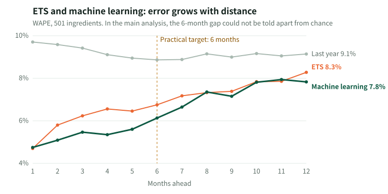
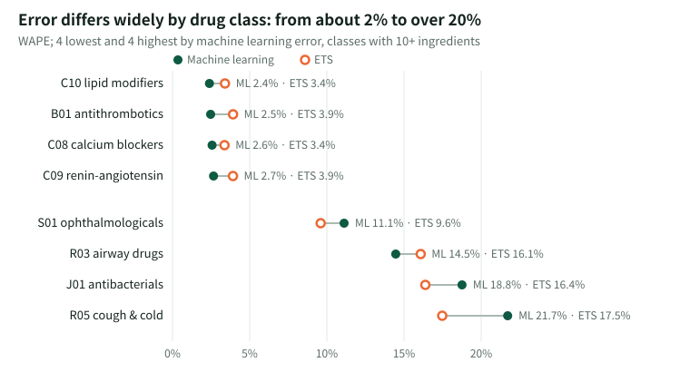
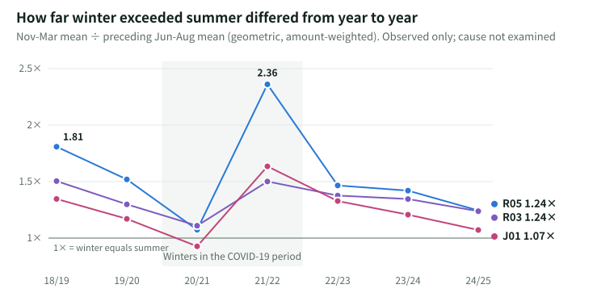
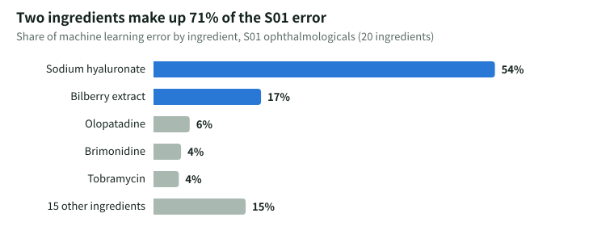

::: {.report-meta}
**Edition** November 24, 2026, with drug-class analysis  
**Data** HIRA reimbursement list 2022-01 to 2025-12; NHIS drug usage statistics 2018-01 to 2025-12 (provisional evaluation 2026-01 to 06)  
**Full report (Korean)** [Read the full Korean version](../../../ko/posts/2026-11-drug-benefit-demand/index.qmd)
:::

This page summarizes the main findings in English. More tables, case studies, and the full list of limitations are in the Korean version.

## Questions

The analysis uses two public monthly datasets to answer three questions: Will a drug's price or reimbursement status change next month? Which way is prescription demand for each ingredient heading? Does using differences between drug classes make forecasts more accurate?

## Four conclusions

1. **Price cuts announced in the reimbursement list almost always came true.** Of 4,669 products with a known outcome, 99.7% were cut. Among planned suspensions, 3 of 91 decisions were blocked by court injunctions.
2. **The remarks column alone gives advance notice of only about a third of price changes.** 66.7% of products whose price changed had no advance note; most were government-wide price cuts published in the list itself.
3. **For 6-month-ahead demand forecasts, a simple statistical model (ETS) was enough.** Machine learning (LightGBM) beat "same month last year" but showed no evidence of beating ETS (6.46% vs 7.11% WAPE over 36 months; the gap could not be told apart from chance).
4. **Drug classes differ in error and in which method fits best, but adding class information did not help.** Error is 2.4% for lipid-lowering drugs and 19–22% for antibiotics (J01) and cough and cold drugs (R05), measured with machine learning. Both class-based approaches differed from the existing model by only 0.12 percentage points. A follow-up look at the high-error classes gave no reason to make the model more complex; it supports **keeping ETS as the default and monitoring each class's characteristics separately** (see "High-error drug classes").

{fig-alt="Of 14,041 price changes, 4,671 (33.3%) were noted, 7,657 (54.5%) came without a note in three bulk-cut months, and 1,713 (12.2%) were other changes without a note."}

{fig-alt="Line chart of forecast error from 1 to 12 months ahead. Machine learning is lower than ETS from 2 to 7 months ahead; the 6-month gap could not be told apart from chance. Same month last year stays around 9%."}

## What to do and not do

| Do | Don't |
|---|---|
| Use price-cut notes in the remarks for alerts | Conclude "no price change this month" from the remarks alone |
| Compare each month's list with the previous month to find price changes | Present planned suspensions as certain |
| Use ETS as the default for ingredient demand monitoring | Forecast with "last year × recent growth rate" |
| Watch respiratory and highly volatile ingredients separately | Use these forecasts directly as pharmacy order quantities |
| Use per-class error to decide how much to trust a forecast | Build a separate forecasting model for each class |

## High-error drug classes

{fig-alt="Error for eight classes, machine learning then ETS: C10 2.4%, 3.4%; B01 2.5%, 3.9%; C08 2.6%, 3.4%; C09 2.7%, 3.9%; S01 11.1%, 9.6%; R03 14.5%, 16.1%; J01 18.8%, 16.4%; R05 21.7%, 17.5%."}

*Among ATC level-2 classes with at least 10 ingredients, ranked by machine learning error. Post-hoc exploration: these are observed patterns and associations, not causes.*

### Respiratory drugs and antibiotics: winter height differed from year to year

::: {.wide-table}
| ATC class | Ingredients | Share of amount | Machine learning error | ETS error | Winter/summer ratio | Year-on-year swing |
|---|---|---|---|---|---|---|
| **R03** Drugs for obstructive airway diseases | 12 | 2.0% | 14.5% | 16.1% | 1.32 | ±33% |
| **J01** Antibacterials for systemic use | 38 | 6.0% | 18.8% | 16.4% | 1.20 | ±27% |
| **R05** Cough and cold preparations | 12 | 2.4% | 21.7% | 17.5% | 1.40 | ±32% |
:::

Errors are weighted by claimed amount within the class. Ratios and swings are medians across ingredients, 2023–2025.

{fig-alt="Winter-to-summer multiples for seven winters. R05: 1.81, 1.52, 1.07, 2.36, 1.47, 1.42, 1.24. R03: 1.50, 1.30, 1.11, 1.50, 1.38, 1.35, 1.24. J01: 1.35, 1.17, 0.93, 1.64, 1.33, 1.21, 1.07."}

Winter height shrank sharply in 2020/21, during the COVID-19 period, rose again in 2021/22, and fell in each of the next three winters. The data used here do not show why.

### A separate group: S01, ophthalmologicals

S01 has 20 ingredients (4.8% of amount), a machine learning error of 11.1% and an ETS error of 9.6%. It has no winter peak (ratio 0.95) and a median swing of only ±7%. Its error is concentrated in two ingredients: 54% of the machine learning error comes from sodium hyaluronate and 17% from bilberry fruit extract.

{fig-alt="Sodium hyaluronate 54%, bilberry 17%, olopatadine 6%, brimonidine 4%, tobramycin 4%, 15 other ingredients 15%."}

### What this means

The analysis does more than measure error: prescription volume varies in different ways across classes.

| Class | Observed | For people using the forecast (untested suggestions) |
|---|---|---|
| R05 | Ingredients miss together. Error is 13% even one month ahead | Read a range rather than a single point. If one ingredient misses, check the others in the class |
| J01 | Ingredients miss together. Children under 10 are 24% of claims but 48% of the year-on-year variation | Check class-wide movement and level shifts of single ingredients. Watch ingredients with a high share of children |
| R03 | Children under 10 are 50% of claims and 64% of the variation. Error grows with distance (8% one month ahead, 17% six months ahead) | Leave more room around six-month-ahead values. Shorter forecasts cannot be used now because of the publication lag |
| S01 | Two ingredients make up 71% of the machine learning error | Check sodium hyaluronate and bilberry individually instead of the class average |

| Class | Follow-up analysis | Data needed |
|---|---|---|
| R05 | Link infectious-disease activity and seasonal usage data | Disease-activity data (not available now) |
| J01 | Antibiotic use by child age group | Age breakdown in usage statistics (available) |
| R03 | Demand and seasonality of children's respiratory drugs | Age breakdown in usage statistics (available) |
| S01 | Analysis of the two ingredients | Usage statistics (available) |

**How large "miss together" is:** removing the common error of the other ingredients in the class lowers error by 36–38% for R05 and 20–25% for J01. Removing the common error of other, similarly volatile drugs still lowers it by 27–34% and 10–15%, so the pattern is not specific to either class.

"Removing the common error" uses the actual outcomes, so it is not error that could have been avoided. The ranges cover machine learning and ETS; "other drugs" is the average over random draws of ingredients with similar volatility and amount. Errors by distance are for workday-adjusted ETS, target months 2023-07 to 2025-06. For comparison, ingredients outside these four classes and R01 (nasal preparations) have 2.6% error one month ahead and 4.7% six months ahead. **Usage statistics come out about five months late, so a one-month-ahead forecast is not one that can actually be made today.**

- **No class had its error cut by 10% or more using information known six months ahead.** The pre-set improvement threshold was not met, so this is not reported as a model improvement. It remains a hypothesis to re-test if monthly disease-activity data become available.
- **Without more data, the analysis does not go on to explain causes.** There are no data on epidemics, allergies, or shortages.
- **Conclusion:** this is not a reason to make the model more complex. Keep ETS as the default and monitor each class's characteristics separately.

## Why the numbers can be trusted

- **Pre-registration:** target ingredients, error metric, tests, and the condition for "better" were written down and locked with the code before results were seen.
- **Backtesting:** each month was forecast using only data available at that time, with automated checks against future data leaking in.
- **Sealed forecasts:** January–June 2026 forecasts were fixed with a SHA-256 hash before the actual values were opened.
- **Mistakes disclosed:** a bug found in the locked code was reported along with how it was worked around.

## Limits

The report does not answer demand at the level of a pharmacy, product, or region. The 2026 evaluation is provisional, because recent usage statistics are revised in later releases. Relationships between price changes, drug classes, and prescription volume are associations, not causal claims. The look at high-error classes is post-hoc: it re-examines 2023–2025, and only two full winters have passed since the COVID-19 period, so it is not generalized to future winters.

## Next analyses

1. **Generic-substitution list and prescription shifts:** check whether the average unit price per ingredient (claimed amount ÷ volume) falls after products enter or leave the substitution incentive list.
2. **Price cuts by type:** separate patent-expiry, price-volume, actual-transaction-price, and re-evaluation cuts, and measure each type's realization rate and market response.
3. **Patent expiry and generic entry:** compare ingredient market value and unit price before and after new same-ingredient products are listed.
4. **Shortage and supply-interruption data:** match official shortage reports with sudden demand changes to explain large errors for respiratory drugs and antibiotics.
5. **Region and facility type:** break national totals down by province and type of care institution.
6. **One pharmacy alert, end to end:** show what a single pharmacy would receive (announced cut, effective date, chance of a court block).
7. **Strength and dosage-form aggregation:** check how combining different strengths and forms under one ingredient code affects forecast error.
8. **Price increases for essential drugs:** track whether prescriptions recover after price-ceiling increases.

Follow-up directions by class (R05, J01, R03, S01) are in the table under "High-error drug classes".

