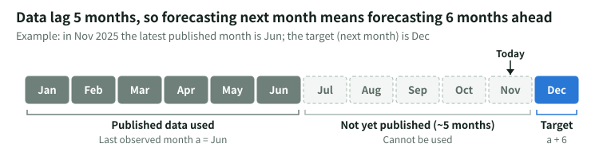
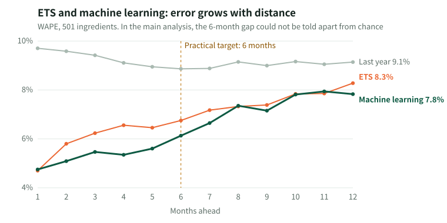
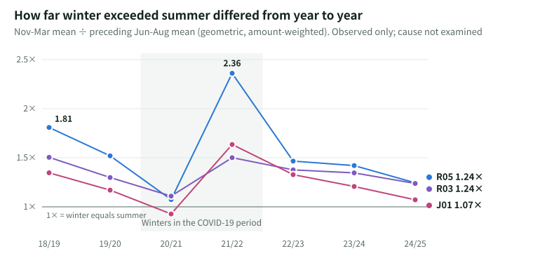
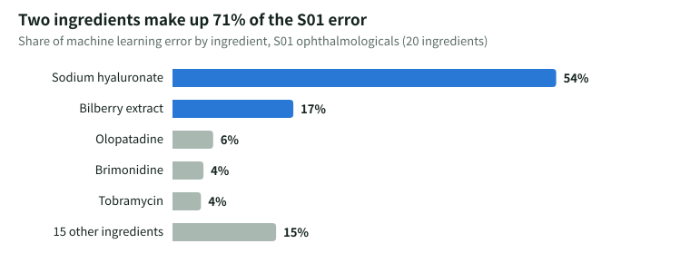
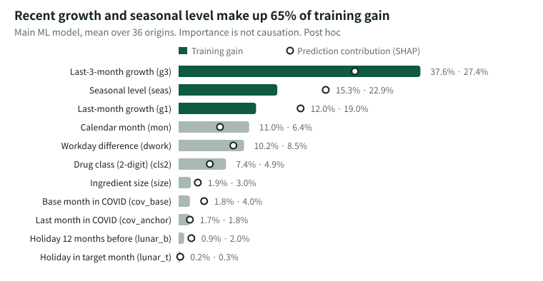

::: {.callout-note}
## About this page
Second edition (2026-11-27), rewritten to start from the pharmacy problem of getting drugs on time. The first edition (2026-11-24) centred on comparing four forecasting methods. Analyses, numbers and figures are unchanged.

Price cuts: [price-cut report](../2026-11-benefit-change-lead/index.qmd). Field context and public-data scope: [pharmacy pain-point research](../../../ko/subjects/drug_store.md). Verification and model specification are included in this report's checks and appendices.
:::

::: {.report-meta}
**Edition** 2nd, November 27, 2026 (numbers from the November 24, 2026 edition)
**Data** NHIS drug usage statistics 2018-01 to 2025-12 (provisional evaluation 2026-01 to 06); drug-class codes as attributes only
**Full report (Korean)** [Read the full Korean version](../../../ko/posts/2026-11-drug-demand-forecast/index.qmd)
:::

## Summary

**Public data cannot show shortages, but they can single out ingredients whose demand swings. Those were concentrated in winter respiratory drugs and antibiotics.**

| What pharmacies experience | What public data show |
|---|---|
| "We can't get the drugs we need on time" | **Shortages themselves are not in these data.** Usage statistics show only what was prescribed, but they can single out ingredients whose prescriptions swing |
| Cold medicines and antibiotics run short every winter | **The drug classes forecast worst were cough and cold drugs, antibiotics and respiratory drugs** (16–22% error). How much larger winter was than summer differed from year to year |

| What a demand-baseline builder asks | What the data show |
|---|---|
| How far off is next month's forecast? | **About 6–7% on average for national ingredient totals.** Data are published five months late, so "next month" is six months past the data |
| Which method? | **A simple statistical model (ETS) was enough.** Machine learning was slightly lower but not distinguishable from chance; "same month last year" was worse than both |
| Where does the error come from? | **59 volatile ingredients are 5.3% of amount but 24.4% of error;** more than half are respiratory or anti-infective |
| Does a separate method per drug class help? | **No.** Both approaches differed by only 0.12 percentage points |

## 1. Whose problem, and who can help {#perspective}

The page takes the view of those who could ease pharmacy burdens with ordering, stock and return information (distributors, pharmacy support services). Pharmacy pain points are sorted by the path a drug takes through a pharmacy: **procuring (A)**, holding stock (B, see the [price-cut page](../2026-11-benefit-change-lead/index.qmd)), dispensing (C), earning (D). Procuring is the problem pharmacies feel most today.

In trade-press cases, drugs are short for several reasons: allocation differs by pharmacy, wholesalers limit quantities or set minimum orders, and changes in distribution policy cut deliveries for days. Of these, only **demand** is visible in public data; production, shipments, wholesale and pharmacy stock are not. Usage statistics also arrive about five months late. This page therefore does not forecast shortages. It builds a demand baseline and shows where that baseline can and cannot be trusted.

**Not in the data**: shortages and supply, product sales, pharmacy purchases and stock, wholesale flows, regional demand.

## 2. How far off is next month's forecast? {#forecast}

{fig-alt="Twelve cells from January to December 2025. January to June are published (last observed month a = June); July to November are not yet published and cannot be used; today is November; the target is December (a + 6)."}

Four methods were compared on 501 ingredients (93.8% of outpatient claimed amount), re-forecasting every month from 2023-01 to 2025-12 with only the data available at the time.

| Method | Plain description | Average error | Verdict |
|---|---|---|---|
| Same month last year | "As much as last July, again this July" | 9.76% | Worse than machine learning (unlikely to be chance) |
| Last year × recent growth | Last year's value times the last 12 months' growth | 45.30% | One ingredient went badly wrong (section 5) |
| ETS | Statistical model of recent trend and seasonal pattern | 7.11% | Not distinguishable from machine learning |
| Machine learning (LightGBM) | One model trained on all 501 ingredients | 6.46% | — |

- Average error is the sum of misses ÷ the sum of actuals: 6.5% means about 6.5 units off per 100.
- The 0.65-point gap between machine learning and ETS could not be told apart from chance over 36 months; on unseen 2026-01 to 06 data (provisional), ETS was 0.25 points lower over six months. ETS is kept as the default because it is easier to explain and check.
- Machine learning was 3.30 points lower than "same month last year", lower in every 2026 month, and lower for 85% of ingredients.

{fig-alt="Line chart of forecast error from 1 to 12 months ahead. Machine learning is lower than ETS from 2 to 7 months ahead; similar at 1 month and at 8 months or more. Same month last year stays around 9%."}

**Adjusting for working days (weekdays that are not holidays) while keeping ETS lowered average error from 7.11% to 6.19%** (−0.92 points, 90% interval −1.59 to −0.25). The same approach gave 90% ranges that contained the actual value 90.77% of the time. It is not yet the default: the idea came from the same 2023–2025 errors it was evaluated on, and for 61 respiratory and antibiotic ingredients error rose from 16.07% to 16.82%. It is the first candidate to confirm on 2026 data.

## 3. Where do forecasts go most wrong? {#class-error}

- For half the ingredients, the busiest month in 2018–2025 was at most 2.3 times the quietest; for the top 5% it was over 17 times.
- The 59 ingredients whose same-month volume swung by ±30% or more from year to year average 29.6% error vs 4.6% for the rest (machine learning).
- The 62 respiratory ingredients had 16.05% error with ETS and 18.63% with machine learning.

{fig-alt="Error for eight classes, machine learning then ETS: C10 2.4%, 3.4%; B01 2.5%, 3.9%; C08 2.6%, 3.4%; C09 2.7%, 3.9%; S01 11.1%, 9.6%; R03 14.5%, 16.1%; J01 18.8%, 16.4%; R05 21.7%, 17.5%."}

Chronic and cardiovascular drugs (lipid-lowering C10, antithrombotics B01) were 2–4% off; respiratory (R03), antibiotics (J01) and cough and cold drugs (R05) were 14–22%. In those three classes the size of the winter peak differed from year to year:

{fig-alt="Winter-to-summer multiples for seven winters. R05: 1.81, 1.52, 1.07, 2.36, 1.47, 1.42, 1.24. R03: 1.50, 1.30, 1.11, 1.50, 1.38, 1.35, 1.24. J01: 1.35, 1.17, 0.93, 1.64, 1.33, 1.21, 1.07."}

These are the same classes pharmacists describe as running short in winter. The data show that winter demand varies and is difficult to forecast; they do not show how much supply fell short or whether a shortage occurred. This analysis examines seasonal prescription differences and ingredient-level forecast errors, not a public early-warning signal.


Among ATC level-2 classes with at least 10 ingredients, the lowest-error groups (C10, B01, C08 and C09) had winter/summer ratios of 0.99–1.00 and year-on-year swings of ±4–5%. R03, J01 and R05 had swings of ±27–33% and winter/summer ratios of 1.20–1.40. S01 had no clear winter peak; 71% of its machine-learning error came from sodium hyaluronate and bilberry. These are post-hoc patterns, not causes. Across classes, error was most strongly associated with year-on-year changes in the same month's prescriptions (rank correlation 0.94), rather than seasonality alone. More detail is in [Appendix A](#appendix-a).

## 4. Does a separate method per drug class help? {#class-test}

No. Blending machine learning and ETS differently per class, and adding class information to the model, were tested against criteria fixed in advance. Both reached 6.34% vs 6.46% for the existing model, a 0.12-point gap with no evidence of improvement. Per-class error is used to decide **how much to trust** a forecast, not to change the method. Further class diagnostics are in [Appendix A](#appendix-a).

## 5. Case: the flu drug and "last year × growth" {#case-flu}

Outpatient prescriptions of oseltamivir rose from about 4,900 in 2022-01 to about 4.15 million in 2023-01. "Last year × recent growth" counted that surge twice, so the 2024-05 forecast was about 1,143 times the actual, and this one ingredient made up 79.1% of the method's total error. Growth multipliers should not be used for ingredients whose demand level jumped.

## 6. Implications {#implications}

Untested suggestions: build a national next-month baseline per ingredient with ETS, and set its trust range from the drug class's error (3–4% for chronic drugs, 16–18% for respiratory drugs and antibiotics, ETS); flag ingredients with large year-on-year swings for human review, using only data available at forecast time; widen ranges for respiratory drugs and antibiotics before winter; fill the five-month publication gap with one's own order data, and split share changes from market changes with own volume ÷ national prescriptions. Do not use "last year × growth", do not use national forecasts as pharmacy orders, and do not build a model per class. Pharmacy-level demand needs pharmacy order and stock records.

## Checks and limits {#limits}

Methods and decision rules were fixed before results (pre-registration); each month was forecast with only data available then (backtest), with a separate test against future-data leakage; unseen 2026 data were scored as well. Limits: the field cases rest mainly on trade press and pharmacist surveys; shortages are not visible, and a prescription switched because a drug was unavailable looks like demand; the 2026 evaluation is provisional; the class diagnostics are post-hoc and only two full post-COVID winters exist; class codes come from 2026 data; revised data were used for 2023–2025; machine learning settings were not tuned. Relationships between drug classes and error are associations.


The forecasts were pre-registered: target ingredients, error metric, statistical tests and the rule for declaring an improvement were locked with the code before results were inspected. Each historical month was forecast using only information then available. The January–June 2026 forecasts were sealed with a SHA-256 hash before actuals were opened. Re-running the class experiments reproduced the baseline forecasts to within a relative difference of 3×10⁻¹⁶. A bug found in the locked code was disclosed with its workaround. The detailed procedure is in Appendix B.

## Appendix: which years the gain came from {#by-year}

{fig-alt="Two rows of 36 monthly bars. Top row (ML minus last year): 35 months below zero, total −3.26 pp. Bottom row (ML minus ETS): 23 months below zero, total −0.63 pp, with several months in 2023 H1 and 2024 where ETS was lower."}

The gain over "same month last year" was 40% in 2023, 31% in 2024 and 29% in 2025 (23% in the first half of 2023), so it is not a post-COVID artefact. Against ETS the months were mixed. This split was not pre-registered and is not used for any verdict. Shifts in prescription mix (age, region, clinic share) did not explain errors either: no feature met the pre-set criteria, and adjusting for them made every case worse, so that direction was closed. Adding reimbursement-list prices did not show a reliable improvement; the experiment is detailed in [Appendix A](#appendix-a).

## Appendix A: additional class diagnostics and price-list experiment {#appendix-a}

### Drug-class diagnostics

*Among ATC level-2 classes with at least 10 ingredients, ranked by machine learning error. Post-hoc exploration: these are observed patterns and associations, not causes. The per-class error chart is in the [demand report](#class-error).*

#### Respiratory drugs and antibiotics: winter height differed from year to year

::: {.wide-table}
| ATC class | Ingredients | Share of amount | Machine learning error | ETS error | Winter/summer ratio | Year-on-year swing |
|---|---|---|---|---|---|---|
| **R03** Drugs for obstructive airway diseases | 12 | 2.0% | 14.5% | 16.1% | 1.32 | ±33% |
| **J01** Antibacterials for systemic use | 38 | 6.0% | 18.8% | 16.4% | 1.20 | ±27% |
| **R05** Cough and cold preparations | 12 | 2.4% | 21.7% | 17.5% | 1.40 | ±32% |
:::

Errors are weighted by claimed amount within the class. Ratios and swings are medians across ingredients, 2023–2025.

#### A separate group: S01, ophthalmologicals

S01 has 20 ingredients (4.8% of amount), a machine learning error of 11.1% and an ETS error of 9.6%. It has no winter peak (ratio 0.95) and a median swing of only ±7%. Its error is concentrated in two ingredients: 54% of the machine learning error comes from sodium hyaluronate and 17% from bilberry fruit extract.

{fig-alt="Sodium hyaluronate 54%, bilberry 17%, olopatadine 6%, brimonidine 4%, tobramycin 4%, 15 other ingredients 15%."}

#### What this means

The analysis does more than measure error: prescription volume varies in different ways across classes.

| Class | Observed | For people using the forecast (untested suggestions) |
|---|---|---|
| R05 | Ingredients miss together. Error is 13% even one month ahead | Read a range rather than a single point. If one ingredient misses, check the others in the class |
| J01 | Ingredients miss together. Children under 10 are 24% of claims but 48% of the year-on-year variation | Check class-wide movement and level shifts of single ingredients. Watch ingredients with a high share of children |
| R03 | Children under 10 are 50% of claims and 64% of the variation. Error grows with distance (8% one month ahead, 17% six months ahead) | Leave more room around six-month-ahead values. Shorter forecasts cannot be used now because of the publication lag |
| S01 | Two ingredients make up 71% of the machine learning error | Check sodium hyaluronate and bilberry individually instead of the class average |

| Class | Follow-up analysis | Data needed |
|---|---|---|
| R05 | Link infectious-disease activity and seasonal usage data | Disease-activity data (not available now) |
| J01 | Antibiotic use by child age group | Age breakdown in usage statistics (available) |
| R03 | Demand and seasonality of children's respiratory drugs | Age breakdown in usage statistics (available) |
| S01 | Analysis of the two ingredients | Usage statistics (available) |

**How large "miss together" is:** removing the common error of the other ingredients in the class lowers error by 36–38% for R05 and 20–25% for J01. Removing the common error of other, similarly volatile drugs still lowers it by 27–34% and 10–15%, so the pattern is not specific to either class.

"Removing the common error" uses the actual outcomes, so it is not error that could have been avoided in a real forecast. Each range spans the values for machine learning and for ETS. "Other drugs" is the average over random draws of ingredients with similar volatility and amount. Errors by distance are for an ETS variant that adjusts for workday differences, target months 2023-07 to 2025-06. For comparison, ingredients outside these four classes and R01 (nasal preparations) have 2.6% error one month ahead and 4.7% six months ahead. **Usage statistics come out about five months late, so a one-month-ahead forecast is not one that can actually be made today.**

- **No class had its error cut by 10% or more using information known six months ahead.** The pre-set improvement threshold was not met, so this is not reported as a model improvement. It remains a hypothesis to re-test if monthly disease-activity data become available.
- **Without more data, the analysis does not go on to explain causes.** There are no data on epidemics, allergies, or shortages.
- **Conclusion:** this is not a reason to make the model more complex. Keep ETS as the default and monitor each class's characteristics separately.

### Reimbursement-list price test

**Adding the price changes visible in the list at forecast time did not show an improvement.** The criteria were fixed before results were seen.

| Question | Result | Verdict |
|---|---|---|
| Unit-price forecast: do list price changes beat the usage-statistics trend alone? | Error 0.0186 vs 0.0217 (about 15% lower), p = 0.252 | Inconclusive (not distinguishable from chance) |
| Is the gap due to matching the timing of price changes? | Not distinguishable from forecasts with timing shifted by 7 or 17 months | Cannot be credited to timing |
| Does it need the ingredient's own price information? | Using other ingredients' price changes made it worse, p = 0.001 | An ingredient's own price changes are associated with its unit price |
| Does a list-based correction improve volume forecasts? | Could not even detect a deliberately injected 20% effect | The test could not measure an effect |

- The median pass-through from list price change to actual claimed unit price was 0.55, so carrying list price changes over one-for-one overstates them.
- The list information is better suited to price and suspension alerts than to demand forecasting.

## Appendix B: model specification and reproducibility {#appendix-b}

**This section records the target set, inputs, training and evaluation so the demand forecast can be reproduced.** All settings were locked in the pre-registration document and code before results were seen.

### Target ingredients and missing months

- **501 ingredients:** of 800 ingredients with at least one month of outpatient data in 2018-01 to 2022-07, those observed in all 55 months and with positive claimed amount in 2018-12 to 2019-11. Chosen without looking at the evaluation period.
- **Weights:** fixed share of outpatient claimed amount in 2018-12 to 2019-11. Volume units (tablets, mL, g) differ by ingredient, so volume cannot serve as a weight.
- **Usable months:** observed, above zero, and not the first month after a suppressed gap. Suppressed cells were not filled with zero; dropped cells were logged with reasons.

### Forecasting approach

- **"Six months ahead" = next month:** if the last observed month is a, the forecast is made in month a + 5, when that month's data is published, and the target a + 6 is next month as of that day. The main results use this six-month model; the 1–12-month models are used only for the [horizon comparison figure](#forecast).
- **Direct six-month forecast:** from a, the month six months later is forecast in one step, not by chaining one-month forecasts.
- **Retrained at every forecast origin:** the model is refit from scratch at each of the 36 origins (target months 2023-01 to 2025-12, last observed months 2022-07 to 2025-06), with a separate model for each horizon. Each origin trains on 17,535 to 33,897 rows.
- **One model for all 501 ingredients:** the target is the year-on-year log change, log y(t) − log y(t−12), which removes scale differences between ingredients. Forecasts are converted back as y(t−12) × exp(predicted change).
- **No ingredient ID:** ingredients are told apart only by the features below (size, class, own recent history).
- **Training and evaluation weight things differently:** training minimizes absolute error in log change with every row weighted equally, so small and large ingredients count the same. The evaluation metric (WAPE) puts more weight on ingredients with a large amount share. Leaving out training weights was decided before results were seen.
- **No reimbursement-list information:** the main model's features contain no list price or listing information. Results with that information added are reported above under "Reimbursement-list price test".

### Rows that cannot be forecast, and zero months

- **Rows without features are not filled:** if any feature is undefined for a target ingredient-month, no machine learning forecast is made, and no other method fills the gap.
- **All four methods are scored on the same rows:** the evaluation set contains only ingredient-months with a usable actual and forecasts from all four methods. Of 16,591 ingredient-months with a usable actual in the evaluation period, 105 (0.6%) were dropped because at least one method had no forecast, leaving 16,486 scored identically for all four.
- **There were no zero months:** zero-volume months were set to be excluded as unusable, but none occurred among the 501 ingredients' observed months in 2018–2025, so the log change is always defined for observed months. What drops out are suppressed months and 13 first months after a suppressed gap.

### Features and importance

All features use data up to the last observed month a only, so the five unpublished months never enter. Rows with any feature undefined were not used for training.

| Feature | Meaning |
|---|---|
| g3 | Year-on-year log change of the last three months' total |
| seas | Same month 12 months earlier ÷ mean of the 12 months ending at a (log), seasonal level |
| g1 | Year-on-year log change of the last observed month |
| mon | Calendar month of the target (1–12), categorical |
| dwork | Workday difference between the target month and 12 months earlier. Workdays exclude weekends and public holidays, so months with Lunar New Year or Chuseok have fewer workdays and partly overlap with the holiday flags below |
| cls2 | First two digits of the domestic drug-efficacy class, categorical (the code number is not used as an order) |
| size | Claimed amount over the 12 months ending at a (log), ingredient size. Amount is used because volume units differ by ingredient |
| cov_base | Whether the same month 12 months earlier fell in the COVID-19 period (2020-01 to 2021-12) |
| cov_anchor | Whether the last observed month fell in the COVID-19 period |
| lunar_b | Lunar New Year or Chuseok in the same month 12 months earlier |
| lunar_t | Lunar New Year or Chuseok in the target month |

{fig-alt="Training gain and prediction contribution for 11 features. Last-3-month growth 37.6% and 27.4%; seasonal level 15.3% and 22.9%; last-month growth 12.0% and 19.0%; calendar month 11.0% and 6.4%; workday difference 10.2% and 8.5%; drug class 7.4% and 4.9%; ingredient size 1.9% and 3.0%; base month in COVID 1.8% and 4.0%; last month in COVID 1.7% and 1.8%; holiday 12 months before 0.9% and 2.0%; holiday in target month 0.2% and 0.3%."}

- These are importances for the main six-month model, averaged over the 36 origins (target months 2023-01 to 2025-12).
- **Training gain** is each feature's share of the loss reduction from tree splits. **Prediction contribution** is each feature's share of the mean absolute SHAP value over the ingredient rows of each origin's target month that had all features defined. SHAP values are in the target's unit, log change.
- **Recent growth (g3, g1) and seasonal level (seas) account for 65% of training gain.** The ranking barely changed across origins; g3's share ranged from 35% to 41%. The two COVID-19 indicators together account for 3.5%.
- Importance shows what the model relied on, not what drives prescriptions.
- Computed after the fact by refitting the locked training code at all 36 origins; the refitted forecasts matched the main results to within a relative difference of 3×10⁻¹⁶.

### Training settings

- **Training window:** 2018-01 to the last observed month. Features need 24 months of history, so for the six-month horizon training target months start in 2019-09.
- **COVID-19 period:** kept in, flagged by the two indicator features above.
- **What the COVID-19 flags miss:** they cover only 2020-01 to 2021-12. Because the target is the change from 12 months earlier, an unusual base year inflates the target itself, and 2023 forecasts whose base year is the incompletely recovered 2022 are not flagged. This period is examined in ["Which years the gain came from"](#by-year).
- **LightGBM settings (fixed, no tuning):** L1 (absolute error) loss, 500 trees, learning rate 0.03, 15 leaves, minimum 100 samples per leaf, no depth limit, no row or feature subsampling, L2 regularization 1, no row weights, deterministic mode, seed 20261114.

### Comparison methods

| Method | Definition |
|---|---|
| Same month last year | y(t−12) |
| Last year × recent growth | y(t−12) × (sum of the 12 months up to the last observed month ÷ sum of the 12 months before that). Only when all 24 months exist |
| ETS | Fit separately for each ingredient on log volume; additive error and seasonality (period 12); trend chosen by AICc between none and damped additive. Requires an unbroken run of at least 36 months ending at the last observed month. If fitting failed, "last year × recent growth" was used instead (2 evaluation cells, 0.01% of amount) |

### Evaluation and testing

- **Combining WAPE:** WAPE (sum of absolute errors ÷ sum of actuals) is computed per ingredient, then weighted by the amount shares above. Errors are summed in volume within an ingredient and by amount share across ingredients.

```{=html}
<p style="text-align:center">WAPE = Σ<sub>i</sub> w<sub>i</sub> × Σ<sub>t</sub>|y<sub>it</sub> − ŷ<sub>it</sub>| ÷ Σ<sub>t</sub> y<sub>it</sub></p>
```

- **Evaluation set:** ingredient-months with a usable actual and forecasts from all four methods (16,486).
- **The test unit is the month:** the 36 monthly differences were tested as one series with the EWC test, built for short autocorrelated series, with Holm correction for the three comparisons.
- **Condition for "better":** p < 0.05, and the error difference negative over the whole period and both sub-periods (2024-01 to 2025-12 and 2023-01 to 2024-10).
- **Per-ingredient figures are not tests:** "lower error for 85% of ingredients" is a simple count. A per-ingredient test would treat ingredients as independent, but they miss together in the same months.

### Data releases

- Training and the 2023–2025 evaluation used one revised release received in November 2026. Accuracy on the first release actually available in each month was not measured.
- The 2026-01 to 06 actuals come from the release of 2026-10-28. Less than 12 months have passed since first publication, so they may still rise; they are used for provisional scoring only.

### Checks against future data leaking in

Automated tests on synthetic data; they never read real evaluation-period actuals.

1. Changing usage statistics after the last observed month leaves all four methods' forecasts unchanged.
2. Deleting or changing reimbursement lists after the forecast origin leaves the list information and features unchanged.
3. A function deliberately made to use future values is caught.
4. Filling after-the-fact columns with nonsense leaves results unchanged.
5. The same input gives the same output.

## Glossary {#glossary}

| Term | Meaning |
|---|---|
| Usage statistics | NHIS monthly table of prescription volume and claimed amount per ingredient, published about five months late |
| Ingredient (4-digit code) | Unit grouping products with the same active ingredient |
| ATC code | International drug classification. C10 lipid-lowering, J01 antibiotics, R03 respiratory, R05 cough and cold, S01 eye |
| Average error (WAPE) | Sum of absolute errors ÷ sum of actuals |
| ETS | Statistical model that weights recent values more and adds a seasonal pattern |
| Backtest | Forecasting from past dates with only the data available then and comparing with actuals |
| Pre-registration | Fixing methods and decision rules before seeing results |
| Post-hoc exploration | Analysis added after seeing results; not used for verdicts |

EWC is a test for short autocorrelated monthly differences; Holm correction controls false positives across multiple comparisons. SHAP values describe feature contributions. Definitions and model details are in [Appendix B](#appendix-b).
