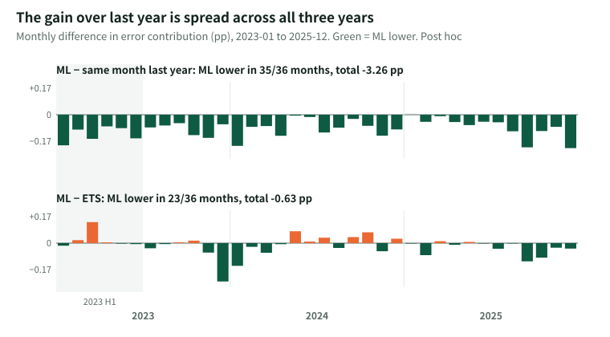

::: {.callout-note}
## About this page
Second edition (2026-11-27), rewritten to start from the pharmacy problem of getting drugs on time. The first edition (2026-11-24) centred on comparing four forecasting methods. Analyses, numbers and figures are unchanged.

Price cuts: [Only in 2024 could most price cuts be seen a month ahead](../2026-11-benefit-change-lead/index.qmd). Whole series: [series overview](../2026-11-pharm-data-series/index.qmd). Verification and model specification: [technical note](../2026-11-drug-demand-tech-note/index.qmd).
:::

::: {.report-meta}
**Edition** 2nd, November 27, 2026 (numbers from the November 24, 2026 edition)
**Data** NHIS drug usage statistics 2018-01 to 2025-12 (provisional evaluation 2026-01 to 06); drug-class codes as attributes only
**Full report (Korean)** [Read the full Korean version](../../../ko/posts/2026-11-drug-demand-forecast/index.qmd)
:::

## Summary

**Public data cannot show shortages, but they can single out ingredients whose demand swings. Those were concentrated in winter respiratory drugs and antibiotics.**

| What pharmacies experience | What public data show |
|---|---|
| "We can't get the drugs we need on time" | **Shortages themselves are not in these data.** Usage statistics show only what was prescribed, but they can single out ingredients whose prescriptions swing |
| Cold medicines and antibiotics run short every winter | **The drug classes forecast worst were cough and cold drugs, antibiotics and respiratory drugs** (16–22% error). How much larger winter was than summer differed from year to year |

| What a demand-baseline builder asks | What the data show |
|---|---|
| How far off is next month's forecast? | **About 6–7% on average for national ingredient totals.** Data are published five months late, so "next month" is six months past the data |
| Which method? | **A simple statistical model (ETS) was enough.** Machine learning was slightly lower but not distinguishable from chance; "same month last year" was worse than both |
| Where does the error come from? | **59 volatile ingredients are 5.3% of amount but 24.4% of error;** more than half are respiratory or anti-infective |
| Does a separate method per drug class help? | **No.** Both approaches differed by only 0.12 percentage points |

## 1. Whose problem, and who can help {#perspective}

The page takes the view of those who could ease pharmacy burdens with ordering, stock and return information (distributors, pharmacy support services). Pharmacy pain points are sorted by the path a drug takes through a pharmacy: **procuring (A)**, holding stock (B, see the [price-cut page](../2026-11-benefit-change-lead/index.qmd)), dispensing (C), earning (D). Procuring is the problem pharmacies feel most today.

In trade-press cases, drugs are short for several reasons: allocation differs by pharmacy, wholesalers limit quantities or set minimum orders, and changes in distribution policy cut deliveries for days. Of these, only **demand** is visible in public data; production, shipments, wholesale and pharmacy stock are not. Usage statistics also arrive about five months late. This page therefore does not forecast shortages. It builds a demand baseline and shows where that baseline can and cannot be trusted.

**Not in the data**: shortages and supply, product sales, pharmacy purchases and stock, wholesale flows, regional demand.

## 2. How far off is next month's forecast? {#forecast}

{fig-alt="Twelve cells from January to December 2025. January to June are published (last observed month a = June); July to November are not yet published and cannot be used; today is November; the target is December (a + 6)."}

Four methods were compared on 501 ingredients (93.8% of outpatient claimed amount), re-forecasting every month from 2023-01 to 2025-12 with only the data available at the time.

| Method | Plain description | Average error | Verdict |
|---|---|---|---|
| Same month last year | "As much as last July, again this July" | 9.76% | Worse than machine learning (unlikely to be chance) |
| Last year × recent growth | Last year's value times the last 12 months' growth | 45.30% | One ingredient went badly wrong (section 5) |
| ETS | Statistical model of recent trend and seasonal pattern | 7.11% | Not distinguishable from machine learning |
| Machine learning (LightGBM) | One model trained on all 501 ingredients | 6.46% | — |

- Average error is the sum of misses ÷ the sum of actuals: 6.5% means about 6.5 units off per 100.
- The 0.65-point gap between machine learning and ETS could not be told apart from chance over 36 months; on unseen 2026-01 to 06 data (provisional), ETS was 0.25 points lower over six months. ETS is kept as the default because it is easier to explain and check.
- Machine learning was 3.30 points lower than "same month last year", lower in every 2026 month, and lower for 85% of ingredients.

{fig-alt="Line chart of forecast error from 1 to 12 months ahead. Machine learning is lower than ETS from 2 to 7 months ahead; similar at 1 month and at 8 months or more. Same month last year stays around 9%."}

## 3. Where do forecasts go most wrong? {#class-error}

- For half the ingredients, the busiest month in 2018–2025 was at most 2.3 times the quietest; for the top 5% it was over 17 times.
- The 59 ingredients whose same-month volume swung by ±30% or more from year to year average 29.6% error vs 4.6% for the rest (machine learning).
- The 62 respiratory ingredients had 16.05% error with ETS and 18.63% with machine learning.

{fig-alt="Error for eight classes, machine learning then ETS: C10 2.4%, 3.4%; B01 2.5%, 3.9%; C08 2.6%, 3.4%; C09 2.7%, 3.9%; S01 11.1%, 9.6%; R03 14.5%, 16.1%; J01 18.8%, 16.4%; R05 21.7%, 17.5%."}

Chronic and cardiovascular drugs (lipid-lowering C10, antithrombotics B01) were 2–4% off; respiratory (R03), antibiotics (J01) and cough and cold drugs (R05) were 14–22%. In those three classes the size of the winter peak differed from year to year:

{fig-alt="Winter-to-summer multiples for seven winters. R05: 1.81, 1.52, 1.07, 2.36, 1.47, 1.42, 1.24. R03: 1.50, 1.30, 1.11, 1.50, 1.38, 1.35, 1.24. J01: 1.35, 1.17, 0.93, 1.64, 1.33, 1.21, 1.07."}

These are the same classes pharmacists describe as running short in winter. The data show only that their demand is hard to forecast; how short supply was is not in the data. These are observed associations, not causes.

## 4. Does a separate method per drug class help? {#class-test}

No. Blending machine learning and ETS differently per class, and adding class information to the model, were tested against criteria fixed in advance. Both reached 6.34% vs 6.46% for the existing model, a 0.12-point gap with no evidence of improvement. Per-class error is used to decide **how much to trust** a forecast, not to change the method. Details are in the [technical note](../2026-11-drug-demand-tech-note/index.qmd#class-test).

## 5. Case: the flu drug and "last year × growth" {#case-flu}

Outpatient prescriptions of oseltamivir rose from about 4,900 in 2022-01 to about 4.15 million in 2023-01. "Last year × recent growth" counted that surge twice, so the 2024-05 forecast was about 1,143 times the actual, and this one ingredient made up 79.1% of the method's total error. Growth multipliers should not be used for ingredients whose demand level jumped.

## 6. Implications {#implications}

Untested suggestions: build a national next-month baseline per ingredient with ETS, and set its trust range from the drug class's error (3–4% for chronic drugs, 16–18% for respiratory drugs and antibiotics, ETS); flag ingredients with large year-on-year swings for human review, using only data available at forecast time; widen ranges for respiratory drugs and antibiotics before winter; fill the five-month publication gap with one's own order data, and split share changes from market changes with own volume ÷ national prescriptions. Do not use "last year × growth", do not use national forecasts as pharmacy orders, and do not build a model per class. Pharmacy-level demand needs pharmacy order and stock records.

## Checks and limits {#limits}

Methods and decision rules were fixed before results (pre-registration); each month was forecast with only data available then (backtest), with a separate test against future-data leakage; unseen 2026 data were scored as well. Limits: the field cases rest mainly on trade press and pharmacist surveys; shortages are not visible, and a prescription switched because a drug was unavailable looks like demand; the 2026 evaluation is provisional; the class diagnostics are post-hoc and only two full post-COVID winters exist; class codes come from 2026 data; revised data were used for 2023–2025; machine learning settings were not tuned. Relationships between drug classes and error are associations.

## Appendix: which years the gain came from {#by-year}

{fig-alt="Two rows of 36 monthly bars. Top row (ML minus last year): 35 months below zero, total −3.26 pp. Bottom row (ML minus ETS): 23 months below zero, total −0.63 pp, with several months in 2023 H1 and 2024 where ETS was lower."}

The gain over "same month last year" was 40% in 2023, 31% in 2024 and 29% in 2025 (23% in the first half of 2023), so it is not a post-COVID artefact. Against ETS the months were mixed. This split was not pre-registered and is not used for any verdict. Adding reimbursement-list prices did not help; see the [series overview](../2026-11-pharm-data-series/index.qmd#list-price).

## Glossary {#glossary}

| Term | Meaning |
|---|---|
| Usage statistics | NHIS monthly table of prescription volume and claimed amount per ingredient, published about five months late |
| Ingredient (4-digit code) | Unit grouping products with the same active ingredient |
| ATC code | International drug classification. C10 lipid-lowering, J01 antibiotics, R03 respiratory, R05 cough and cold, S01 eye |
| Average error (WAPE) | Sum of absolute errors ÷ sum of actuals |
| ETS | Statistical model that weights recent values more and adds a seasonal pattern |
| Backtest | Forecasting from past dates with only the data available then and comparing with actuals |
| Pre-registration | Fixing methods and decision rules before seeing results |
| Post-hoc exploration | Analysis added after seeing results; not used for verdicts |

More technical terms (EWC test, Holm correction, SHAP values) are in the [technical note](../2026-11-drug-demand-tech-note/index.qmd).
