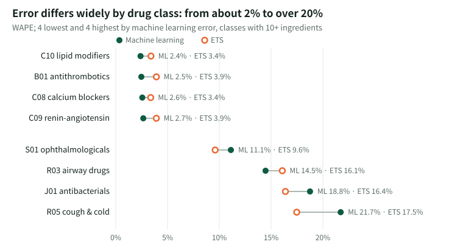

::: {.callout-note}
## This report was split into a series
"Monitoring reimbursement changes and demand" (2026-11-24) was split into four pages on 2026-11-27. This page is the **demand forecasting** part; the numbers are unchanged from the 2026-11-24 edition.

- Realization of announced price cuts and suspensions, and price changes without a note: [How far can announced price cuts be trusted?](../2026-11-benefit-change-lead/index.qmd)
- Drug-class diagnostics, verification, and model specification: [Demand forecasting technical note](../2026-11-drug-demand-tech-note/index.qmd)
- The whole series, and whether reimbursement-list prices help: [Series overview](../2026-11-pharm-data-series/index.qmd)
:::

::: {.report-meta}
**Edition** November 24, 2026, split into a series on November 27, 2026  
**Data** NHIS drug usage statistics 2018-01 to 2025-12 (provisional evaluation 2026-01 to 06); drug-class codes as attributes only  
**Full report (Korean)** [Read the full Korean version](../../../ko/posts/2026-11-drug-demand-forecast/index.qmd)
:::

This page summarizes the main findings in English. More tables, case studies, and the full list of limitations are in the Korean version.

## Questions

Which way is prescription demand for each ingredient heading? How well can six months ahead (next month, as seen on the day of the forecast) be forecast, and which method should be the default? Does using differences between drug classes make forecasts more accurate?

## Three conclusions

1. **For 6-month-ahead demand forecasts, a simple statistical model (ETS) was enough.** Machine learning (LightGBM) beat "same month last year" but showed no evidence of beating ETS (6.46% vs 7.11% WAPE over 36 months; the gap could not be told apart from chance). The gain over "same month last year" was spread across 2023, 2024 and 2025, not concentrated in the post-COVID recovery.
2. **Forecast errors pile up in a small set of highly volatile ingredients.** The 59 ingredients whose same-month volume swung by ±30% or more from year to year are 5.3% of amount but make up 24.4% of total error. More than half are respiratory or anti-infective drugs.
3. **Drug classes differ in error and in which method fits best, but adding class information did not help.** Error is 2.4% for lipid-lowering drugs and 19–22% for antibiotics (J01) and cough and cold drugs (R05), measured with machine learning. Both class-based approaches differed from the existing model by only 0.12 percentage points. A follow-up look at the high-error classes gave no reason to make the model more complex; it supports **keeping ETS as the default and monitoring each class's characteristics separately** (see the [technical note](../2026-11-drug-demand-tech-note/index.qmd#class-diff)).

## Demand forecasting six months ahead {#forecast}

**Why six months:** usage statistics are published about five months late. The latest month available today is five months back, so forecasting "next month" means forecasting six months past the data. In other words, "six months ahead" is not the distant future: it is **next month** as seen on the day of the forecast.

{fig-alt="Twelve cells from January to December 2025. January to June are published (last observed month a = June); July to November are not yet published and cannot be used; today is November; the target is December (a + 6)."}

Four methods were compared on 501 ingredients (93.8% of outpatient claimed amount), re-forecasting every month from 2023-01 to 2025-12.

| Method | Plain description | Average error (WAPE) | Verdict |
|---|---|---|---|
| Same month last year | "As much as last July, again this July" | 9.76% | Worse than machine learning (significant) |
| Last year × recent growth | Last year's value times the last 12 months' growth | 45.30% | One ingredient went badly wrong |
| ETS | Statistical model of recent trend and seasonal pattern | 7.11% | Not distinguishable from machine learning |
| Machine learning (LightGBM) | One model trained on all 501 ingredients | 6.46% | — |

"Significant" refers to a **monthly** test: the 36 monthly error differences were tested as one series; no per-ingredient test was used. The 2023–2025 evaluation used fully revised usage statistics (the November 2026 release). The 2026 actuals are a provisional release that may still rise; if they do, a model that forecast low looks better now than it really is, so 2026 will be re-scored on the final release.

{fig-alt="Line chart of forecast error from 1 to 12 months ahead. Machine learning is lower than ETS from 2 to 7 months ahead; the 6-month gap could not be told apart from chance. Same month last year stays around 9%."}

### Which years the gain came from {#by-year}

**The gain over "same month last year" is spread evenly across the three years.** The first half of 2023, right after the COVID-19 recovery, is when "same month last year" missed badly. If the gain had piled up there, the conclusion could reflect that one episode, so it was split by period. This was not pre-registered and is not used for any verdict.

{fig-alt="Two rows of 36 monthly bars. Top row (ML minus last year): 35 months below zero, total −3.26 pp. Bottom row (ML minus ETS): 23 months below zero, total −0.63 pp, with several months in 2023 H1 and 2024 where ETS was lower."}

- The share of the gain over last year was 40% in 2023, 31% in 2024 and 29% in 2025; the first half of 2023 alone was 23%.
- Against ETS the months were mixed; in the first half of 2023 machine learning was 0.13 pp worse.
- The model's COVID-19 indicators cover only 2020–2021. Forecasts for 2023, whose base year is the incompletely recovered 2022, are not flagged (see the [model specification](../2026-11-drug-demand-tech-note/index.qmd#model-spec)). In the previous edition (2026-11-19), most of the machine learning gain came from this period; in this edition it was 23%.
- The figure uses a slightly simplified set of ingredient-months, so its totals differ a little from the official values (−3.30 pp, −0.65 pp).

Adding reimbursement-list price information to the forecast did not show an improvement; see the [series overview](../2026-11-pharm-data-series/index.qmd#list-price) and the [technical note](../2026-11-drug-demand-tech-note/index.qmd#list-price-test).

## What to do and not do

| Do | Don't |
|---|---|
| Use ETS as the default for ingredient demand monitoring | Forecast with "last year × recent growth rate" |
| Watch respiratory and highly volatile ingredients separately | Use these forecasts directly as pharmacy order quantities |
| Use per-class error to decide how much to trust a forecast | Build a separate forecasting model for each class |

Price alert recommendations are in the [reimbursement-change page](../2026-11-benefit-change-lead/index.qmd).

## High-error drug classes {#class-error}

{fig-alt="Error for eight classes, machine learning then ETS: C10 2.4%, 3.4%; B01 2.5%, 3.9%; C08 2.6%, 3.4%; C09 2.7%, 3.9%; S01 11.1%, 9.6%; R03 14.5%, 16.1%; J01 18.8%, 16.4%; R05 21.7%, 17.5%."}

*Among ATC level-2 classes with at least 10 ingredients, ranked by machine learning error. Post-hoc exploration: these are observed patterns and associations, not causes.*

In R03, J01 and R05, the size of the winter peak differed from year to year. The figure below shows, for each winter, how many times larger winter prescriptions were than summer.

{fig-alt="Winter-to-summer multiples for seven winters. R05: 1.81, 1.52, 1.07, 2.36, 1.47, 1.42, 1.24. R03: 1.50, 1.30, 1.11, 1.50, 1.38, 1.35, 1.24. J01: 1.35, 1.17, 0.93, 1.64, 1.33, 1.21, 1.07."}

Winter height shrank sharply in 2020/21, during the COVID-19 period, rose again in 2021/22, and fell in each of the next three winters. The data used here do not show why.

Per-class tables, the separate S01 group, and follow-up directions are in the [technical note](../2026-11-drug-demand-tech-note/index.qmd#class-diff).

## Limits

The report does not answer demand at the level of a pharmacy, product, or region. The 2026 evaluation is provisional, because recent usage statistics are revised in later releases. The 2023–2025 evaluation used revised data, so forecasts made with the first release available at the time could be less accurate. The machine learning settings were fixed without tuning, and results are limited to those settings. Relationships between price changes, drug classes, and prescription volume are associations, not causal claims. The look at high-error classes is post-hoc: it re-examines 2023–2025, and only two full winters have passed since the COVID-19 period, so it is not generalized to future winters.

## Next analyses

Demand-side follow-ups are linking shortage and supply-interruption data, breaking national totals down by province and facility type, and checking the effect of combining strengths and dosage forms. The full list is in the [series overview](../2026-11-pharm-data-series/index.qmd#next).

## Glossary {#glossary}

| Term | Meaning |
|---|---|
| WAPE | Sum of absolute errors ÷ sum of actuals. 6.5% means forecasts missed by about 6.5 units per 100 |
| pp (percentage point) | Difference between two percentages. 7.11% and 6.46% differ by 0.65 pp |
| ETS | Classical statistical model that weights recent values more and adds a seasonal pattern |
| Backtest | Going back to past dates, forecasting with only the data available then, and comparing with known actuals |
| Pre-registration | Fixing the analysis method and decision rules before seeing results |
| Inconclusive | The gap cannot be told apart from chance, so neither method can be called better. Not the same as "no difference" |
| Post-hoc exploration | Analysis added after seeing results, not planned in advance. Not used for verdicts |
| EWC test | A test designed to avoid spurious significance in short series whose months move together |
| Holm correction | Adjustment that stops one comparison from looking significant by chance when several are made |
| Feature importance | How much the model relied on each input. Not a cause |
| SHAP value | A single forecast split into contributions from each feature |
