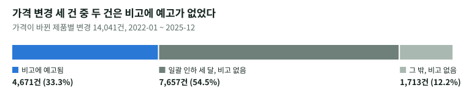

::: {.callout-note}
## 이 글에 대해 (2판, 2026-11-27)
시리즈 전체와 다른 고충(약을 구하지 못하는 문제 등)은 [시리즈 안내](../2026-11-pharm-data-series/index.qmd)에, 수요 예측은 [수요 보고서](../2026-11-drug-demand-forecast/index.qmd)에 있다.
:::

::: {.leaflet .report-overview}
::: {.leaflet-row}
[고충]{.k}

::: {.v}
사둔 약의 가치가 약가인하로 깎인다. 한 약사는 "약가인하를 며칠 전에야 알아 대조를 포기하고, 1원 단위 인하는 손해를 안고 간다"고 말했다.
:::
:::

::: {.leaflet-row}
[묻는 것]{.k}

::: {.v}
① 인하를 언제 알 수 있나 ② 인하는 얼마나 작은가 ③ 미리 알려진 인하는 믿을 수 있나 ④ 어떤 인하가 컸고 어떤 인하가 작았나
:::
:::

::: {.leaflet-row}
[쓴 자료]{.k}

::: {.v}
심평원 급여목록 2022-01~2025-12, 2026년 1~11월은 따로 표시. 보건복지부 고시 네 건과 대한병원협회·대한약사회 안내 문서. 모두 공개 자료다.
:::
:::

::: {.leaflet-row .caution}
[주의]{.k}

::: {.v}
예고는 아직 일어난 변화가 아니다. 약국별 손실액은 약국 재고 기록이 있어야 알 수 있어 계산하지 않았다.
:::
:::
:::

## 한 쪽 요약

**약국 현장의 말은 대체로 맞았다. 다만 해마다 같지는 않았다.**

| 약국이 하는 말 | 데이터로 본 것 |
|---|---|
| "약가인하를 시행 며칠 전에야 안다" | **맞다.** 급여목록만 보면 대부분의 인하가 시행되는 달에 처음 보인다. 정부 고시와 단체 안내로도 4~13일 전이다. 한 달 이상 미리 보인 인하는 2022~2025년 인하의 31.6%인데, 거의 전부가 2024년 두 달에 몰려 있다 |
| "1원 단위로 내려가는 품목은 손해를 안고 간다" | **2026년 1월에는 맞다.** 그달 정부가 한꺼번에 내린 인하의 19.6%가 정확히 1원, 39.9%가 5원 이내였다. 2022~2025년 전체로는 5원 이내가 10.2%라 해마다 같지 않다 |

| 알림을 만드는 쪽이 묻는 것 | 데이터로 본 것 |
|---|---|
| 미리 알려진 인하는 믿을 만한가 | **그렇다.** 목록 메모 칸에 미리 적힌 인하는 거의 전부(99.96%) 실제로 내렸다. 다만 미리 적히는 것은 가격 변경의 3분의 1뿐이다 |
| 어떤 인하가 크고 어떤 인하가 작았나 | **문서에 적힌 사유가 달랐다.** 2023년 9월 기준요건 재평가 인하는 대부분 10~20%, 2026년 1월 실거래가 조정 인하는 대부분 1% 미만이었다 |

**그래서 약국을 돕는 쪽이 할 수 있는 것**: 메모 칸에 적힌 인하는 한 달 전 알림으로, 정부가 한꺼번에 내리는 인하는 고시·단체 안내 일정(시행 1~2주 전)에 맞춘 알림으로 나눠 보낸다. 인하 폭을 함께 보여 줘서 대조할 품목의 순서를 정하게 돕는다([7장](#implications)).

## 1. 관점: 누구의 문제를, 누가 덜어 주나 {#perspective}

이 글은 약국의 고충을 다루되, **주문·재고·반품 정보로 그 고충을 덜어 줄 수 있는 쪽**(의약품 유통, 약국 지원 서비스)의 관점에서 본다. 그래서 "약국이 무엇 때문에 힘든가"와 함께 "공개 정보로 무엇을 미리 알려 줄 수 있는가"를 묻는다.

약국의 고충은 약이 약국을 지나가는 순서대로 네 단계로 나눌 수 있다([시리즈 안내](../2026-11-pharm-data-series/index.qmd#why), 조사 원문은 [약국 고충 시장조사](../../subjects/drug_store.md)).

| 단계 | 질문 | 무엇이 새는가 | 이 글 |
|---|---|---|---|
| A. 들여오기 | 필요한 약을 제때 구할 수 있는가 | 시간, 조제 기회 | — |
| **B. 쌓아두기** | **이미 사둔 약의 가치가 지켜지는가** | **돈** | **여기** |
| C. 내주기 | 조제 과정이 감당 가능한가 | 시간, 소모품, 분쟁 | — |
| D. 벌기 | 매출과 마진이 유지되는가 | 매출 | — |

쌓아두기 단계는 지금 체감으로는 품절(들여오기) 다음이지만, 이미 등재된 약을 2027년부터 차례로 재평가할 예정이라 **가장 빠르게 나빠질 고충**으로 꼽힌다. 그리고 공개 데이터로 가장 많이 다룰 수 있는 단계다. 무엇이 언제 얼마나 인하되는지가 급여목록과 고시에 나오기 때문이다.

## 2. 현장의 말과 그 뒤의 사정 {#case}

**상황**: 한 약사는 약가인하 대상 품목을 시행 며칠 전에야 알 수 있고, 약국 일을 하면서 며칠 동안 대조해 **차액정산**(약가가 내리기 전에 산 재고의 가격 차이를 제약사·도매에서 돌려받는 것)을 받기는 너무 힘들어 포기한다고 말했다. 1원 단위로 내려가는 품목은 그냥 손해를 안고 간다고 했다(약업 전문지 보도).

이 말 뒤에는 세 가지 사정이 있다.

| 사정 | 내용 | 공개 데이터로 볼 수 있나 |
|---|---|---|
| 시간이 없다 | 인하를 미리 알 시간이 부족하다 | **있다.** 인하가 처음 보인 때와 시행일의 차이를 잴 수 있다 → [3장](#q1) |
| 금액이 작다 | 인하 폭이 작을수록 정산에 드는 시간이 받을 돈보다 크다 | **있다.** 인하 폭(원·비율)을 잴 수 있다 → [4장](#q2) |
| 보상이 줄었다 | 제약사·도매가 재고 보상과 반품 조건을 줄인다 | **없다.** 보상·반품 조건은 공개 자료에 없다 |

여기에 알림을 만들 쪽이 꼭 알아야 할 두 가지를 더했다. 미리 알려진 인하가 실제로 일어나는지([5장](#q3)), 그리고 어떤 인하가 크고 어떤 인하가 작았는지([6장](#q4))다.

## 자료

| 자료 | 내는 곳 | 쓴 것 |
|---|---|---|
| 급여목록 | 건강보험심사평가원 | 매달 1일 기준 파일. 약과 상한금액, 메모 칸(비고). 2022-01 \~ 2025-12, 그리고 따로 표시한 2026-01 \~ 11 |
| 「약제 급여 목록 및 급여 상한금액표」 개정 고시와 변경대비표 | 보건복지부 | 정부가 한꺼번에 인하한 네 달(제2022-199호, 제2023-166호, 제2024-67호, 제2025-218호) |
| 공문·안내 자료 | 대한병원협회(2022, 2023), 대한약사회(2025-12) | 인하 사유와 사전 안내 시점 |

급여목록은 매달 찍은 사진과 같아서 한 장만 봐서는 언제 바뀌었는지 알 수 없다. 그래서 파일을 이어 붙여 **제품별 변화 기록표**를 만들었다. 메모 칸에 적힌 "'25.7.1. 인하" 같은 미래 날짜는 아직 일어난 변화가 아니라 **예고**로 따로 적고, 뒤 파일로 실제로 내렸는지 확인했다.

인하는 세 가지로 나눴다.

| 이 글의 이름 | 뜻 |
|---|---|
| 메모 칸에 미리 적힌 인하 | 시행 전 목록의 메모 칸(비고)에 날짜와 금액이 적힌 인하 |
| 정부가 한꺼번에 내린 인하 | 같은 달 메모 없이 상한금액이 바뀐 성분이 50개 이상인 달의 인하 |
| 예고 없이 바뀐 그 밖의 인하 | 위 둘에 들지 않는, 메모 없이 바뀐 인하 |

**이 자료에 없는 것**: 약국별 구매·재고, 제품별 판매량, 도매 유통, 제약사·도매의 보상·반품 조건, 급여 삭제 예정일. 그래서 약국이 실제로 얼마를 잃는지는 이 글에서 답하지 않는다.

## 3. 인하를 언제 알 수 있나 {#q1}

**급여목록만 보면, 한 달 이상 미리 알 수 있었던 인하는 거의 2024년에만 있었다.** 인하가 목록에 처음 보인 달과 시행된 달의 차이로 셌다. 파일의 실제 공개일을 알 수 없어 "며칠 전"이 아니라 달 단위로 셌다.

{fig-alt="2022년 0.0%, 2023년 0.05%, 2024년 80.8%, 2025년 0.35%, 2026년 1~11월 0.0%. 2024년은 거의 전부가 2024-03과 2024-07 두 달이다."}

* **네 해를 합치면 31.6%**(2022~2025년 인하 13,708건 중 4,337건)지만, 이 숫자 하나로 쓰면 오해를 낳는다. 2024년 3월과 7월 두 달의 메모 칸 인하가 거의 전부다.
* **미리 보인 인하는 모두 메모 칸에 적힌 인하였고, 대부분 정확히 한 달 전이었다.** 4,337건 중 4,334건이 시행 전달 목록에 처음 실렸다(29~31일 전). 두 달 이상 앞선 것은 3건이다.
* **정부가 한꺼번에 내린 인하와 예고 없이 바뀐 그 밖의 인하는 모두 시행되는 달의 목록에 처음 보였다.** "시행 당일에야 안다"는 뜻은 아니다. 시행일이 그달 중순이면 며칠 여유가 있다.
* **목록으로 알림을 만들면** 시행 뒤에야 처음 보인 인하는 7건뿐이다. 놓치는 것이 아니라 **늦게** 잡는 것이 문제다.

애초에 메모 칸에 미리 적히는 가격 변경이 적다. 가격이 바뀐 제품별 변경 14,041건 중 9,370건(66.7%)은 메모 없이 목록 고시로 바로 시행됐다.

{fig-alt="가격 변경 14,041건 가운데 메모 칸에 예고된 것 4,671건(33.3%), 일괄 인하 세 달의 메모 없는 변경 7,657건(54.5%), 그 밖의 메모 없는 변경 1,713건(12.2%)."}

### 목록 밖에서는 며칠 먼저 알려졌나

**정부가 한꺼번에 내린 인하는 고시와 단체 안내로 시행 4~13일 전에 알 수 있었다.** 현장의 "며칠 전"과 맞는다.

| 인하 | 경로 | 문서 | 시행 며칠 전 |
|---|---|---|---|
| 2022년 9월 | 고시 | 보건복지부 고시 제2022-199호 (2022-08-25) | 7일 |
| 2022년 9월 | 병원 | 대한병원협회 공문 (2022-08-26) | 6일 |
| 2023년 9월 | 고시 | 보건복지부 고시 제2023-166호 (2023-09-01) | 4일 |
| 2023년 9월 | 병원 | 대한병원협회 사전 안내 (인하 품목 목록, 인하 후 금액 없음) | 문서에 날짜 없음 |
| 2026년 1월 | 고시 | 보건복지부 고시 제2025-218호 (2025-12-24) | 8일 |
| 2026년 1월 | 약국 | 대한약사회 「실거래가 상한금액 조정」 품목 표 (2025-12-19 공유 추정) | 13일 |
| 2026년 2월 | 약국 | 대한약사회 「급여적정성 재평가에 따른 자진인하」 품목 표 (같은 자료) | 44일 |

* 날짜는 문서 본문에 적힌 것만 썼다. 대한약사회 자료의 날짜는 약사 전문지에 공유된 날로, 추정이다.
* 병원 경로 문서는 병원을 위한 안내다. 약국 경로 자료는 2026년 것 하나뿐이라, 다른 해에도 약국에 미리 알려졌는지는 알 수 없다.

## 4. 인하는 얼마나 작은가 {#q2}

**2026년 1월 인하는 아주 작았다. 그 전의 큰 일괄 인하는 그렇지 않았다.**

* **2026년 1월 정부가 한꺼번에 내린 인하 3,865건 중 정확히 1원이 19.6%, 5원 이내가 39.9%다.** 1원 인하 759건 중 718건이 실거래가 조정 품목 표에 있다.
* **2022~2025년 전체 인하로는 5원 이내가 10.2%(1원 이하 4.4%)다.** 2023년 9월 인하에는 1원 이하가 거의 없었다.
* **미리 알 수 있었던 인하일수록 작았다.** 2022~2025년에 한 달 이상 전에 보인 인하 중 5원 이내는 27.2%, 그 밖의 인하는 2.2%다. 미리 알아도 정산할 만한 금액이 아닌 경우가 많았다.
* 여기서 원은 1정·1mL 같은 단위 하나에서 내린 금액이다. 한 상자에서 줄어드는 금액은 이보다 크고, 규격이 다른 제품이 섞여 있다. 그래서 비율로도 함께 봤다([6장](#q4), [부록 B](#appendix-b)). 정산·손실 금액은 계산하지 않았다.

## 5. 미리 알려진 인하는 믿을 수 있나 {#q3}

**메모 칸에 미리 적힌 인하는 거의 그대로 실제로 내렸다.** 그래서 알림으로 쓸 만하다. 메모 칸의 예고는 이미 발표된 고시를 옮겨 적은 것이라 실현율이 높은 것이 자연스럽다.

예외는 **집행정지**다. 처분에 불복한 회사가 신청하면 법원이 처분의 효력을 일정 기간 멈출 수 있고, 그동안 예고된 인하나 급여정지는 시행되지 않는다.

| 예고 종류 | 제품 수 | 확인 가능한 것 중 실제로 시행 | 예정일에 그대로 | 얼마나 먼저 보이나 (중앙값) |
|---|---|---|---|---|
| 약값 인하 (메모 칸) | 4,683 | 99.96% | 98.5% | 30일 |
| 신규 등재 | 342 | 100.0% | 100.0% | 8일 |
| 급여정지·중지 예정 | 203 | 100.0% | 35.8% | 23일 |

* **실제로 시행**에는 조금 늦게, 다른 금액으로, 또는 급여정지 대신 삭제로 시행된 것도 들어 있다. '확인 가능한 것'에서는 아직 집행정지로 결과가 안 난 것과, 집행정지 뒤 목록에서 빠져 판단할 수 없게 된 것을 뺐다.
* **급여정지·중지 예정은 날짜가 자주 밀렸다**(예정일에 그대로 35.8%). 회사의 처분 하나를 한 건으로 세면 91건 중 결과가 난 89건이 모두 시행됐다. 결과가 없는 81개 제품은 집행정지가 이어지는 두 회사의 처분이다(59개, 22개).

**집행정지에 막힌 인하 예고는 오래 걸렸다.** 막혔던 인하 예고 151개 제품을 2026년 11월까지 따라가 보니, 결말이 난 88개 중 75.0%가 예고대로, 12.5%가 다른 금액으로 시행됐고 12.5%는 시행되지 않았다. 예고부터 결말까지 중앙값 27개월이었다. 몇 개 회사의 처분 사례라 일반적인 성질로 읽으면 안 된다([부록 D](#appendix-d)). 그래서 3장에서는 집행정지가 풀린 것이 목록에 보인 달부터 다시 쟀다.

## 6. 어떤 인하가 컸고, 어떤 인하가 작았나 {#q4}

**정부가 한꺼번에 내린 인하의 폭은 그때그때 달랐고, 고시·안내 문서에 적힌 사유도 달랐다.** 아래는 문서의 사유와 폭을 나란히 놓은 것이다.

{fig-alt="2022-09 170건 중앙값 6.2%, 2023-09 7,363건 중앙값 15.0%이고 90%가 10~20%, 2024-05 111건 중앙값 1.9%, 2026-01 3,865건 중앙값 0.6%이고 60%가 1% 미만."}

* **2023년 9월 「기준요건 1차 재평가」**: 7,363건 중 7,231건(98.2%)이 재평가 인하 목록에 있다. 이 인하는 92.0%가 10~20% 폭이었다(중앙값 15.0%). 이 기간에 한 번 있었던 재평가 인하로, 한 번에 수천 품목이 크게 내려갔다.
* **2026년 1월 「실거래가 조정」**: 3,865건 중 2,405건(62.2%)이 실거래가 상한금액 조정 품목 표에 있다. 이 인하는 67.9%가 1% 미만이었다(중앙값 0.47%). 나머지 1,441건은 같은 고시로 내렸지만 사유가 적힌 품목 표에는 없다.
* **2022년 9월, 2024년 5월**: 고시에 사유가 적혀 있지 않다. 폭은 중앙값 6.2%, 1.9%였다.
* 약국이 겪는 부담의 모양도 다르다. 재평가 인하는 품목당 금액이 커서 정산할 가치가 크지만 품목이 많다. 실거래가 조정 인하는 품목당 금액이 작아 "대조할 가치가 없는" 품목이 많다. 2027년부터의 재평가가 어느 쪽에 가까울지는 이 자료로 알 수 없다.

## 7. 이 관점에서 할 수 있는 것 {#implications}

공개 정보로 약국의 처방·약가·보상 조건을 바꿀 수는 없다. 줄일 수 있는 것은 **약국이 늦게 알거나 혼자 대조하느라 생기는 손실**이다. 이 글의 결과로 알림을 설계하면 다음과 같다. 모두 이 분석에서 시험하지 않은 제안이다.

| 인하 | 언제 알 수 있나 | 알림 |
|---|---|---|
| 메모 칸에 미리 적힌 인하 | 시행 한 달 전 목록 | 한 달 전 알림. 거의 그대로 시행돼 믿을 만하다 |
| 정부가 한꺼번에 내린 인하 | 목록은 시행 달. 고시·단체 안내는 4~13일 전 | 고시·단체 안내 일정을 따라가는 알림. 품목 표가 나오면 바로 대조 목록으로 |
| 예고 없이 바뀐 그 밖의 인하 | 시행 달 목록 | 매달 목록을 전달과 비교하는 점검 |
| 집행정지에 막힌 예고 | 해제가 목록에 보인 달 | "막혀 있음, 결말까지 수년 걸릴 수 있음" 표시 |

* **인하 폭을 함께 보여 준다.** 1~5원 인하가 많은 달에는 약국이 대조 시간과 정산액을 비교해 품목 순서를 정할 수 있다.
* **약국별 예상 손실**은 이 알림을 약국의 재고 기록과 합쳐야 계산할 수 있다. 그 단계는 공개 데이터 밖이다.
* 보상·반품 조건이 줄어드는 문제는 이 자료로 다룰 수 없다.

## 8. 판정을 어떻게 확인했나 {#checks}

* **메모 칸 판정**: 메모 문구를 예고 유형으로 나누는 자동 판정을 사람이 만든 정답 30건과 맞춰 봤고, 유형 일치는 83.3%였다. 동아에스티 급여정지 사례에서 목록에 적힌 집행정지 날짜가 법원 결정일(2022-05-09)과 같았다.
* **정부 고시와 대조**: 네 달의 일괄 인하 11,509건 중 11,460건(99.6%)이 고시 변경대비표와 제품코드·인하 전후 금액까지 같았다.
* **2026년 목록을 더한 기록표**: 2022~2025년 가격 변경 14,041건이 기존 기록표와 모두 같았다.

## 9. 한계 {#limits}

| 한계 | 무엇을 조심해야 하나 |
|---|---|
| 현장의 말과 고충 순위의 근거 | 대부분 약업 전문지 보도와 약사 단체 설문이다. 피해를 호소하는 설문은 응답이 피해 쪽으로 쏠릴 수 있다 |
| 달 단위로 쟀다 | 파일의 실제 공개일을 모른다. 파일은 기준일보다 먼저 공개되기도 해서 실제로 먼저 보인 기간은 조금 길 수 있다 |
| 한 달 이상 미리 보인 인하가 두 달에 몰려 있다 | 합친 비율 31.6%를 "보통 이 정도"로 읽으면 안 된다 |
| 2026년 1월 인하의 37.3%는 품목별 사유를 확인하지 못했다 | 같은 고시·같은 일정이지만 사유가 적힌 품목 표에 없다. 다른 사유가 섞였을 수 있다 |
| 목록 밖 경로의 날짜 일부는 추정이다 | 대한약사회 자료의 공유일은 추정이고, 2023년 9월 병원협회 안내는 날짜가 없다 |
| 집행정지 결말은 몇 회사의 사례다 | 회사 하나가 시행 건의 대부분이다 |
| 약국별 손실은 계산하지 않았다 | 약국 재고·구매 기록이 없다. 정산 금액, 절감액·장려금 금액도 계산하지 않았다 |

2026년 6월부터 약가유연계약이 적용된 제품은 목록에 실제 청구 기준과 다른 금액이 적힐 수 있다. 이 제품의 인하는 0건이라 이번 숫자에는 영향이 없다([부록 E](#appendix-e)).

## 용어

| 용어 | 한 줄 풀이 |
|---|---|
| 급여목록 | 건강보험이 적용되는 약과 그 상한가격의 공식 목록. 심평원이 매달 새 파일로 낸다 |
| 메모 칸(비고) | 급여목록의 메모 칸. "'25.7.1. 인하"처럼 앞으로의 처분이 미리 적힌다 |
| 예고 | 아직 시행되지 않은 처분 예정. 연기·취소될 수 있다 |
| 차액정산 | 약가가 내리기 전에 산 재고의 가격 차이를 제약사·도매에서 돌려받는 것 |
| 일괄 인하 | 정부가 여러 성분의 상한가를 한꺼번에 내리는 것 |
| 기준요건 재평가 | 문서 표현으로 "기등재 의약품 상한금액(기준요건) 재평가". 2023년 9월 일괄 인하의 사유 |
| 실거래가 조정 | 문서 표현으로 "실거래가 조사에 따른 약제 상한금액 조정". 2026년 1월 일괄 인하의 사유 |
| 집행정지 | 처분에 불복한 쪽의 신청으로 법원이 처분의 효력을 일정 기간 멈추는 것 |

## 부록

### A. 인하 종류별로 처음 보인 시점 {#appendix-a}

| 기간 | 인하 | 건수 | 2개월 이상 전 | 1개월 전 | 시행되는 달 | 시행 뒤 |
|---|---|---|---|---|---|---|
| 2022 \~ 2025 | 메모 칸에 미리 적힌 인하 | 4,671 | 3 | 4,334 | 327 | 7 |
| 2022 \~ 2025 | 정부가 한꺼번에 내린 인하 | 7,644 | 0 | 0 | 7,644 | 0 |
| 2022 \~ 2025 | 예고 없이 바뀐 그 밖의 인하 | 1,393 | 0 | 0 | 1,393 | 0 |
| 2026 (1 \~ 11월) | 메모 칸에 미리 적힌 인하 | 22 | 0 | 0 | 22 | 0 |
| 2026 (1 \~ 11월) | 정부가 한꺼번에 내린 인하 | 3,865 | 0 | 0 | 3,865 | 0 |
| 2026 (1 \~ 11월) | 예고 없이 바뀐 그 밖의 인하 | 242 | 0 | 0 | 242 | 0 |

| 연도 | 인하 | 1개월 이상 전에 보임 | 비율 |
|---|---|---|---|
| 2022 | 444 | 0 | 0.0% |
| 2023 | 7,621 | 4 | 0.05% |
| 2024 | 5,359 | 4,332 | 80.8% |
| 2025 | 284 | 1 | 0.35% |
| 2026 (1 \~ 11월) | 4,129 | 0 | 0.0% |

### B. 인하 폭, 단위 하나당 원 {#appendix-b}

| 기간 | 인하 | 1원 이하 | 2 \~ 5원 | 6 \~ 10원 | 11 \~ 50원 | 51 \~ 100원 | 101 \~ 1,000원 | 1,000원 초과 |
|---|---|---|---|---|---|---|---|---|
| 2022 \~ 2025 | 전체 13,708 | 4.4% | 5.7% | 4.2% | 29.3% | 21.4% | 28.0% | 6.9% |
| 2022 \~ 2025 | 메모 칸에 미리 적힌 인하 | 12.1% | 13.4% | 8.1% | 28.0% | 9.1% | 20.3% | 9.0% |
| 2022 \~ 2025 | 정부가 한꺼번에 내린 인하 | 0.2% | 1.3% | 1.2% | 29.7% | 31.0% | 35.0% | 1.7% |
| 2026년 1월 | 정부가 한꺼번에 내린 인하 3,865 | 19.6% | 20.2% | 8.8% | 19.2% | 6.7% | 17.1% | 8.4% |

### C. 정부가 한꺼번에 내린 인하의 사유와 폭 {#appendix-c}

사유는 문서에 적힌 문구만 썼고, 근거가 얼마나 직접적인지 나눠 적었다. "품목 확인"은 사유가 적힌 품목 목록에 그 제품이 있다는 뜻이고, "같은 고시, 목록에 없음"은 같은 고시로 내렸지만 그 목록에는 없다는 뜻이다.

| 인하 | 사유 | 건수 | 인하율 중앙값 | 1% 미만 | 10 \~ 20% |
|---|---|---|---|---|---|
| 2022년 9월 | 고시에 사유 기재 없음 | 169 | 6.23% | 8.3% | 1.2% |
| 2023년 9월 | 기준요건 1차 재평가 (품목 확인) | 7,231 | 14.98% | 0.4% | 92.0% |
| 2023년 9월 | 기준요건 1차 재평가 (같은 고시, 목록에 없음) | 115 | 3.15% | 6.1% | 2.6% |
| 2024년 5월 | 고시에 사유 기재 없음 | 111 | 1.85% | 34.2% | 10.8% |
| 2026년 1월 | 실거래가 조정 (품목 확인) | 2,405 | 0.47% | 67.9% | 0.6% |
| 2026년 1월 | 실거래가 조정 (같은 고시, 목록에 없음) | 1,441 | 1.09% | 48.2% | 0.0% |
| 2026년 2월 | 급여적정성 재평가에 따른 자진인하 (품목 확인, 참고) | 76 | — | 0.0% | 97.4% |

고시 변경대비표에 없는 인하(2022년 9월 1건, 2023년 9월 17건, 2026년 1월 19건)는 표에서 뺐다. 2026년 2월의 76건은 정부가 한꺼번에 내린 인하가 아니라 "예고 없이 바뀐 그 밖의 인하"로 센 것이다.

### D. 집행정지에 막힌 인하 예고의 결말 {#appendix-d}

| 결말 | 실현율 계산에 | 제품 | 비중 | 예고 → 결말 개월, 중앙값 [최소 \~ 최대] |
|---|---|---|---|---|
| 예고대로 시행 | 넣음 | 66 | 75.0% | 27 [22 \~ 27] |
| 다른 금액으로 시행 | 넣음 | 11 | 12.5% | 27 [22 \~ 27] |
| 시행 안 됨 | 넣음 | 11 | 12.5% | 27 [26 \~ 32] |
| 목록에서 빠짐 (허가취하 7·유효기간 만료 3·미청구 정비 6) | 뺌 | 16 | — | — |
| 아직 진행 중 | 뺌 | 47 | — | 2026년 11월까지 25 [25 \~ 33] 경과 |

2022 \~ 2025년에 처음 실린 예고를 2026년 11월 목록까지 따라갔다. 목록에서 빠진 사유는 필자가 식품의약품안전처 의약품 정보와 캐시닥에서 확인했다.

### E. 약가유연계약 표시 {#appendix-e}

목록 메모 칸에 `약가유연계약 적용 약제`가 붙은 제품은 2026년 6월 12개에서 11월 52개로 늘었다. 처음 표시된 달에 목록 금액이 오른 제품이 16개였다(전달 대비 중앙값 3.03배). 목록에 적히는 금액(상한금액표 금액)과 별도로 합의한 금액은 다를 수 있고, 별도합의 금액은 공개되지 않는다. 제도 설명의 출처는 건강보험심사평가원 안내와 보건복지부 고시다.

자료 출처: 건강보험심사평가원 급여목록·대체조제 목록 2022-01 \~ 2025-12, 급여목록 2026-01 \~ 11. 보건복지부 고시 제2022-199호·제2023-166호·제2024-67호·제2025-218호와 변경대비표. 대한병원협회 공문(2022, 2023), 대한약사회 안내 자료(2025-12). 목록에서 빠진 사유는 식품의약품안전처 의약품 정보·캐시닥, 약가유연계약 설명은 건강보험심사평가원 안내·보건복지부 고시. 약국 현장의 말은 약업 전문지 보도. 숫자는 분석 코드의 결과 파일에서 왔다(메모 없는 가격 변경과 예고가 먼저 보이는 일수는 2026-11-24 판, 나머지는 2026-11-27 판).
