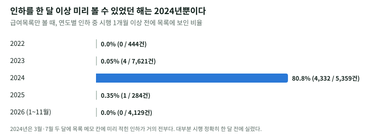
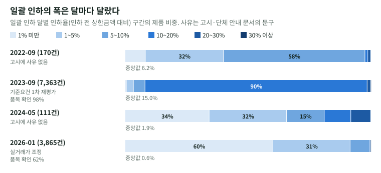

::: {.callout-note}
## 이 글에 대해 (2판, 2026-11-27)
1판은 2026-11-24에 낸 「급여 변동과 수요 모니터링」의 급여 변동 부분이었다. 2판에서는 **"급여목록만 보는 사람이 인하를 얼마나 미리 알 수 있나"**와 **인하 폭**을 더했다. 새로 더한 숫자는 새로 실행해 계산했다. 예고 실현율은 집행정지 뒤 목록에서 빠진 제품을 분모에서 빼는 규칙으로 다시 셌다([아래](#realization)). 비고 없는 가격 변경의 숫자는 1판과 같다.

수요 예측은 [수요 보고서](../2026-11-drug-demand-forecast/index.qmd)에, 시리즈 전체는 [시리즈 안내](../2026-11-pharm-data-series/index.qmd)에 있다.
:::

::: {.leaflet .report-overview}
::: {.leaflet-row}
[묻는 것]{.k}

::: {.v}
급여목록 비고의 예고는 얼마나 실현되나. 목록만 보는 사람은 약값 인하를 시행 몇 달 전에 알 수 있나. 그 인하는 얼마나 작은가.
:::
:::

::: {.leaflet-row}
[쓴 자료]{.k}

::: {.v}
심평원 급여목록 2022-01~2025-12(주 결과), 2026-01~11(확장 구간, 따로 표시). 일괄 인하의 사유는 보건복지부 고시와 대한병원협회·대한약사회 안내 문서에서 확인했다. 모두 공개 자료다.
:::
:::

::: {.leaflet-row .caution}
[주의]{.k}

::: {.v}
예고는 아직 일어난 변화가 아니다. 급여정지 예정과 일부 인하 예고는 법원 집행정지로 막힐 수 있다.
:::
:::
:::

## 왜 이 질문인가 {#why}

약국의 고충을 약이 약국을 지나가는 순서로 나누면 들여오기, 쌓아두기, 내주기, 벌기 네 단계가 된다([시리즈 안내](../2026-11-pharm-data-series/index.qmd#why)). 이 글은 둘째 단계, **이미 사둔 약의 가치가 약가인하로 깎이는 문제**를 다룬다. 출발점은 보도된 한 약사의 말이다. 약가인하 대상을 시행 며칠 전에야 알 수 있어 약국 일을 하면서 대조해 차액정산을 받기가 너무 힘들어 포기하고, 1원 단위로 내려가는 품목은 그냥 손해를 안고 간다는 것이다.

그래서 공개 급여목록으로 두 가지를 셌다. **목록만 보는 사람이 인하를 얼마나 미리 알 수 있나**, 그리고 **그 인하는 얼마나 작은가**. 약국별로 얼마를 잃는지는 약국의 구매·재고 기록이 있어야 알 수 있어 이 글에서 다루지 않는다.

## 한 쪽 요약

**결론 네 가지**

1. **비고에 적힌 약값 인하 예고는 거의 다 실현됐다.** 결과가 난 제품 4,659개 중 99.96%다.
2. **하지만 목록만 보고 인하를 한 달 이상 미리 안 것은 2024년뿐이다.** 2022~2025 인하 13,708건 중 31.6%가 시행 1개월 이상 전에 목록에 보였는데, 그 거의 전부가 2024년의 두 달이다. 다른 해는 0~0.35%다. 미리 보인 인하도 대부분 **정확히 한 달 전**이었다.
3. **정부의 일괄 인하는 목록에서는 시행되는 달에 처음 보인다.** 고시와 단체 안내로는 4~13일 먼저 알 수 있었다.
4. **일괄 인하의 폭은 그때그때 달랐다.** 2023-09 기준요건 재평가 인하는 대부분 10~20%였고, 2026-01 실거래가 조정 인하는 60%가 1% 미만이었다. 2026-01 인하의 19.6%는 정확히 1원이었다.

**현장의 말과 맞춰 보면**

| 현장의 말 | 데이터로 본 것 |
|---|---|
| "약가인하를 시행 며칠 전에야 안다" | **맞다.** 목록만 보면 대부분의 인하가 시행되는 달에 처음 보이고, 고시·단체 안내로도 4~13일 전이다. 예외는 2024년의 비고 예고로, 정확히 한 달 전에 보였다 |
| "1원 단위로 내려가는 품목은 손해를 안고 간다" | **2026-01에는 맞다.** 그달 일괄 인하의 19.6%가 정확히 1원, 39.9%가 5원 이내였고, 대부분 실거래가 조정 품목이다. 2022~2025 전체로는 5원 이내가 10.2%라 해마다 같지는 않다 |
| 목록으로 알림을 만들면 얼마나 잡나 | 인하의 99.95%는 시행되는 달의 목록까지는 보인다(시행 뒤에 처음 보인 것은 7건). 문제는 시점이다. 대조를 준비할 한 달 이상의 여유를 준 것은 31.6%이고, 그마저 2024년 두 달에 몰려 있다 |

| 할 것 | 하지 말 것 |
|---|---|
| 비고의 인하 예고를 알림에 쓴다 | 비고만 보고 "이번 달 가격 변동 없음"이라고 판단한다 |
| 매달 목록을 전달과 비교하고, 고시·단체 안내를 함께 본다 | "목록에 미리 나온다"고 기대한다. 대부분의 인하는 시행되는 달에 처음 보인다 |
| 인하 폭을 원 단위와 비율로 함께 본다 | 한 해의 비율 하나로 "늘 이렇다"고 말한다 |

## 자료 소개

| 항목 | 내용 |
|---|---|
| 내는 곳 | 건강보험심사평가원(심평원) |
| 무엇이 들었나 | 건강보험이 적용되는 약과 상한가격, 메모 칸(비고), 약효분류 번호 |
| 단위 | 제품 |
| 쓴 기간 | 주 결과 2022-01 \~ 2025-12 (48개월), 확장 구간 2026-01 \~ 11 |
| 공개 시차 | 매달 1일 기준 파일 |
| 주의할 점 | 한 장만 봐서는 언제 바뀌었는지 알 수 없음 |

급여목록은 매달의 스냅샷이다. 그래서 파일을 이어 붙여 **제품별 변화 기록표**(언제 무엇이 바뀌었는지)를 만들었다. 비고에 적힌 "'25.7.1. 인하" 같은 미래 날짜는 아직 일어난 변화가 아니라 **예고**로 따로 적고, 뒤 파일로 실현 여부를 확인했다.

일괄 인하의 사유는 목록에 없다. 그래서 보건복지부 「약제 급여 목록 및 급여 상한금액표」 개정 고시 네 건과 그 변경대비표, 대한병원협회 공문, 대한약사회 안내 자료를 제품 단위로 맞춰 봤다([부록 C](#appendix-c)).

**이 자료에 없는 것**: 제품별 판매량, 약국별 구매·재고, 도매 유통, 급여 삭제 예정일. 이것들에 대한 결론은 이 글에 없다.

## 예고는 얼마나 실현되나 {#realization}

**약값 인하와 신규 등재 예고는 거의 그대로 실현됐다. 급여정지·중지 예정은 법원에서 막히는 경우가 있어 날짜가 자주 밀렸다.** 비고의 예고는 이미 발표된 고시를 옮겨 적은 것이라 실현율이 높은 것이 자연스럽다.

| 예고 종류 | 제품 수 | 결과가 난 것 중 실현 | 예정일에 그대로 | 얼마나 먼저 보이나 (중앙값) |
|---|---|---|---|---|
| 약값 인하 (비고) | 4,683 | 99.96% | 98.5% | 30일 |
| 신규 등재 | 342 | 100.0% | 100.0% | 8일 |
| 급여정지·중지 예정 | 203 | 100.0% | 35.8% | 23일 |

* **실현**에는 조금 늦게, 다른 금액으로, 또는 급여정지 대신 삭제로 실현된 것도 들어 있다. '결과가 난 것'은 아직 법원 집행정지로 결과가 안 난 것과 **집행정지 뒤 목록에서 빠진 것**을 뺀 것이다. 목록에서 빠지면 예고가 실현됐는지 판단할 대상이 사라진다. 아래 집행정지 결말 표와 같은 규칙이다.
* **1판과 숫자가 다른 이유**: 1판은 집행정지 뒤 목록에서 빠진 제품(인하 예고 10개, 급여정지·중지 예정 13개)을 미실현으로 세어 99.7%, 89.3%였다. 2판에서 분모에서 뺐다.
* **급여정지·중지 예정은 결과가 난 109개 제품이 모두 실현됐다.** 처분 단위(같은 회사의 같은 처분을 제품 수와 관계없이 한 건으로 셈)로도 91건 중 결과가 난 89건이 모두 실현됐다. 결과가 아직 없는 81개 제품은 집행정지가 이어지는 두 회사의 처분이다(59개, 22개).

### 집행정지에 막힌 인하 예고는 어떻게 끝났나

**집행정지에 막혔던 인하 예고 151개 제품을 2026-11까지 따라가 보니, 결말이 난 88개 중 75.0%가 예고대로, 12.5%가 다른 금액으로 실현됐고 12.5%는 실현되지 않았다.** 예고가 처음 실린 때부터 결말까지는 중앙값 27개월이 걸렸다. 아직 결말이 나지 않은 47개는 이미 25~33개월이 지났다.

* 이 숫자는 몇 개 회사의 처분 사례다. 실현된 66개 중 62개가 한 회사 제품이다. 집행정지의 일반적인 성질로 읽으면 안 된다.
* 목록에서 빠진 16개(허가취하 7, 유효기간 만료 3, 미청구 정비 6)는 인하 여부를 판단할 대상이 사라진 것이라 분모에서 뺐다. 삭제 사유는 필자가 식품의약품안전처 의약품 정보와 캐시닥에서 따로 확인했다.
* 표는 [부록 D](#appendix-d)에 있다.

## 비고에 없는 가격 변경이 더 많다

**가격이 바뀐 제품별 변경 14,041건 중 9,370건(66.7%)은 비고에 미리 적히지 않았다.** 이 변경들은 목록 고시 자체로 시행됐다.

{fig-alt="가격 변경 14,041건 가운데 비고에 예고된 것 4,671건(33.3%), 일괄 인하 세 달의 비고 없는 변경 7,657건(54.5%), 그 밖의 비고 없는 변경 1,713건(12.2%)."}

* 그중 7,657건은 정부가 여러 성분의 상한가를 한꺼번에 내린 **일괄 인하** 세 달에 몰려 있다. 2023-09 「기준요건 재평가」 인하 한 번이 7,371건이다. 나머지는 2022-09의 175건, 2024-05의 111건이다.
* 일괄 인하 달을 빼도 26.8%는 비고 없이 바뀌었다.

## 목록만 보면 인하를 얼마나 미리 알 수 있나 {#lead}

**한 달 이상 미리 알 수 있었던 인하는 거의 2024년에만 있었다.** 인하를 처음 목록에 보인 달과 시행된 달의 차이로 셌다. 파일의 실제 공개일을 알 수 없어 "며칠 전"이 아니라 달 단위로 셌다.

{fig-alt="2022년 0.0%, 2023년 0.05%, 2024년 80.8%, 2025년 0.35%, 2026년 1~11월 0.0%. 2024년은 4,332건 중 거의 전부가 2024-03과 2024-07 두 달이다."}

* **전체 기간으로 합치면 31.6%**(13,708건 중 4,337건)지만, 이 숫자 하나로 쓰면 오해를 낳는다. 2024-03과 2024-07 두 달의 비고 예고가 거의 전부다.
* **미리 보인 인하는 모두 비고 예고였고, 대부분 정확히 한 달 전이었다.** 4,337건 중 4,334건이 시행 전달 목록에 처음 실렸다(목록 기준일부터 시행일까지 29~31일). 두 달 이상 앞서 보인 것은 3건이다.
* **일괄 인하와 그 밖의 비고 없는 인하는 모두 시행되는 달 목록에 처음 보였다.** "1개월 미만"은 "시행 당일에야 안다"는 뜻이 아니라 "시행되는 달의 목록에서 처음 보였다"는 뜻이다.
* 집행정지에 막혔던 예고는 집행정지가 풀린 것이 목록에 보인 달부터 다시 쟀다. 처음 예고된 달부터 재면 두 달 이상 앞선 것처럼 보이지만, 그동안은 시행될지 알 수 없었다.

### 목록 밖에서는 며칠 먼저 알려졌나

**일괄 인하는 고시와 단체 안내로 시행 4~13일 전에 알 수 있었다.** 목록만 보는 사람보다는 빠르지만, 한 달에는 못 미친다.

| 인하 | 경로 | 문서 | 시행 며칠 전 |
|---|---|---|---|
| 2022-09 | 고시 | 보건복지부 고시 제2022-199호 (2022-08-25) | 7일 |
| 2022-09 | 병원 | 대한병원협회 공문 (2022-08-26) | 6일 |
| 2023-09 | 고시 | 보건복지부 고시 제2023-166호 (2023-09-01) | 4일 |
| 2023-09 | 병원 | 대한병원협회 사전 안내 (인하 품목 목록, 인하 후 금액 없음) | 문서에 날짜 없음 |
| 2026-01 | 고시 | 보건복지부 고시 제2025-218호 (2025-12-24) | 8일 |
| 2026-01 | 약국 | 대한약사회 「실거래가 상한금액 조정」 품목 표 (2025-12-19 공유 추정) | 13일 |
| 2026-02 | 약국 | 대한약사회 「급여적정성 재평가에 따른 자진인하」 품목 표 (같은 자료) | 44일 |

* 날짜는 문서 본문에 적힌 것만 썼다. 대한약사회 자료의 날짜는 약사 전문지에 공유된 날로, 추정이다.
* 병원 경로 문서는 병원을 위한 안내다. 약국 경로 자료는 2026년 것 하나뿐이라, 다른 해에도 약국에 미리 알려졌는지는 이 자료로 알 수 없다.

## 인하는 얼마나 작은가 {#size}

**일괄 인하의 폭은 그때그때 달랐다. 문서로 확인한 사유도 달랐다.**

{fig-alt="2022-09 170건 중앙값 6.2%, 2023-09 7,363건 중앙값 15.0%이고 90%가 10~20%, 2024-05 111건 중앙값 1.9%, 2026-01 3,865건 중앙값 0.6%이고 60%가 1% 미만."}

* **2023-09**: 7,363건 중 7,231건(98.2%)이 「기준요건 1차 재평가」 인하 목록에 있다. 이 인하는 92.0%가 10~20% 폭이었다(중앙값 15.0%).
* **2026-01**: 3,865건 중 2,405건(62.2%)이 「실거래가 상한금액 조정」 품목 표에 있다. 이 인하는 67.9%가 1% 미만이었다(중앙값 0.47%). 나머지 1,441건은 같은 고시로 시행됐지만 품목 표에서 확인되지 않았다. 대한약사회 안내 자료는 이 고시를 실거래가 조사에 따른 조정 일정으로 안내했지만, 품목 목록은 없다.
* **2022-09, 2024-05**: 고시에 사유가 적혀 있지 않다. 폭도 10~20%가 아니었다(중앙값 6.2%, 1.9%).
* "2022~2025 일괄 인하는 대부분 10~20%"라고 합쳐 말하면 틀리지는 않지만, 그것은 2023-09 한 번의 성질이다.

**원 단위로 보면 2026-01 인하가 특히 작았다.** 3,865건 중 정확히 1원이 19.6%, 5원 이내가 39.9%다. 1원 이하 인하 대부분(759건 중 718건)이 실거래가 조정 품목 표에 있다. 2022~2025 전체로는 5원 이내가 10.2%다.

* **미리 알 수 있었던 인하일수록 작았다.** 2022~2025에 1개월 이상 전에 보인 인하 중 5원 이내는 27.2%, 그 밖의 인하는 2.2%다.
* 원 단위는 단위(1정, 1mL 등)당 금액 차라 규격이 다른 제품이 섞인다. 비율이 이 차이를 덜 탄다. 정산·손실 금액은 계산하지 않았다.

## 누가 어떻게 쓸까 {#who-uses}

**가격 예고는 "언제 무엇이 바뀔지" 알림에 맞다.** 아래는 모두 이 분석에서 시험하지 않은 활용 제안이다.

| 실무 | 쓸 수 있는 것 |
|---|---|
| 약국 | 비고 예고는 한 달 전 알림으로 쓰고, 일괄 인하는 고시·단체 안내 일정(시행 1~2주 전)에 맞춰 대조를 준비한다. 인하 폭이 1~5원인 품목이 많은 달은 대조 시간과 정산액을 비교해 우선순위를 정한다. 약국별 예상 손실은 그 약국의 재고 기록과 합쳐야 계산된다 |
| 제약 약가·대관 | 급여정지 예정과 집행정지 여부, 비고 없이 바뀐 가격 점검 |
| 유통 운영 | 약국에 인하·급여정지 예고 알림. 급여정지는 "막힐 수 있음" 표시 |
| 유통 데이터팀 | 매달 목록을 전달과 비교하는 자동 점검, 고시 변경대비표와 맞춰 보기 |

**기억할 것**: 예고는 아직 일어난 일이 아니다. "인하 예고가 있다"라고 쓰고, "인하됐다"라고 쓰지 않는다.

## 판정을 어떻게 확인했나 {#checks}

* **비고 판정**: 비고 문구를 예고 유형으로 나누는 자동 판정을 사람이 만든 정답 30건과 맞춰 봤고, 유형 일치는 83.3%였다. 동아에스티 급여정지 사례에서 목록에 적힌 집행정지 날짜가 법원 결정일(2022-05-09)과 같았다.
* **일괄 인하와 고시 대조**: 네 달 일괄 인하 11,509건 중 11,460건(99.6%)이 고시 변경대비표와 제품코드·인하 전후 금액까지 같았다.
* **확장 구간**: 2026 목록을 더해 다시 만든 기록표에서 2022~2025 가격 변경 14,041건이 기존 기록표와 모두 같았다.

## 한계

| 한계 | 무엇을 조심해야 하나 |
|---|---|
| 사전 인지를 달 단위로 쟀다 | 파일의 실제 공개일을 모른다. 파일은 기준일보다 먼저 공개되기도 해서 실제로 먼저 보인 기간은 조금 길 수 있다 |
| 한 달 이상 미리 보인 인하가 두 달에 몰려 있다 | 전체 비율 31.6%를 "보통 이 정도"로 읽으면 안 된다. 연도별로 함께 본다 |
| 2026-01 인하의 37.3%는 품목 단위 사유를 확인하지 못했다 | 같은 고시·같은 일정이지만 품목 표에 없다. 다른 사유가 섞였을 수 있다 |
| 목록 밖 경로의 날짜 일부는 추정이다 | 대한약사회 자료의 공유일은 추정이다. 2023-09 병원협회 안내는 날짜가 없다 |
| 집행정지 결말은 몇 회사의 사례다 | 회사 하나가 실현 건의 대부분이다 |
| 원 단위 폭은 규격이 섞인다 | 비율과 함께 본다 |
| 비고에는 인하 사유가 없다 | 사유는 고시·단체 안내 문서로만 붙였다. 문서에 없는 사유는 붙이지 않았다 |

2026-06부터 약가유연계약이 적용된 제품은 목록에 실제 청구 기준과 다른 금액이 적힐 수 있다. 이 제품의 인하는 0건이라 이번 숫자에는 영향이 없다([부록 E](#appendix-e)). 가격 변화와 처방량의 관계는 이 글에서 다루지 않는다. 절감액·장려금 금액은 계산하지 않았다.

시리즈의 다음 분석은 [시리즈 안내](../2026-11-pharm-data-series/index.qmd#next)에 있다.

## 용어

| 용어 | 한 줄 풀이 |
|---|---|
| 급여목록 | 건강보험이 적용되는 약과 그 상한가격의 공식 목록. 심평원이 매달 새 파일로 낸다 |
| 비고 | 급여목록의 메모 칸. "'25.7.1. 인하"처럼 앞으로의 처분이 미리 적힌다 |
| 예고 | 아직 시행되지 않은 처분 예정. 연기·취소될 수 있다 |
| 실현율 | 예고 중 실제로 시행된 비율 |
| 일괄 인하 | 정부가 여러 성분의 상한가를 한꺼번에 내리는 것. 같은 달 비고 없이 바뀐 성분이 50개 이상인 경우로 셌다 |
| 기준요건 재평가 | 문서 표현으로 "기등재 의약품 상한금액(기준요건) 재평가". 2023-09 일괄 인하의 사유 |
| 실거래가 조정 | 문서 표현으로 "실거래가 조사에 따른 약제 상한금액 조정". 2026-01 일괄 인하의 사유 |
| 집행정지 | 처분에 불복한 쪽의 신청으로 법원이 처분의 효력을 일정 기간 멈추는 것 |
| 확장 구간 | 2026-01 \~ 11 목록. 주 결과(2022 \~ 2025)와 섞지 않고 따로 적었다 |

## 부록

### A. 인하 유형별로 처음 보인 시점 {#appendix-a}

| 구간 | 유형 | 인하 | 2개월 이상 | 1개월 | 1개월 미만 | 시행 뒤 보임 |
|---|---|---|---|---|---|---|
| 2022 \~ 2025 | 비고 예고 | 4,671 | 3 | 4,334 | 327 | 7 |
| 2022 \~ 2025 | 일괄 인하 | 7,644 | 0 | 0 | 7,644 | 0 |
| 2022 \~ 2025 | 그 밖의 비고 없는 인하 | 1,393 | 0 | 0 | 1,393 | 0 |
| 2026 (1 \~ 11월) | 비고 예고 | 22 | 0 | 0 | 22 | 0 |
| 2026 (1 \~ 11월) | 일괄 인하 | 3,865 | 0 | 0 | 3,865 | 0 |
| 2026 (1 \~ 11월) | 그 밖의 비고 없는 인하 | 242 | 0 | 0 | 242 | 0 |

| 연도 | 인하 | 1개월 이상 전 | 비율 |
|---|---|---|---|
| 2022 | 444 | 0 | 0.0% |
| 2023 | 7,621 | 4 | 0.05% |
| 2024 | 5,359 | 4,332 | 80.8% |
| 2025 | 284 | 1 | 0.35% |
| 2026 (1 \~ 11월) | 4,129 | 0 | 0.0% |

### B. 인하 폭, 원 단위 {#appendix-b}

| 구간 | 유형 | 1원 이하 | 2 \~ 5원 | 6 \~ 10원 | 11 \~ 50원 | 51 \~ 100원 | 101 \~ 1,000원 | 1,000원 초과 |
|---|---|---|---|---|---|---|---|---|
| 2022 \~ 2025 | 전체 13,708 | 4.4% | 5.7% | 4.2% | 29.3% | 21.4% | 28.0% | 6.9% |
| 2022 \~ 2025 | 비고 예고 | 12.1% | 13.4% | 8.1% | 28.0% | 9.1% | 20.3% | 9.0% |
| 2022 \~ 2025 | 일괄 인하 | 0.2% | 1.3% | 1.2% | 29.7% | 31.0% | 35.0% | 1.7% |
| 2026-01 | 일괄 인하 3,865 | 19.6% | 20.2% | 8.8% | 19.2% | 6.7% | 17.1% | 8.4% |

### C. 일괄 인하의 사유와 폭 {#appendix-c}

사유는 문서에 적힌 문구만 썼고, 근거의 강도를 나눠 적었다. "품목 확인"은 사유가 적힌 품목 목록에 제품코드가 있다는 뜻이고, "고시분(품목 미확인)"은 같은 고시로 시행됐지만 그 목록에는 없다는 뜻이다.

| 인하 | 사유 | 건수 | 인하율 중앙값 | 1% 미만 | 10 \~ 20% |
|---|---|---|---|---|---|
| 2022-09 | 고시에 사유 기재 없음 | 169 | 6.23% | 8.3% | 1.2% |
| 2023-09 | 기준요건 1차 재평가 (품목 확인) | 7,231 | 14.98% | 0.4% | 92.0% |
| 2023-09 | 기준요건 1차 재평가 고시분 (품목 미확인) | 115 | 3.15% | 6.1% | 2.6% |
| 2024-05 | 고시에 사유 기재 없음 | 111 | 1.85% | 34.2% | 10.8% |
| 2026-01 | 실거래가 조정 (품목 확인) | 2,405 | 0.47% | 67.9% | 0.6% |
| 2026-01 | 실거래가 조정 고시분 (품목 미확인) | 1,441 | 1.09% | 48.2% | 0.0% |
| 2026-02 | 급여적정성 재평가에 따른 자진인하 (품목 확인, 참고) | 76 | — | 0.0% | 97.4% |

고시 변경대비표에 없는 일괄 인하(2022-09 1건, 2023-09 17건, 2026-01 19건)는 표에서 뺐다. 2026-02의 76건은 일괄 인하가 아니라 "그 밖의 비고 없는 인하"로 센 것이다.

### D. 집행정지에 막힌 인하 예고의 결말 {#appendix-d}

| 결말 | 실현율 분모 | 제품 | 비중 | 예고 → 결말 개월, 중앙값 [최소 \~ 최대] |
|---|---|---|---|---|
| 실현 | 넣음 | 66 | 75.0% | 27 [22 \~ 27] |
| 다른 금액으로 실현 | 넣음 | 11 | 12.5% | 27 [22 \~ 27] |
| 실현 안 됨 | 넣음 | 11 | 12.5% | 27 [26 \~ 32] |
| 목록 이탈 (허가취하·유효기간 만료·미청구 정비) | 뺌 | 16 | — | — |
| 진행 중 | 뺌 | 47 | — | 2026-11까지 25 [25 \~ 33] 경과 |

2022 \~ 2025에 처음 실린 예고를 2026-11 목록까지 따라갔다.

### E. 약가유연계약 표시 {#appendix-e}

목록 비고에 `약가유연계약 적용 약제`가 붙은 제품은 2026-06 12개에서 2026-11 52개로 늘었다. 처음 표시된 달에 목록 금액이 오른 제품이 16개였다(전달 대비 중앙값 3.03배). 목록에 적히는 금액(상한금액표 금액)과 별도로 합의한 금액은 다를 수 있고, 별도합의 금액은 공개되지 않는다. 제도 설명의 출처는 건강보험심사평가원 안내와 보건복지부 고시다.

자료 출처: 건강보험심사평가원 급여목록·대체조제 목록 2022-01 \~ 2025-12, 급여목록 2026-01 \~ 11. 보건복지부 고시 제2022-199호·제2023-166호·제2024-67호·제2025-218호와 변경대비표. 대한병원협회 공문(2022, 2023), 대한약사회 안내 자료(2025-12). 목록 이탈 사유는 식품의약품안전처 의약품 정보·캐시닥, 약가유연계약 설명은 건강보험심사평가원 안내·보건복지부 고시. 숫자는 분석 코드의 결과 파일에서 왔다(비고 없는 가격 변경과 예정일까지의 일수는 2026-11-24 판, 나머지는 2026-11-27 판).
