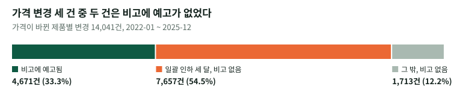
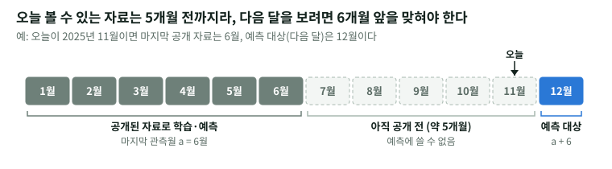
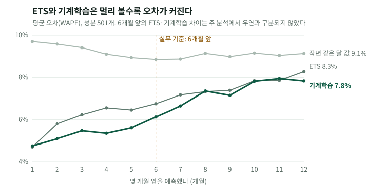
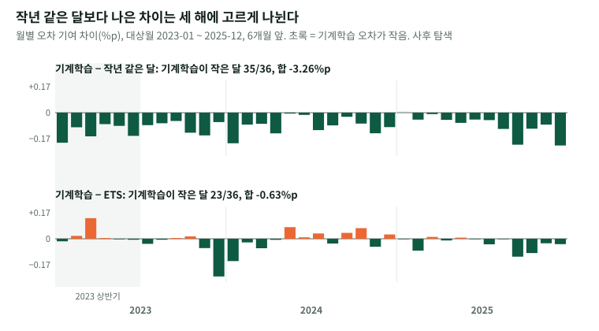
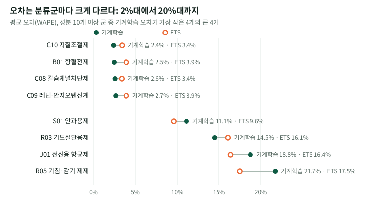
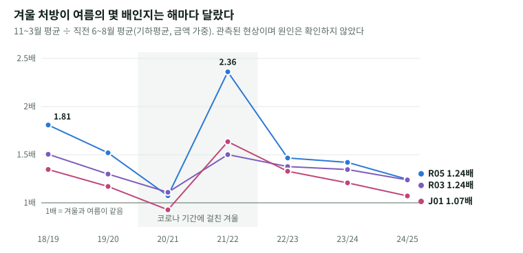
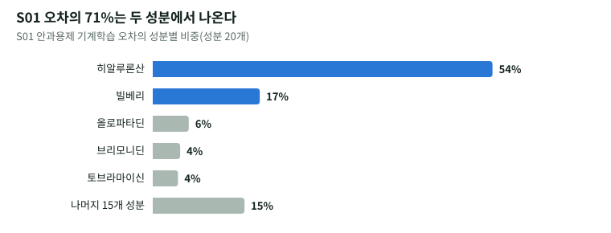
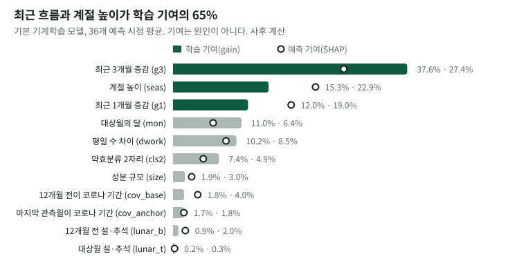

::: {.leaflet .report-overview}
::: {.leaflet-row}
[묻는 것]{.k}

::: {.v}
다음 달 약값이나 급여가 바뀌는가. 성분별 처방 수요는 어느 쪽으로 가는가. 약의 분류군 차이를 예측에 쓰면 더 잘 맞히는가.
:::
:::

::: {.leaflet-row}
[쓴 자료]{.k}

::: {.v}
심평원 급여목록 2022-01~2025-12(48개월), 건보공단 의약품 사용통계 2018-01~2025-12와 잠정 평가용 2026-01~06, 2026 약가정보의 ATC 분류 코드. 모두 공개 데이터다.
:::
:::

::: {.leaflet-row}
[읽는 순서]{.k}

::: {.v}
실무 결론만 필요하면 한 쪽 요약의 "할 것 / 하지 말 것" 표까지 읽으면 된다. 분류군 실험, 검증 방식, 예측 모델 명세(입력·학습·평가·특징 중요도)는 부록에 있다. 모르는 용어는 부록 E의 용어집에 한 줄씩 풀어 두었다.
:::
:::

::: {.leaflet-row .caution}
[주의]{.k}

::: {.v}
예측은 전국 성분 단위다. 특정 약국이나 제품의 발주량으로 쓰지 않는다. 급여정지 예정은 법원 집행정지로 막힐 수 있다.
:::
:::
:::


## 한 쪽 요약

공개 데이터 두 가지로 세 질문에 답했다. "다음 달 약값이나 급여가 바뀌는가", "이 성분의 처방 수요는 어느 쪽으로 가는가", "약의 분류군 차이를 예측에 쓰면 더 잘 맞히는가"다.

**결론 다섯 가지**

1. **급여목록에 미리 적힌 약값 인하 예고는 거의 다 실현됐다.** 결과가 난 제품 4,669개 중 99.7%다. 급여정지·중지 예정은 처분 91건 중 3건이 법원 집행정지로 막혔다.
2. **하지만 비고(메모 칸)만 보면 가격 변경의 약 3분의 1만 미리 알 수 있다.** 가격이 바뀐 제품의 66.7%는 비고 예고 없이 목록 고시로 바뀌었다. 대부분 정부의 일괄 인하다.
3. **6개월 앞 성분 처방량 예측은 단순한 통계 모형(ETS)으로 충분했다.** 기계학습 모델은 "작년 같은 달 값"보다 나았지만 ETS보다 낫다는 근거는 없었다. "작년 같은 달 값"보다 앞선 차이는 2023~2025년 세 해에 고르게 나뉘었고, 코로나 회복기에 몰리지 않았다.
4. **급여목록의 가격 정보를 예측에 넣어도 나아졌다는 근거는 없었다.** 성분 단가 예측 오차는 숫자로는 약 15% 작았지만 우연과 구분되지 않았고, 처방량 예측에서는 이 시험으로 효과를 잴 수 없었다.
5. **분류군마다 예측 오차와 잘 맞는 방법은 다르지만, 그 차이를 예측에 넣어도 나아지지 않았다.** 고지혈증약 군은 오차 2.4%, 항생제(J01)·기침감기약(R05) 군은 19 \~ 22%다(기계학습 기준). 군마다 방법을 섞거나 군 정보를 더한 두 방식 모두 기존 기계학습 모델과 0.12%p 차이로, 낫다는 근거가 없었다. 오차가 큰 군을 따로 진단한 결과도 모델을 더 복잡하게 만들 근거가 아니라, **ETS를 기본으로 유지하면서 성분군별 특성을 따로 모니터링할 근거**였다(부록 A).

| 할 것 | 하지 말 것 |
|---|---|
| 비고의 인하 예고를 알림에 쓴다 | 비고만 보고 "이번 달 가격 변동 없음"이라고 판단한다 |
| 매달 목록을 전달과 비교해 가격 변경을 찾는다 | 급여정지 예정을 확정된 일로 안내한다 |
| 성분 수요 모니터링은 ETS를 기본으로 둔다 | "작년 × 최근 증감률" 방식으로 예측한다 |
| 호흡기·급변 성분은 따로 지켜본다 | 이 예측을 약국 발주량으로 그대로 쓴다 |
| 분류군별 오차를 "얼마나 믿을지"의 기준으로 쓴다 | 분류군마다 따로 예측 모델을 만든다 |

## 자료 소개

두 기관이 매달 공개하는 표 두 가지를 썼다. 하나는 **가격**, 하나는 **처방량**을 보여준다. 분류군 분석에는 약의 분류 코드를 속성으로만 더했다.

|  | 급여목록 | 의약품 사용통계 |
|---|---|---|
| 내는 곳 | 건강보험심사평가원(심평원) | 국민건강보험공단(건보공단) |
| 무엇이 들었나 | 건강보험이 적용되는 약과 상한가격, 메모 칸(비고), 약효분류 번호 | 성분별 처방 수량·청구건수·청구금액. 연령·시도·요양기관 구분은 부록 A의 진단에서 일부만 썼다 |
| 단위 | 제품 | 성분(주성분 코드 4자리) × 월 |
| 쓴 기간 | 2022-01 \~ 2025-12 (48개월) | 2018-01 \~ 2025-12, 잠정 평가용 2026-01 \~ 06 |
| 공개 시차 | 매달 1일 기준 파일 | 약 4 \~ 5개월 뒤 공개 |
| 주의할 점 | 한 장만 봐서는 언제 바뀌었는지 알 수 없음 | 업체·품목이 2개 이하인 칸은 비공개. 최근 달은 뒤 판에서 늘 수 있음 |

급여목록은 매달의 스냅샷이다. 그래서 48개 파일을 이어 붙여 **제품별 변화 기록표**(언제 무엇이 바뀌었는지)를 만들었다. 비고에 적힌 "'25.7.1. 인하" 같은 미래 날짜는 아직 일어난 변화가 아니라 **예고**로 따로 적고, 뒤 파일로 실현 여부를 확인했다.

**분류군 배정**: 성분마다 두 분류를 붙였다. ① 약효분류 앞 2자리(급여목록 2022-07판에서 그 성분 제품이 가장 많이 속한 분류). ② 국제 표준 분류인 **ATC 코드**(2026 약가정보의 표준코드로 제품에 연결, 그 성분 제품이 가장 많이 속한 코드). 성분 501개 모두 연결됐다. ATC는 2단계(예: C10)와 1단계(예: C)를 썼고, 성분이 3개보다 적은 군은 상위 분류의 "기타" 군으로 합쳤다.

**이 자료에 없는 것**: 제품별 판매량, 약국별 구매·재고, 도매 유통, 지역별 수요(예측은 전국 합계만 썼다). 이것들에 대한 결론은 이 보고서에 없다.

## 급여 상태 변동: 예고는 얼마나 실현되나

**약값 인하와 신규 등재 예고는 거의 그대로 실현됐다. 급여정지·중지 예정은 법원에서 막히는 경우가 있어 날짜가 자주 밀렸다.** 비고의 예고는 이미 발표된 고시를 옮겨 적은 것이라 실현율이 높은 것이 자연스럽다.

| 예고 종류 | 제품 수 | 결과가 난 것 중 실현 | 예정일에 그대로 | 얼마나 먼저 보이나 (중앙값) |
|---|---|---|---|---|
| 약값 인하 (비고) | 4,683 | 99.7% | 98.3% | 30일 |
| 신규 등재 | 342 | 100.0% | 100.0% | 8일 |
| 급여정지·중지 예정 | 203 | 89.3% | 32.0% | 23일 |

* **실현**에는 조금 늦게 또는 다른 금액으로 실현된 것도 들어 있다. '결과가 난 것'은 아직 법원 집행정지로 결과가 안 난 것을 뺀 것이다.
* **급여정지·중지 예정은 처분 단위(같은 회사의 같은 처분을 제품 수와 관계없이 한 건으로 셈)로 보면 91건 중 88건(96.7%)이 실현됐다.** 막힌 3건에 제품이 몰려 있어(한 회사 72개) 제품 기준 숫자가 낮아 보인다.
* 급여정지 예정을 안내할 때는 "법원 결정으로 막힐 수 있음"을 함께 표시하는 편이 맞다.

### 비고에 없는 가격 변경이 더 많다

**가격이 바뀐 제품별 변경 14,041건 중 9,370건(66.7%)은 비고에 미리 적히지 않았다.** 이 변경들은 목록 고시 자체로 시행됐다. 미리 알려지지 않았다는 뜻은 아니고, 비고만 봐서는 못 찾는다는 뜻이다.

{fig-alt="가격 변경 14,041건 가운데 비고에 예고된 것 4,671건(33.3%), 일괄 인하 세 달의 비고 없는 변경 7,657건(54.5%), 그 밖의 비고 없는 변경 1,713건(12.2%)."}

* 그중 7,657건은 정부가 여러 성분의 상한가를 한꺼번에 내린 **일괄 인하** 세 달에 몰려 있다. 2023-09 제네릭 재평가 한 번이 7,371건이다. 나머지는 2022-09의 175건, 2024-05의 111건이다.
* 일괄 인하 달을 빼도 26.8%는 비고 없이 바뀌었다.
* 그래서 가격 알림은 **비고 예고 + 매달 목록을 전달과 비교**, 두 가지를 함께 써야 빠짐이 없다.

## 수요 모니터링: 6개월 앞 처방량 예측

**성분별 전국 처방량을 6개월 앞에 예측하면 평균 약 6 \~ 7% 빗나간다. 기본 방법으로는 ETS를 권한다.**

왜 6개월 앞인가: 사용통계는 약 5개월 늦게 나온다. 오늘 볼 수 있는 마지막 달이 5개월 전이므로, "다음 달"을 보려면 자료 기준으로 6개월 앞을 맞혀야 한다.

{fig-alt="2025년 1월부터 12월까지 12칸. 1~6월은 공개된 자료(마지막 관측월 a = 6월), 7~11월은 아직 공개 전이라 예측에 쓸 수 없음, 오늘은 11월, 예측 대상은 12월(a + 6)."}

성분 501개(원외 청구금액의 93.8%)를 2023-01 \~ 2025-12 36개월 동안 매달 다시 예측해 네 방법을 비교했다.

| 방법 | 쉬운 설명 | 평균 오차(WAPE) | 판정 |
|---|---|---|---|
| 작년 같은 달 값 | "작년 7월만큼 올해 7월에도 나간다" | 9.76% | 기계학습보다 나쁨 (유의) |
| 작년 × 최근 증감률 | 작년 값에 최근 1년 증감률을 곱함 | 45.30% | 한 성분에서 크게 빗나감 |
| ETS | 최근 흐름과 계절 패턴을 함께 반영하는 통계 모형 | 7.11% | 기계학습과 구분 안 됨 |
| 기계학습 (LightGBM) | 성분 501개를 함께 학습하는 모델 | 6.46% | — |

기계학습의 오차가 숫자로는 가장 작다. 하지만 ETS와의 차이 0.65%p는 36개월 자료로는 우연과 구분되지 않았다. 처음 보는 2026-01 \~ 06 자료(잠정)에서는 오히려 ETS가 6개월 합으로 0.25%p 작았다. 더 복잡한 모델이 낫다는 근거가 없으므로, 설명과 점검이 쉬운 ETS를 기본으로 둔다.

여기서 "유의"는 **월 단위** 검정 결과다. 36개월의 월별 오차 차이를 한 줄의 자료로 보고 검정했고, 성분별로 검정하지는 않았다(부록 D).

자료 판본도 결과 해석에 영향을 준다. 2023~2025년 평가에는 수정이 끝난 사용통계(2026-11 받은 판)를 썼다. 2026년 정답은 첫 공개 후 12개월이 지나지 않은 잠정 판이라, 처방량이 뒤 판에서 더 늘 수 있다. 정답이 나중에 늘어나면 지금은 낮게 예측한 모델의 오차가 실제보다 작아 보인다. 그래서 2026년 결과는 확정 판으로 다시 채점한다.

{fig-alt="1~12개월 앞 예측 오차 선그래프. 기계학습은 2~7개월 앞에서 ETS보다 낮고, 1개월과 8개월 이상에서는 비슷하다. 작년 같은 달 값은 약 9%로 가장 높다."}

그림 읽는 법: 선이 낮을수록 잘 맞힌 것이다. 1개월 앞에서는 ETS와 기계학습이 같고, 8개월 이상에서도 다시 비슷해진다.

'작년 같은 달 값'을 쓰고 있다면 바꾸는 편이 낫다. 기계학습은 이 방법보다 3.30%p 작았고(유의), 2026년 6개월에서도 매달 작았다. 성분별로는 85%에서 오차가 작았다(검정이 아닌 단순 집계).

### 기계학습이 앞선 차이는 어느 해에서 나왔나

**"작년 같은 달 값"보다 앞선 차이는 세 해에 고르게 나뉜다.** 2023년 상반기는 코로나 회복기 직후라 작년 같은 달 값이 크게 빗나간 시기다. 차이가 이 구간에 몰렸다면 결론이 그 한 시기의 일일 수 있어 따로 나눠 봤다. 미리 정하지 않은 추가 분석이라 판정에는 쓰지 않는다.

{fig-alt="36개월 막대 두 단. 위 단(기계학습 − 작년 같은 달)은 35개월이 0 아래로 기계학습이 작고 합은 −3.26%p. 아래 단(기계학습 − ETS)은 23개월이 0 아래, 합은 −0.63%p이고 2023 상반기와 2024년에는 ETS가 작은 달이 여럿 있다."}

* 작년 같은 달 값보다 앞선 차이의 비중은 2023년 40%, 2024년 31%, 2025년 29%다. 2023년 상반기만 보면 23%다.
* ETS와는 달마다 엇갈렸다. 2023년 상반기에는 오히려 기계학습 오차가 0.13%p 컸다.
* 이 그림은 평가에 쓴 성분·월을 조금 단순하게 잡아 계산했다. 그래서 합계가 공식 값(−3.30%p, −0.65%p)과 조금 다르다.

### 급여목록 가격 정보를 넣으면 나아지나

**예측 시점에 목록에 보이던 가격 변화를 넣어도 나아졌다는 근거는 없었다.** 판정 기준은 결과를 보기 전에 정했다.

| 질문 | 결과 | 판정 |
|---|---|---|
| 성분 단가 예측: 목록의 가격 변화를 쓰면 사용통계 추세만 쓸 때보다 나은가 | 단가 예측 오차 0.0186 대 0.0217(약 15% 작음), p = 0.252 | 판단 보류(우연과 구분 안 됨) |
| 그 차이가 가격 변화 시점을 맞춘 덕분인가 | 시점을 일부러 7개월·17개월 어긋나게 넣은 예측과 구분되지 않음 | 시점 덕분이라고 볼 수 없음 |
| 제 성분의 가격 정보여야 하는가 | 다른 성분의 가격 변화를 넣으면 나빠짐, p = 0.001 | 제 성분의 가격 변화는 단가와 연관 있음 |
| 처방량 예측에 목록 정보를 보정으로 더하면 나아지나 | 일부러 넣은 20% 효과도 찾지 못함 | 이 시험으로는 효과를 잴 수 없음 |

* 목록 가격이 바뀐 만큼 실제 청구 단가가 바뀐 비율은 중앙값 0.55다. 목록 가격 변화를 단가에 그대로 옮기면 과하다.
* 처방량 쪽 결과는 "효과가 없다"가 아니라 "이 시험으로는 잴 수 없었다"는 뜻이다.
* 급여목록 정보는 수요 예측보다 가격·급여정지 알림에 맞는 정보다.

## 주의할 성분

**대부분의 성분은 매달 처방량이 크게 흔들리지 않지만, 일부는 수십 \~ 수만 배까지 변한다. 예측이 틀리는 곳은 주로 여기다.**

* 성분 501개의 2018 \~ 2025년 월 처방량을 보면, 가장 많은 달과 가장 적은 달의 차이는 절반의 성분에서 2.3배 이하다.
* 그러나 상위 5% 성분은 그 차이가 17배를 넘고, 가장 큰 성분은 약 7만 3천 배다.

### 호흡기 성분

호흡기 계열 성분 62개의 오차는 ETS 16.05%, 기계학습 18.63%로, 전체와 달리 기계학습이 더 크다. 그 밖의 성분(ETS 약 6.3%, 기계학습 약 5.4%)보다 오차가 ETS는 약 2.5배, 기계학습은 약 3.5배 크다.

### 오차가 큰 분류군: 특성이 서로 다르다

오차는 분류군마다 크게 다르다. 그런데 오차가 큰 군끼리도 특성이 다르다. 겨울 처방이 여름의 몇 배인지가 해마다 달랐던 군(R03·J01·R05)이 있고, 두 성분에 오차가 몰린 군(S01)이 있다. 모두 관측된 현상이며 원인은 확인하지 않았다. 자세한 표와 시사점은 부록 A에 있다.

{fig-alt="분류군 8개의 오차. 기계학습·ETS 순으로 C10 2.4%·3.4%, B01 2.5%·3.9%, C08 2.6%·3.4%, C09 2.7%·3.9%, S01 11.1%·9.6%, R03 14.5%·16.1%, J01 18.8%·16.4%, R05 21.7%·17.5%."}

오차가 큰 R03·J01·R05에서는 겨울 처방의 크기가 해마다 달랐다. 아래 그림은 겨울 처방이 여름의 몇 배였는지를 겨울마다 보여준다.

{fig-alt="겨울 일곱 번의 배수. R05 1.81, 1.52, 1.07, 2.36, 1.47, 1.42, 1.24. R03 1.50, 1.30, 1.11, 1.50, 1.38, 1.35, 1.24. J01 1.35, 1.17, 0.93, 1.64, 1.33, 1.21, 1.07."}

### 사례: 독감 치료제와 '작년 × 증감률'의 함정

독감 치료제 oseltamivir의 원외 처방량은 2022-01 약 4,900에서 2023-01 약 415만으로 늘었다. 관측된 변화이며 원인은 확인하지 않았다.

1. '작년 × 최근 증감률'은 작년 값에 이미 급증이 들어 있는데, 증감률에도 같은 급증이 또 들어간다.
2. 그래서 늘어난 폭이 두 번 곱해져, 2024-05 예측이 실제의 약 1,143배가 됐다.
3. 이 한 성분이 이 방법 전체 오차의 79.1%를 차지했다. 계산 실수가 아니라 식의 성질이다.

**교훈**: 수요 수준이 급변한 성분에는 증감률을 곱하는 방식을 쓰지 않는다. 예측값이 작년의 몇 배가 되면 사람이 확인하는 장치를 둔다(시험하지 않은 제안).

## 현실적 권장안

**당장은 ETS를 기본으로 유지하고 분류군별로 예측 방법을 나누지 않는다. 오차가 몰리는 고변동 성분만 따로 표시해 사람이 검토한다.** 고변동 성분 표시는 이 분석에서 시험하지 않은 운영 제안이다.

1. **기본 운영: ETS 유지, 분류군별로 나누지 않음.** 설명과 점검이 쉽다. 예측 방법을 분류군별로 쪼개면 관리할 곳과 검증 부담만 늘고, 성능 이득은 부록 B의 실험에서 확인되지 않았다.
2. **호흡기·급변 성분 대응: 방법을 나누지 말고 표시한다.** 해마다 같은 달 처방량이 ±30% 이상 흔들리거나 급등 이력이 있는 성분을 별도 모니터링·예외 검토 대상으로 표시한다. 가벼운 운영 보완이다.

근거: 2023 \~ 2025년 기준으로 ±30% 이상 흔들린 성분은 59개다. 금액 비중은 5.3%인데 전체 오차의 24.4%를 만든다. 이 성분들의 평균 오차는 29.6%, 나머지는 4.6%다(기계학습 기준). 절반 이상이 호흡기(16개)·항감염(15개) 계열이다. 실제 운영에서는 표시 기준을 예측 시점 이전 자료로 정해야 한다. 위 숫자는 평가 기간을 돌아본 것이다.

## 누가 어떻게 쓸까

**가격 예고는 "언제 무엇이 바뀔지" 알림에, 수요 예측은 "성분 시장이 어느 쪽으로 가는지" 기준선에 맞다.** 아래는 모두 이 분석에서 시험하지 않은 활용 제안이다.

| 실무 | 가격 알림으로 | 수요 모니터링으로 |
|---|---|---|
| 제약 영업·마케팅 | 자사·경쟁 제품의 인하 예고와 시행일을 한 표로 확인 | 자사 성분의 전국 시장 흐름과 6개월 앞 예측 범위. 범위는 그 성분이 속한 분류군의 오차를 기준으로 |
| 제약 약가·대관 | 급여정지 예정과 법원 집행정지 여부, 비고 없이 바뀐 가격 점검 | — |
| 유통 운영 | 약국에 인하·급여정지 예고 알림. 급여정지는 "막힐 수 있음" 표시 | 성분별 자체 거래량 ÷ 전국 처방량으로 점유율 변화와 시장 변화를 나눔 |
| 유통 데이터팀 | 매달 목록을 전달과 비교하는 자동 점검 | 사용통계가 나오지 않은 5개월을 자체 거래 자료로 메우는 예측 실험 |

**기억할 것 네 가지**

1. 예고는 아직 일어난 일이 아니다. "인하 예고가 있다"라고 쓰고, "인하됐다"라고 쓰지 않는다.
2. 이 예측은 전국 성분 단위다. 특정 약국·제품의 발주량이 아니다.
3. 오차 6%는 평균이다. ETS 기준으로 순환계 주요 군(B01·C08·C09·C10)은 3 \~ 4%, 항생제·호흡기 군(R03·J01·R05)은 16 \~ 18%로 훨씬 더 빗나간다.
4. 분류군마다 예측 방법을 따로 두면 나아진다는 근거가 없었다. ETS를 기본으로 쓰고, 분류군별 오차로 믿을 만큼을 나눈다.

## 한계: 이 보고서가 답하지 않는 것

**약국·제품·지역 단위의 수요는 이 보고서가 답하지 않는다.** 그 밖의 한계는 아래와 같다.

| 한계 | 무엇을 조심해야 하나 |
|---|---|
| 2026년 평가는 잠정이다 | 최근 달 사용통계는 뒤 판에서 늘 수 있다. 2027-11 이후 판으로 다시 채점한다 |
| 처음 보는 기간이 6개월뿐이다 | 2023 \~ 2025는 이전 분석에서 이미 본 기간이다 |
| 분류군 실험은 완전한 맹검이 아니다 | 군별 섞기의 착안이 같은 2023 \~ 2025 오차에서 나왔다. 그런데도 개선이 없었다 |
| 오차가 큰 군의 진단은 사후 탐색이다 | 이미 본 2023 \~ 2025를 다시 나눠 본 것이고 원인을 밝히지 않았다. 코로나 뒤 완전한 겨울은 두 번뿐이라 다음 겨울로 일반화하지 않는다 |
| 분류군 배정은 2026 자료다 | ATC 코드를 2026 약가정보에서 가져왔다. 평가 시점에 같은 배정을 알 수 있었다고 가정했다 |
| 섞는 비율의 창에 특수한 해가 들어 있다 | 2023년 예측의 직전 12개월에는 코로나 기간(2021)과 회복기(2022)가 들어 있다 |
| 수정된 자료로 평가했다 | 그 달에 실제로 볼 수 있었던 첫 공개본으로 예측하면 오차가 더 클 수 있다 |
| 모델 설정을 조정하지 않았다 | 기계학습 설정은 고정했다. 결과는 그 설정에 한정된다 |
| 자동 판정의 정답을 한 사람이 정했다 | 30건 표본이라 범위가 넓다(83.3%의 95% 구간 66.4 \~ 92.7%) |
| 목록에 표시되지 않은 집행정지는 놓친다 | 외부 자료로 넣은 것은 1건뿐이다 |
| 급여정지와 급여중지가 섞여 있다 | 제재와 허가 관련 사유를 비고만으로는 나눌 수 없다 |

가격 변화와 처방량의 관계는 전후 변화와 연관으로만 봤다. "인하 때문에 처방이 늘었다" 같은 인과 주장은 하지 않는다. 분류군과 오차의 관계도 연관이다. 절감액·장려금 금액은 계산하지 않았다.

## 다음 분석

이 보고서를 이어 받아 다음 질문을 차례로 다룰 계획이다. 모두 이미 공개된 자료로 할 수 있는 것부터 골랐다.

1. **대체조제 목록 변화와 처방 이동**: 대체조제 장려금 대상 목록에 제품이 새로 들어오거나 빠진 달 전후로, 성분별 평균 단가(청구금액 ÷ 처방 수량)가 내려가는지 본다. 제품 단위 처방 자료가 없으므로, 같은 성분 안에서 저가 제품 쪽으로 처방이 옮겨 갔는지를 평균 단가로 간접 확인한다.
2. **약가 인하를 유형별로 나누기**: 특허만료 인하, 사용량-약가 연동 인하, 실거래가 인하, 재평가 인하를 비고와 고시 문구로 구분하고, 유형마다 실현율과 뒤따르는 처방 변화를 따로 본다. 유형마다 시장에 주는 신호가 다르기 때문이다.
3. **특허만료와 제네릭 진입**: 오리지널 제품의 인하 시점, 같은 성분으로 새로 등재된 제품 수, 그 뒤 성분 시장 금액과 평균 단가의 변화를 사건 전후로 비교한다.
4. **품절·공급중단 자료 결합**: 의약품안전나라의 공급중단·부족 보고를 사용통계의 급변 달과 맞춰, 호흡기·항생제 성분의 예측 오차가 큰 달을 설명할 수 있는지 확인한다.
5. **지역과 기관 단위로 내려가기**: 전국 합계 대신 시도와 요양기관 종류별로 나눠, 지역마다 처방 흐름이 어떻게 다른지 본다.
6. **약국 알림 한 건의 예시**: 제품별 변화 기록표로 약국 한 곳이 받을 알림(인하 예고, 시행일, 법원 결정으로 막힐 가능성)을 화면 예시로 만든다.
7. **함량·제형 합산의 영향 점검**: 성분 코드 4자리는 함량과 제형이 다른 제품을 한 처방량으로 합친다. 이 합산이 예측 오차에 주는 영향을 확인한다.
8. **약가 인상과 퇴장방지의약품**: 상한가 인상 고시를 공급 회복 신호로 보고, 인상 뒤 처방량이 회복되는지 추적한다.

성분군별 후속 분석 방향(R05·J01·R03·S01)은 부록 A의 시사점 표에 있다.

운영 쪽으로는 새 급여목록과 사용통계가 나올 때마다 같은 방식으로 갱신하는 월간 리포트를 만들고, 2027년 11월 이후 수정본으로 2026년 예측을 다시 채점한다. 분석 코드는 사전등록 문서의 커밋 시각, 예측 파일 지문과 함께 공개할 예정이다.

## 부록 A. 분류군마다 무엇이 다른가

**분류군 사이에 예측 오차, 계절 패턴, 잘 맞는 방법이 크게 다르다. 하지만 ETS가 모든 해에 꾸준히 이기는 군은 없었다.** 아래는 본문의 백테스트 예측(2023-01 \~ 2025-12, 6개월 앞)을 분류군별로 다시 나눠 본 것이다.

성분 10개 이상인 ATC 2단계 군 19개를 기계학습 오차 순으로 세우면, 오차가 작은 4개 군과 큰 4개 군의 패턴이 다르다. 큰 쪽 4개 가운데 S01은 나머지와 달라 따로 적는다.

### 오차가 가장 작은 4개 군: 만성질환·순환계

매일 꾸준히 먹는 장기 유지 치료제다. 계절 변동이 거의 없고(겨울/여름 비 0.99 \~ 1.00), 해마다 같은 달 처방량의 흔들림이 ±4 \~ 5%라 오차가 2.4 \~ 2.7%다.

::: {.wide-table}
| ATC 군 | 분석에 든 주요 성분 (금액 상위 5) | 성분 수 | 금액 비중 | 기계학습 오차 | ETS 오차 | 겨울/여름 비 | 전년 같은 달 대비 흔들림 |
|---|---|---|---|---|---|---|---|
| **C10** 지질조절제 (Lipid modifying agents) | atorvastatin, rosuvastatin, pitavastatin, fenofibrate, simvastatin | 23 | 13.2% | 2.4% | 3.4% | 1.00 | ±5% |
| **B01** 항혈전제 (Antithrombotic agents) | clopidogrel, sarpogrelate, limaprost, cilostazol, aspirin | 10 | 6.7% | 2.5% | 3.9% | 0.99 | ±5% |
| **C08** 칼슘채널차단제 (Calcium channel blockers) | amlodipine, S-amlodipine, diltiazem, lercanidipine, felodipine | 10 | 2.1% | 2.6% | 3.4% | 1.00 | ±5% |
| **C09** 레닌-안지오텐신계 작용제 (Agents acting on the renin-angiotensin system) | telmisartan, losartan, valsartan, candesartan, olmesartan | 34 | 9.4% | 2.7% | 3.9% | 1.00 | ±4% |
:::

### 오차가 큰 군: 호흡기·항생제 (성분 10개 이상 군 중 기계학습 기준)

**겨울 높이(겨울 처방이 여름의 몇 배인지)가 해마다 달랐다.** R03·J01·R05는 해마다 같은 달 처방량이 ±27 \~ 33% 흔들렸고, 겨울 처방은 2023 \~ 2025년 기준 여름의 1.20 \~ 1.40배다. 이 비는 해마다 다른 겨울들의 요약값이다. R05와 J01은 ETS가, R03은 기계학습이 오차가 작다.

::: {.wide-table}
| ATC 군 | 분석에 든 주요 성분 (금액 상위 5) | 성분 수 | 금액 비중 | 기계학습 오차 | ETS 오차 | 겨울/여름 비 | 전년 같은 달 대비 흔들림 |
|---|---|---|---|---|---|---|---|
| **R03** 폐쇄성 기도질환용제 (Drugs for obstructive airway diseases) | montelukast, pranlukast, acebrophylline, tulobuterol, salmeterol | 12 | 2.0% | 14.5% | 16.1% | 1.32 | ±33% |
| **J01** 전신용 항균제 (Antibacterials for systemic use) | cefaclor, clarithromycin, clavulanate, levofloxacin, cefpodoxime | 38 | 6.0% | 18.8% | 16.4% | 1.20 | ±27% |
| **R05** 기침 및 감기 제제 (Cough and cold preparations) | erdosteine, DL-methylephedrine, levodropropizine, acetylcysteine, ivy leaf | 12 | 2.4% | 21.7% | 17.5% | 1.40 | ±32% |
:::

겨울별 배수는 본문 '오차가 큰 분류군'의 그림에 있다. 코로나 기간인 2020/21 겨울에는 높이가 크게 줄었고 2021/22에 다시 커졌으며 그 뒤 세 겨울은 차례로 낮아졌다. 이는 관측된 현상이다. 왜 달라졌는지는 이 자료로 확인하지 않았다.

### 별도 성분군: S01 안과용제

S01은 위 세 군과 묶지 않는다. 겨울이 높지 않고(겨울/여름 비 0.95), 흔들림의 성분 중앙값은 ±7%인데 군 오차는 11.1%다. 군 전체의 움직임이 아니라 **두 성분에 몰려 있다**: 기계학습 오차의 54%가 히알루론산(sodium hyaluronate), 17%가 빌베리(bilberry fruit ext.)다.

{fig-alt="S01 오차의 성분별 비중. 히알루론산 54%, 빌베리 17%, 올로파타딘 6%, 브리모니딘 4%, 토브라마이신 4%, 나머지 15개 성분 15%."}

::: {.wide-table}
| ATC 군 | 분석에 든 주요 성분 (금액 상위 5) | 성분 수 | 금액 비중 | 기계학습 오차 | ETS 오차 | 겨울/여름 비 | 전년 같은 달 대비 흔들림 |
|---|---|---|---|---|---|---|---|
| **S01** 안과용제 (Ophthalmologicals) | sodium hyaluronate, olopatadine, cyclosporin, latanoprost, bilberry fruit ext. | 20 | 4.8% | 11.1% | 9.6% | 0.95 | ±7% |
:::

오차는 군 안 금액 가중 WAPE, 패턴은 군 안 성분의 중앙값이다. 주요 성분은 이 분석의 성분 501개 중 그 군에 배정된 것이고, 복합제 때문에 다른 군의 성분이 들어오기도 한다(예: C10의 telmisartan). 나머지 15군과 약효분류 기준 표는 분석 산출 파일에 있다.

해석(시험하지 않음): 장기 유지 치료제는 처방 패턴이 안정적이라 과거 흐름만으로도 잘 맞는다. 급성기 치료제는 겨울 높이가 해마다 달라 과거 처방량만으로는 다음 겨울의 크기를 잡기 어렵다.

### 시사점: 성분군마다 변동의 특성이 다르다

이 분석은 예측 오차를 잰 데 그치지 않는다. **성분군마다 처방량이 변하는 방식이 다르다는 것을 관측했다.** 아래는 사후 탐색에서 본 현상과 연관이고 원인이 아니다.

| 성분군 | 관측된 특성 | 예측을 쓰는 사람에게 뜻하는 것 (시험하지 않은 제안) |
|---|---|---|
| R05 | 성분들이 함께 틀린다. 한 달 앞 예측도 오차가 13%다 | 점 예측 하나보다 범위로 본다. 한 성분이 빗나가면 같은 군도 점검한다 |
| J01 | 성분들이 함께 틀린다. 10세 미만이 청구 건수의 24%, 전년 대비 변동의 48%다 | 군 공통 움직임과 성분별 수준 변화를 함께 확인하고, 소아 비중이 큰 성분을 따로 본다 |
| R03 | 10세 미만이 청구 건수의 50%, 변동의 64%다. 멀리 볼수록 오차가 커진다(1개월 8%, 6개월 17%) | 6개월 앞 값은 여유 있게 해석한다. 짧은 거리 예측은 공개 시차 때문에 지금은 쓸 수 없다 |
| S01 | 두 성분이 기계학습 오차의 71%다 | 군 평균 대신 히알루론산·빌베리를 성분별로 확인한다 |

| 성분군 | 후속 분석 방향 | 필요한 자료 |
|---|---|---|
| R05 | 감염병 유행 및 계절별 사용량 자료 연결 | 유행 자료(지금 없음) |
| J01 | 소아 연령대별 항생제 사용량 분석 | 사용통계 연령 구분(있음) |
| R03 | 소아 호흡기약 수요 및 계절성 분석 | 사용통계 연령 구분(있음) |
| S01 | 히알루론산·빌베리 개별 성분 분석 | 사용통계(있음) |

**'함께 틀린다'의 크기**: 같은 군 다른 성분들의 공통 오차를 빼면 오차가 R05는 36 \~ 38%, J01은 20 \~ 25% 줄어든다. 변동이 비슷한 다른 약의 공통 오차를 빼도 R05는 27 \~ 34%, J01은 10 \~ 15% 줄어 그 군만의 특성이라고는 못 한다.

'공통 오차를 빼면'은 정답을 알고 난 뒤의 계산이라, 실제 예측에서 줄일 수 있는 오차가 아니다. 줄어든 비율의 범위는 기계학습과 ETS 두 모델 각각의 값이다. '다른 약'은 변동성과 금액이 비슷한 성분을 무작위로 뽑아 평균 낸 것이다. 거리별 오차는 평일 수 차이를 반영한 ETS(본문 ETS의 변형)로 대상월 2023-07 \~ 2025-06에서 잰 값이며, 비교 기준으로 이 네 군과 R01(코 질환용제)을 뺀 나머지 성분은 1개월 앞 2.6%, 6개월 앞 4.7%다. **사용통계는 약 5개월 뒤에 공개되므로 1개월 앞 예측은 지금 실제로 쓸 수 있는 예측이 아니다.**

* **6개월 전에 알 수 있는 정보로 오차가 10% 이상 줄어든 군은 없었다.** 미리 정한 개선 기준을 넘지 못했으므로 모델 개선 성과로 보지 않는다. 월별 유행 정보를 확보하면 다시 검증할 가설로만 남긴다.
* **추가 자료 없이 원인 규명까지 나아가지 않는다.** 유행·알레르기·품절 자료가 없고, 코로나 뒤 완전한 겨울도 두 번뿐이다.
* **판단**: 모델을 더 복잡하게 만들 근거가 아니다. **ETS를 기본으로 유지하면서 성분군별 특성을 따로 모니터링할 근거다.**

### 군 사이 비교

* **오차 수준은 어느 군인지가 크게 좌우한다.** 성분끼리 오차 차이(로그 기준)의 약 60%(약효분류 22군) \~ 67%(ATC 54군)가 군 차이로 설명된다. 같은 군의 성분끼리는 오차 수준이 비슷하다는 뜻이다.
* **오차와 가장 강하게 연관된 것은 '해마다 같은 달의 처방량이 얼마나 달라지나'다.** 성분을 이 흔들림 순으로 세운 순서와 오차 순으로 세운 순서가 거의 같다(순위 상관 0.94, 1이면 완전히 같음). 계절성이 강한 것 자체는 약하게만 연관되고(0.17), 규모가 큰 성분일수록 오차가 작다(−0.45). 계절이 있어도 해마다 똑같이 반복되면 잘 맞는다.
* **어느 방법이 나은지도 군마다 다르다.** ATC 54군 중 15군(금액 비중 23.0%)에서 ETS 등 다른 방법이 기계학습보다 나았다. 주로 항생제·호흡기·안약 계열이다. 비중이 큰 순환계 군(C09·C10·C08 등)은 기계학습이 나았다.
* **하지만 꾸준한 군은 없었다.** 성분 5개 이상인 ATC 33군·약효분류 17군에서, 2022 \~ 2023과 2024 \~ 2025, 그리고 2023·2024·2025 해마다 ETS가 이긴 군은 0개다. R05는 2022년만(기계학습 17.4%p 우세), J01은 2023년만(0.4%p) 뒤집혔다. ETS의 우위는 2024년에 가장 컸고, 여러 군이 같은 해에 함께 움직여 군의 성질인지 한 시즌의 사건인지 가르지 못했다.
* **묶는 방식도 비교했다.** 같은 군 수라면 ATC 분류가 사용 패턴(계절성·추세)으로 묶은 것보다 군 차이를 더 잘 남겼다. 성분이 충분한 군은 그대로 두고 작은 군만 가까운 군에 붙이는 방식(23 \~ 37군)과, 작은 군일수록 상위 분류 쪽으로 당겨 쓰는 방식이 가장 나았다.

이 절의 모든 비교는 같은 평가 기간을 다시 본 서술이다. 분류군과 오차의 관계는 연관이고, 약효가 오차를 만든다는 뜻이 아니다.

## 부록 B. 분류군 차이를 예측에 쓰면 나아지나

**분류군 차이를 예측에 넣은 두 방식 모두 기존 기계학습 모델보다 낫다는 근거가 없었다. 군 정보를 더한 방식은 기존 모델과 사실상 같았다.** 기존 모델은 이미 약효분류 앞 2자리를 포함한 특징 11개를 입력으로 쓴다(부록 D). 이 11개가 비교의 기준 특징 집합이다. 그래서 질문은 "그 밖의 분류군 정보가 더 보탤 것이 있는가"였다. 방법과 판정 기준은 결과를 보기 전에 잠갔다.

::: {.wide-table}
| 방식 | 무엇을 했나 | 평균 오차(WAPE) | 기계학습 대비 | 90% 구간 | 판정 |
|---|---|---|---|---|---|
| 기계학습 (기준) | 본문 수요 예측의 모델 그대로 | 6.46% | — | — | — |
| 군별로 섞기 | 분류군마다 기계학습과 ETS를 섞는 비율을 직전 12개월 성적으로 정함. 성분이 적은 군은 상위 분류 비율 쪽으로 당김 | 6.34% | −0.12%p | −0.81 \~ +0.57%p | 판단 보류 |
| 군 정보 더하기 | 기계학습에 ATC 분류, 군의 계절 패턴, 같은 군 다른 성분의 최근 흐름을 입력으로 더함 | 6.34% | −0.12%p | −0.37 \~ +0.14%p | 동등 |
| (참고) 한 비율로 섞기 | 군 없이 기계학습과 ETS를 한 비율로 섞음 | 6.24% | −0.21%p | −0.72 \~ +0.29%p | 판정 대상 아님 |
:::

성분 501개, 2023-01 \~ 2025-12, 6개월 앞. '동등'은 90% 구간이 미리 정한 실무 허용폭 ±0.5%p 안이라는 뜻이다. 두 비교를 함께 했으므로 우연히 나오는 유의를 막는 보정을 했다.

* **군별로 섞기의 이득은 '군 차이'에서 오지 않았다.** 미리 정한 성공 조건은 군 없이 한 비율로 섞은 것보다도 나아야 한다는 것이었다. 결과는 오히려 0.09%p 컸다.
* **군별로 갈렸다.** ETS가 잘 맞는 호흡기(R) −1.07%p, 안과·감각기(S) −1.51%p, 근골격(M) −0.80%p는 나아졌지만 항감염(J)은 +1.31%p 나빠졌다. 직전 12개월 성적이 다음 해를 잘 예고하지 못한 경우다.
* **군 정보는 모델이 실제로 썼지만 오차는 거의 같았다.** ATC 2단계 분류가 학습 기여의 14.0%를 차지했다. 분류·패턴·흐름을 하나씩만 더하면 차이가 −0.01 \~ +0.03%p였다.
* **군마다 모델을 따로 학습시키는 방식은 오차가 더 컸다**(아래 '되돌린 첫 설계').
* '한 비율로 섞기'의 −0.21%p는 결과를 보고 눈에 띈 값이다. 확인하려면 새 자료가 필요해 결론으로 쓰지 않는다. 2026년 자료는 이 용도로 열지 않았다.

**실무에 주는 뜻**: 분류군별 오차는 "이 예측을 얼마나 믿을지"를 정하는 데 쓴다. 군마다 예측 방법을 바꿀 근거는 아직 없다.

## 부록 C. 이 숫자를 믿을 수 있는 이유

**결과를 보기 전에 채점 규칙을 잠갔고, 그 규칙이 낸 답을 그대로 적었다.** 분석자가 유리한 숫자만 고르는 일을 막기 위해서다. 분류군 실험도 같은 방식으로 했다.

1. **사전등록**: 시험 보기 전에 채점 기준을 공개하는 것과 같다. 대상 성분, 오차 지표, 통계 검정, "나음" 판정 조건을 문서로 먼저 정하고 분석 코드와 함께 잠갔다. 코드가 바뀌면 주 결과를 내지 않는다. 분류군 실험은 목적·성공 기준·예상 결과("개선은 0.5%p 미만일 것")까지 먼저 적었고, 결과는 그 예상대로였다.
2. **과거로 돌아가 예측하기(백테스트)**: 매달 그때 볼 수 있던 자료만으로 예측했다. 미래 자료가 섞이지 않게 하는 자동 시험을 두었다(시험 내용은 부록 D). 분류군 실험의 섞는 비율도 그 시점에 이미 정답이 나온 직전 12개월로만 정했고, 같은 군 다른 성분의 흐름은 그 성분 자신을 뺀 값이다.
3. **예측 봉인**: 2026년 1 \~ 6월 예측은 정답을 열기 전에 파일 지문(SHA-256)을 찍어 고정했다. 뒤에서 고칠 수 없다.
4. **재현 확인**: 분류군 실험에서 다시 돌린 기계학습·ETS 예측이 앞 분석의 예측과 유효숫자 15자리까지 같았다(상대 차이 3×10⁻¹⁶ 이하).
5. **실수도 공개**: 잠긴 코드에서 나온 버그를 숨기지 않고, 무엇을 어떻게 우회했는지 보고서에 적었다.

### 되돌린 첫 설계

분류군 실험의 첫 설계는 군마다 모델을 따로 학습시키거나(군 54·23·14개) 군별 평균 치우침을 고치는 것이었다. 네 방식 모두 기존 모델보다 오차가 0.46 \~ 0.93%p 컸다(판단 보류). 그런데 이 설계는 분석에서 찾은 차이(군마다 잘 맞는 방법·패턴·함께 움직임)를 쓰지 않고 자료만 나눴다. 그래서 결과를 결론으로 쓰지 않고 되돌린 뒤, 목적과 예상 결과를 먼저 적은 두 번째 설계로 다시 잠갔다(부록 B의 결과).

### '판단 보류'는 '차이 없음'이 아니다

동전을 10번 던져 앞면이 6번 나왔다고 이 동전이 기울었다고 말할 수는 없다. 기계학습과 ETS의 차이도 같다. 36개월 자료로는 1%p 안팎의 차이를 가려낼 힘이 약하다. 그래서 결론은 "ETS가 낫다"가 아니라 **"기계학습이 낫다는 근거가 없다"**이고, 그렇다면 더 단순한 쪽을 고른다. 반대로 '동등'은 차이가 있더라도 실무 허용폭(±0.5%p) 안이라는 적극적 결론이다.

가격 예고 쪽은 자동 판정을 사람이 만든 정답 30건과 맞춰 봤고, 유형 일치는 83.3%였다. 외부 사실과도 대조했다. 동아에스티 급여정지 사례에서 목록에 적힌 집행정지 날짜가 법원 결정일(2022-05-09)과 같았다.

## 부록 D. 예측 모델 명세

**본문의 수요 예측을 다시 만들 수 있도록 대상, 입력, 학습, 평가를 적는다.** 모든 설정은 결과를 보기 전에 사전등록 문서와 코드로 잠갔다.

### 대상 성분과 빠진 달

* **대상 501개**: 2018-01 \~ 2022-07 원외 관측이 1개월 이상인 성분 800개 중, 55개월 모두 관측되고 2018-12 \~ 2019-11 원외 청구금액이 0보다 큰 성분이다. 평가 기간 자료를 보지 않고 골랐다.
* **가중치**: 2018-12 \~ 2019-11 원외 청구금액 비중으로 고정했다. 성분마다 수량 단위(정·mL·g)가 달라 수량으로는 무게를 줄 수 없기 때문이다.
* **쓸 수 있는 칸**: 관측됐고, 값이 0보다 크고, 비공개였다가 다시 나타난 첫 달이 아닌 칸이다. 비공개 칸은 0으로 채우지 않았다. 뺀 칸은 사유와 함께 파일로 남겼다.

### 예측 방식

* **한 번에 6개월 앞**: 1개월씩 이어 예측하지 않고, 마지막 관측월 a에서 a의 6개월 뒤 달을 바로 예측한다.
* **예측 시점마다 새로 학습**: 36개 예측 시점마다 모델을 처음부터 다시 학습한다. 예측 거리(1 \~ 12개월)마다 모델도 따로다.
* **성분 501개를 한 모델로**: 목표를 "전년 같은 달 대비 로그 증감" log y(t) − log y(t−12)로 두어 성분 사이 규모 차이를 없앴다. 예측값은 y(t−12) × exp(예측 증감)으로 되돌린다.
* **성분 ID는 넣지 않았다**: 성분은 아래 특징(규모, 분류, 자기 과거 흐름)으로만 구분된다.

### 입력 특징과 중요도

모든 특징은 마지막 관측월 a까지의 값으로만 만든다. 사용통계가 약 5개월 늦게 나오므로 a 뒤 5개월의 값은 특징에 들어가지 않는다. 특징 하나라도 계산되지 않는 행은 학습에 쓰지 않았다.

| 특징 | 뜻 |
|---|---|
| g3 | 최근 3개월 합의 전년 대비 로그 증감 |
| seas | 12개월 전 같은 달 ÷ 최근 12개월 평균(로그), 계절 높이 |
| g1 | 마지막 관측월의 전년 대비 로그 증감 |
| mon | 대상월의 달(1 \~ 12) |
| dwork | 대상월과 12개월 전의 평일 수 차이 |
| cls2 | 약효분류 앞 2자리 |
| size | 최근 12개월 청구금액 합(로그), 성분 규모 |
| cov_base | 12개월 전 같은 달이 코로나 기간(2020-01 \~ 2021-12)인가 |
| cov_anchor | 마지막 관측월이 코로나 기간인가 |
| lunar_b | 12개월 전 같은 달에 설·추석이 있었나 |
| lunar_t | 대상월에 설·추석이 있나 |

{fig-alt="특징 11개의 학습 기여와 예측 기여. 최근 3개월 증감 37.6%·27.4%, 계절 높이 15.3%·22.9%, 최근 1개월 증감 12.0%·19.0%, 대상월의 달 11.0%·6.4%, 평일 수 차이 10.2%·8.5%, 약효분류 7.4%·4.9%, 성분 규모 1.9%·3.0%, 12개월 전 코로나 1.8%·4.0%, 마지막 관측월 코로나 1.7%·1.8%, 12개월 전 설·추석 0.9%·2.0%, 대상월 설·추석 0.2%·0.3%."}

* **학습 기여**는 트리가 갈라질 때 오차를 줄인 양의 특징별 비중이다. 36개 예측 시점의 평균이다.
* **예측 기여**는 실제 예측에서 각 특징이 예측값을 움직인 크기(SHAP 값의 절대값 평균)의 비중이다.
* **최근 흐름(g3, g1)과 계절 높이(seas)가 학습 기여의 65%**를 차지한다. 순위는 예측 시점에 따라 거의 바뀌지 않았다. g3의 비중은 시점별로 35 \~ 41%다.
* 코로나 표시 두 개의 학습 기여는 합쳐 3.5%다.
* 중요도는 모델이 무엇에 기댔는지를 보여줄 뿐, 그 특징이 처방량을 움직였다는 뜻이 아니다.
* 사후 계산이다. 잠긴 학습 코드로 36개 시점을 다시 학습했고, 다시 만든 예측은 주 결과와 상대 차이 3×10⁻¹⁶ 이하로 같았다.

### 학습 설정

* **학습 기간**: 2018-01부터 마지막 관측월까지. 특징에 24개월 이력이 필요해, 6개월 앞 기준으로 학습 대상월은 2019-09부터다.
* **코로나 기간**: 빼지 않았다. 대신 위의 코로나 표시 특징 두 개로 그 기간임을 알렸다.
* **LightGBM 설정(조정 없이 고정)**: 손실 L1(절대오차), 트리 500개, 학습률 0.03, 잎 15개, 잎당 최소 표본 100, 깊이 제한 없음, 표본·특징 추출 없음, L2 규제 1, 학습 행 가중치 없음, 결정론 모드, 시드 20261114.

### 비교 방법의 정의

| 방법 | 정의 |
|---|---|
| 작년 같은 달 값 | y(t−12) |
| 작년 × 최근 증감률 | y(t−12) × (마지막 관측월까지 12개월 합 ÷ 그 전 12개월 합). 24개월이 모두 있을 때만 |
| ETS | 성분마다 따로 적합. 로그 수량, 오차·계절 가법(주기 12), 추세는 "없음"과 "감쇠 가법" 중 AICc가 작은 쪽. 마지막 관측월에서 끝나는 가장 긴 연속 구간이 36개월 이상일 때만. 적합에 실패하면 "작년 × 증감률"로 대신했다(평가 대상 2개 칸, 금액 비중 0.01%) |

### 평가와 검정

* **WAPE를 합치는 방식**: 성분마다 WAPE(오차 합 ÷ 실제 합)를 내고, 위 금액 비중으로 가중합했다. 성분 안에서는 수량으로, 성분 사이는 금액 비중으로 더한 것이다.

```{=html}
<p style="text-align:center">WAPE = Σ<sub>i</sub> w<sub>i</sub> × Σ<sub>t</sub>|y<sub>it</sub> − ŷ<sub>it</sub>| ÷ Σ<sub>t</sub> y<sub>it</sub></p>
```

* **평가 대상**: 정답을 쓸 수 있고 네 방법이 모두 예측한 성분·월(16,486개)만 셌다.
* **검정 단위는 월**: 위 식을 대상월별로 나눈 36개월 차이 계열을 한 계열로 보고 검정했다. 짧고 서로 상관된 계열에 맞춘 EWC 검정을 썼고, 세 방법과의 비교라 Holm 보정을 했다.
* **'나음'의 조건**: p < 0.05이면서, 전체 기간과 두 부분 기간(2024-01 \~ 2025-12, 2023-01 \~ 2024-10) 모두에서 오차 차이가 음수여야 한다.
* **성분별 수치는 검정이 아니다**: 본문의 "성분별 85%"는 기술 통계다. 성분별로 검정하면 표본이 커져 쉽게 유의해지지만, 성분들이 같은 달에 함께 틀리므로 독립 표본이 아니다.

### 자료 판본

* 학습과 2023 \~ 2025 평가에는 2026-11에 받은 수정본 하나를 썼다. 그 달에 실제로 볼 수 있었던 첫 공개본의 정확도는 재지 못했다.
* 2026-01 \~ 06 정답은 2026-10-28 공개 판이다. 첫 공개 후 12개월이 지나지 않아 뒤 판에서 늘 수 있으므로 잠정 채점으로만 쓴다.

### 미래 자료 차단 시험

합성 자료로 만든 자동 시험이다. 실제 평가 기간 정답은 읽지 않는다.

1. 마지막 관측월 뒤의 사용통계를 바꿔도 네 방법의 예측이 같은지 확인한다.
2. 예측 시점 뒤의 급여목록을 지우거나 바꿔도 목록 정보와 특징이 같은지 확인한다.
3. 일부러 미래 값을 쓰게 만든 함수를 넣으면 시험이 잡아내는지 확인한다.
4. 사후에 고친 칸에 엉터리 값을 넣어도 결과가 같은지 확인한다.
5. 같은 입력이면 같은 출력이 나오는지 확인한다.

## 부록 E. 용어집

| 용어 | 한 줄 풀이 |
|---|---|
| 급여목록 | 건강보험이 적용되는 약과 그 상한가격의 공식 목록. 심평원이 매달 새 파일로 낸다 |
| 비고 | 급여목록의 메모 칸. "'25.7.1. 인하"처럼 앞으로의 처분이 미리 적힌다 |
| 예고 | 아직 시행되지 않은 처분 예정. 연기·취소될 수 있다 |
| 실현율 | 예고 중 실제로 시행된 비율 |
| 일괄 인하 | 정부가 여러 성분의 상한가를 한꺼번에 내리는 것. 2023-09 제네릭 재평가가 대표적이다 |
| 급여정지·중지 | 건강보험 적용을 멈추는 처분. 제재에 따른 정지와 허가 관련 중지가 있다 |
| 집행정지 | 처분에 불복한 쪽의 신청으로 법원이 처분의 효력을 일정 기간 멈추는 것 |
| 원외 처방 | 병원 밖 약국에서 조제되는 처방 |
| 성분(코드 4자리) | 같은 성분을 가진 여러 회사 제품을 묶는 단위 |
| 사용통계 비공개 | 업체·품목이 2개 이하라 공개되지 않는 칸. 0이 아니라 "모름"이다 |
| 분류군 | 약효나 부위가 비슷한 성분끼리의 묶음. 이 보고서는 약효분류와 ATC 두 가지를 썼다 |
| 약효분류 | 급여목록에 적힌 국내 약효 분류 번호. 이 보고서는 앞 2자리를 썼다 |
| ATC 코드 | 국제 표준 의약품 분류. 1단계는 알파벳 한 글자(예: C), 2단계는 세 자리(예: C10) |
| WAPE | 빗나간 양의 합 ÷ 실제량의 합. 6.5%면 100개를 예상했을 때 평균 6.5개씩 빗나간다는 뜻 |
| %p | 비율끼리의 차. 7.11%와 6.46%의 차는 0.65%p |
| ETS | 최근 값에 더 큰 무게를 주고 계절 패턴을 더해 앞을 내다보는 전통 통계 모형 |
| LightGBM | 여러 개의 결정 트리를 쌓아 예측하는 기계학습 모델 |
| 섞기(결합) | 두 방법의 예측을 정한 비율로 더하는 것. 예: 기계학습 70% + ETS 30% |
| 백테스트 | 과거 시점으로 돌아가 그때 자료만으로 예측하고, 이미 아는 실제값과 맞춰 보는 검증 |
| 사전등록 | 결과를 보기 전에 분석 방법과 판정 기준을 고정해 두는 것 |
| 맹검 평가 | 방법을 정할 때 보지 않은 자료로 채점하는 것 |
| p값 | 실제로 차이가 없는데도 이만큼의 차이가 우연히 나올 가능성. 0.05보다 작으면 "유의하다"고 본다 |
| 신뢰구간 | 진짜 값이 있을 법한 범위. 표본이 작을수록 넓다 |
| 판단 보류 | 차이가 우연과 구분되지 않아 어느 쪽이 낫다고 말할 수 없는 경우. '차이 없음'과 다르다 |
| 사후 탐색 | 결과를 본 뒤 미리 정하지 않고 더 해 본 분석. 판정에 쓰지 않고 가설로만 남긴다 |
| 동등 | 두 방법의 차이가 미리 정한 실무 허용폭(±0.5%p) 안이라고 말할 수 있는 경우 |
| EWC 검정 | 달마다 서로 비슷하게 움직이는 짧은 오차 계열에서 우연한 유의를 덜 내도록 만든 검정 |
| Holm 보정 | 여러 비교를 한꺼번에 할 때 우연히 하나쯤 유의해지는 일을 막는 보정 |
| 특징 중요도 | 모델이 예측할 때 어떤 입력에 얼마나 기댔는지의 비중. 원인을 뜻하지 않는다 |
| SHAP 값 | 예측값 하나를 특징별 기여로 나눈 값 |

자료 출처: 건강보험심사평가원 급여목록·대체조제 목록 2022-01 \~ 2025-12, 국민건강보험공단 의약품 사용통계 2018-01 \~ 2025-12와 2026-01 \~ 06(2026-10-28 공개본), 2026 약가정보(ATC 코드, 속성으로만). 모두 공개 데이터다. 숫자는 분석 코드의 결과 파일에서 왔다. 이전 판은 2026-11-19에 냈고, 이번 판에서 분류군(약효분류·ATC) 분석과 실험, 예측 모델 명세를 더했다.

