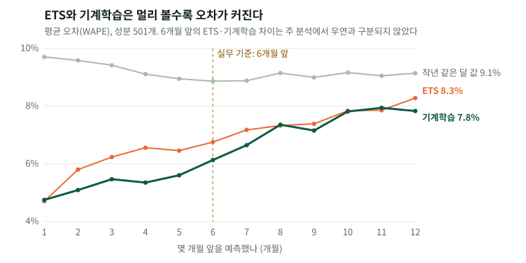
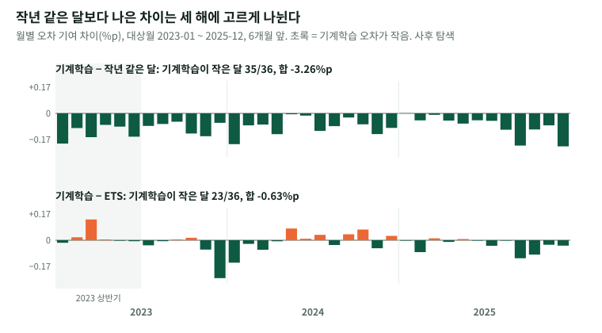
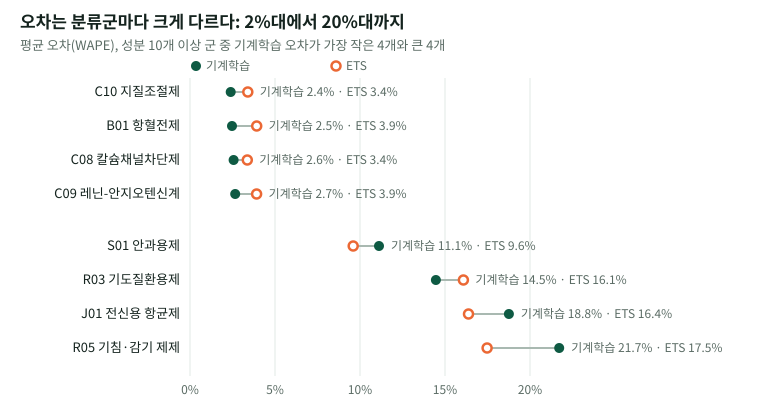

::: {.callout-note}
## 이 글은 시리즈로 나뉘었다
2026-11-24에 낸 「급여 변동과 수요 모니터링」을 2026-11-27에 네 편으로 나눴다. 이 글은 그중 **수요 예측** 편이다. 숫자는 2026-11-24 판과 같다.

* 약값 인하·급여정지 예고의 실현율, 비고에 없는 가격 변경: [약국은 약가인하를 며칠 전에 알 수 있나](../2026-11-benefit-change-lead/index.qmd)
* 분류군 실험, 검증 방식, 예측 모델 명세(옛 부록 A \~ D): [수요 예측 기술 노트](../2026-11-drug-demand-tech-note/index.qmd)
* 시리즈 전체와 "급여목록 가격 정보를 넣으면 나아지나": [시리즈 안내](../2026-11-pharm-data-series/index.qmd)
:::

::: {.leaflet .report-overview}
::: {.leaflet-row}
[묻는 것]{.k}

::: {.v}
성분별 처방 수요는 어느 쪽으로 가는가. 6개월 앞(예측하는 날 기준으로 다음 달)을 얼마나 맞힐 수 있고, 어느 방법을 기본으로 둘까. 어느 성분에서 예측이 크게 틀리나.
:::
:::

::: {.leaflet-row}
[쓴 자료]{.k}

::: {.v}
건보공단 의약품 사용통계 2018-01~2025-12와 잠정 평가용 2026-01~06. 분류군 배정에 심평원 급여목록의 약효분류 번호와 2026 약가정보의 ATC 분류 코드를 속성으로만 썼다. 모두 공개 데이터다.
:::
:::

::: {.leaflet-row}
[읽는 순서]{.k}

::: {.v}
실무 결론만 필요하면 한 쪽 요약의 "할 것 / 하지 말 것" 표까지 읽으면 된다. 분류군 실험과 모델 명세는 [기술 노트](../2026-11-drug-demand-tech-note/index.qmd)에 있다. 모르는 용어는 맨 끝 용어집에 한 줄씩 풀어 두었다.
:::
:::

::: {.leaflet-row .caution}
[주의]{.k}

::: {.v}
예측은 전국 성분 단위다. 특정 약국이나 제품의 발주량으로 쓰지 않는다.
:::
:::
:::

## 한 쪽 요약

공개된 처방량 자료로 두 질문에 답했다. "이 성분의 처방 수요는 어느 쪽으로 가는가", "약의 분류군 차이를 예측에 쓰면 더 잘 맞히는가"다.

**결론 세 가지**

1. **6개월 앞 성분 처방량 예측은 단순한 통계 모형(ETS)으로 충분했다.** 기계학습 모델은 "작년 같은 달 값"보다 나았지만 ETS보다 낫다는 근거는 없었다. "작년 같은 달 값"보다 앞선 차이는 2023~2025년 세 해에 고르게 나뉘었고, 코로나 회복기에 몰리지 않았다.
2. **예측이 틀리는 곳은 일부 고변동 성분에 몰린다.** 해마다 같은 달 처방량이 ±30% 이상 흔들린 성분 59개는 금액 비중이 5.3%인데 전체 오차의 24.4%를 만든다. 절반 이상이 호흡기·항감염 계열이다.
3. **분류군마다 예측 오차와 잘 맞는 방법은 다르지만, 그 차이를 예측에 넣어도 나아지지 않았다.** 고지혈증약 군은 오차 2.4%, 항생제(J01)·기침감기약(R05) 군은 19 \~ 22%다(기계학습 기준). 군마다 방법을 섞거나 군 정보를 더한 두 방식 모두 기존 기계학습 모델과 0.12%p 차이로, 낫다는 근거가 없었다. 그래서 모델을 더 복잡하게 만들지 않고, **ETS를 기본으로 유지하면서 성분군별 특성을 따로 모니터링한다.**

| 할 것 | 하지 말 것 |
|---|---|
| 성분 수요 모니터링은 ETS를 기본으로 둔다 | "작년 × 최근 증감률" 방식으로 예측한다 |
| 호흡기·급변 성분은 따로 지켜본다 | 이 예측을 약국 발주량으로 그대로 쓴다 |
| 분류군별 오차를 "얼마나 믿을지"의 기준으로 쓴다 | 분류군마다 따로 예측 모델을 만든다 |

## 자료 소개

건보공단이 매달 공개하는 **의약품 사용통계**를 썼다. 분류군 분석에는 약의 분류 코드를 속성으로만 더했다.

| 항목 | 내용 |
|---|---|
| 내는 곳 | 국민건강보험공단(건보공단) |
| 무엇이 들었나 | 성분별 처방 수량·청구건수·청구금액. 연령·시도·요양기관 구분은 [기술 노트](../2026-11-drug-demand-tech-note/index.qmd#class-diff)의 분류군 진단에서 일부만 썼다 |
| 단위 | 성분(주성분 코드 4자리) × 월 |
| 쓴 기간 | 2018-01 \~ 2025-12, 잠정 평가용 2026-01 \~ 06 |
| 공개 시차 | 약 4 \~ 5개월 뒤 공개 |
| 주의할 점 | 업체·품목이 2개 이하인 칸은 비공개. 최근 달은 뒤 판에서 늘 수 있음 |

**분류군 배정**: 성분마다 두 분류를 붙였다. ① 약효분류 앞 2자리(심평원 급여목록 2022-07판에서 그 성분 제품이 가장 많이 속한 분류). ② 국제 표준 분류인 **ATC 코드**(2026 약가정보의 표준코드로 제품에 연결, 그 성분 제품이 가장 많이 속한 코드). 성분 501개 모두 연결됐다. ATC는 2단계(예: C10)와 1단계(예: C)를 썼고, 성분이 3개보다 적은 군은 상위 분류의 "기타" 군으로 합쳤다.

**이 자료에 없는 것**: 제품별 판매량, 약국별 구매·재고, 도매 유통, 지역별 수요(예측은 전국 합계만 썼다). 이것들에 대한 결론은 이 글에 없다.

## 6개월 앞 처방량 예측 {#forecast}

**성분별 전국 처방량을 6개월 앞에 예측하면 평균 약 6 \~ 7% 빗나간다. 기본 방법으로는 ETS를 권한다.**

왜 6개월 앞인가: 사용통계는 약 5개월 늦게 나온다. 오늘 볼 수 있는 마지막 달이 5개월 전이므로, "다음 달"을 보려면 자료 기준으로 6개월 앞을 맞혀야 한다. 즉 "6개월 앞"은 먼 미래가 아니라, 예측하는 날 기준으로 **다음 달**이다.

{fig-alt="2025년 1월부터 12월까지 12칸. 1~6월은 공개된 자료(마지막 관측월 a = 6월), 7~11월은 아직 공개 전이라 예측에 쓸 수 없음, 오늘은 11월, 예측 대상은 12월(a + 6)."}

성분 501개(원외 청구금액의 93.8%)를 2023-01 \~ 2025-12 36개월 동안 매달 다시 예측해 네 방법을 비교했다.

| 방법 | 쉬운 설명 | 평균 오차(WAPE) | 판정 |
|---|---|---|---|
| 작년 같은 달 값 | "작년 7월만큼 올해 7월에도 나간다" | 9.76% | 기계학습보다 나쁨 (유의) |
| 작년 × 최근 증감률 | 작년 값에 최근 1년 증감률을 곱함 | 45.30% | 한 성분에서 크게 빗나감 |
| ETS | 최근 흐름과 계절 패턴을 함께 반영하는 통계 모형 | 7.11% | 기계학습과 구분 안 됨 |
| 기계학습 (LightGBM) | 성분 501개를 함께 학습하는 모델 | 6.46% | — |

기계학습의 오차가 숫자로는 가장 작다. 하지만 ETS와의 차이 0.65%p는 36개월 자료로는 우연과 구분되지 않았다. 처음 보는 2026-01 \~ 06 자료(잠정)에서는 오히려 ETS가 6개월 합으로 0.25%p 작았다. 더 복잡한 모델이 낫다는 근거가 없으므로, 설명과 점검이 쉬운 ETS를 기본으로 둔다.

여기서 "유의"는 **월 단위** 검정 결과다. 36개월의 월별 오차 차이를 한 줄의 자료로 보고 검정했고, 성분별로 검정하지는 않았다([기술 노트: 평가와 검정](../2026-11-drug-demand-tech-note/index.qmd#model-spec)).

자료 판본도 결과 해석에 영향을 준다. 2023~2025년 평가에는 수정이 끝난 사용통계(2026-11 받은 판)를 썼다. 2026년 정답은 첫 공개 후 12개월이 지나지 않은 잠정 판이라, 처방량이 뒤 판에서 더 늘 수 있다. 정답이 나중에 늘어나면 지금은 낮게 예측한 모델의 오차가 실제보다 작아 보인다. 그래서 2026년 결과는 확정 판으로 다시 채점한다.

{fig-alt="1~12개월 앞 예측 오차 선그래프. 기계학습은 2~7개월 앞에서 ETS보다 낮고, 1개월과 8개월 이상에서는 비슷하다. 작년 같은 달 값은 약 9%로 가장 높다."}

그림 읽는 법: 선이 낮을수록 잘 맞힌 것이다. 1개월 앞에서는 ETS와 기계학습이 같고, 8개월 이상에서도 다시 비슷해진다.

'작년 같은 달 값'을 쓰고 있다면 바꾸는 편이 낫다. 기계학습은 이 방법보다 3.30%p 작았고(유의), 2026년 6개월에서도 매달 작았다. 성분별로는 85%에서 오차가 작았다(검정이 아닌 단순 집계).

### 기계학습이 앞선 차이는 어느 해에서 나왔나 {#by-year}

**"작년 같은 달 값"보다 앞선 차이는 세 해에 고르게 나뉜다.** 2023년 상반기는 코로나 회복기 직후라 작년 같은 달 값이 크게 빗나간 시기다. 차이가 이 구간에 몰렸다면 결론이 그 한 시기의 일일 수 있어 따로 나눠 봤다. 미리 정하지 않은 추가 분석이라 판정에는 쓰지 않는다.

{fig-alt="36개월 막대 두 단. 위 단(기계학습 − 작년 같은 달)은 35개월이 0 아래로 기계학습이 작고 합은 −3.26%p. 아래 단(기계학습 − ETS)은 23개월이 0 아래, 합은 −0.63%p이고 2023 상반기와 2024년에는 ETS가 작은 달이 여럿 있다."}

* 작년 같은 달 값보다 앞선 차이의 비중은 2023년 40%, 2024년 31%, 2025년 29%다. 2023년 상반기만 보면 23%다.
* ETS와는 달마다 엇갈렸다. 2023년 상반기에는 오히려 기계학습 오차가 0.13%p 컸다.
* 기계학습 모델의 코로나 표시는 2020~2021년만 덮는다. 처방이 덜 회복된 2022년을 기준 해로 삼는 2023년 예측은 표시되지 않는다([기술 노트: 학습 설정](../2026-11-drug-demand-tech-note/index.qmd#model-spec)). 이전 판(2026-11-19) 분석에서는 기계학습이 앞선 차이가 거의 이 구간에서 나왔지만, 이번 판에서는 23%였다.
* 이 그림은 평가에 쓴 성분·월을 조금 단순하게 잡아 계산했다. 그래서 합계가 공식 값(−3.30%p, −0.65%p)과 조금 다르다.

급여목록의 가격 정보를 예측에 넣어 본 실험은 [시리즈 안내](../2026-11-pharm-data-series/index.qmd#list-price)에 한 단락으로, 표는 [기술 노트](../2026-11-drug-demand-tech-note/index.qmd#list-price-test)에 있다. 나아졌다는 근거는 없었다.

## 주의할 성분

**대부분의 성분은 매달 처방량이 크게 흔들리지 않지만, 일부는 수십 \~ 수만 배까지 변한다. 예측이 틀리는 곳은 주로 여기다.**

* 성분 501개의 2018 \~ 2025년 월 처방량을 보면, 가장 많은 달과 가장 적은 달의 차이는 절반의 성분에서 2.3배 이하다.
* 그러나 상위 5% 성분은 그 차이가 17배를 넘고, 가장 큰 성분은 약 7만 3천 배다.

### 호흡기 성분

호흡기 계열 성분 62개의 오차는 ETS 16.05%, 기계학습 18.63%로, 전체와 달리 기계학습이 더 크다. 그 밖의 성분(ETS 약 6.3%, 기계학습 약 5.4%)보다 오차가 ETS는 약 2.5배, 기계학습은 약 3.5배 크다.

### 오차가 큰 분류군: 특성이 서로 다르다 {#class-error}

오차는 분류군마다 크게 다르다. 그런데 오차가 큰 군끼리도 특성이 다르다. 겨울 처방이 여름의 몇 배인지가 해마다 달랐던 군(R03·J01·R05)이 있고, 두 성분에 오차가 몰린 군(S01)이 있다. 모두 관측된 현상이며 원인은 확인하지 않았다. 군별 표와 시사점은 [기술 노트](../2026-11-drug-demand-tech-note/index.qmd#class-diff)에 있다.

{fig-alt="분류군 8개의 오차. 기계학습·ETS 순으로 C10 2.4%·3.4%, B01 2.5%·3.9%, C08 2.6%·3.4%, C09 2.7%·3.9%, S01 11.1%·9.6%, R03 14.5%·16.1%, J01 18.8%·16.4%, R05 21.7%·17.5%."}

오차가 큰 R03·J01·R05에서는 겨울 처방의 크기가 해마다 달랐다. 아래 그림은 겨울 처방이 여름의 몇 배였는지를 겨울마다 보여준다.

{fig-alt="겨울 일곱 번의 배수. R05 1.81, 1.52, 1.07, 2.36, 1.47, 1.42, 1.24. R03 1.50, 1.30, 1.11, 1.50, 1.38, 1.35, 1.24. J01 1.35, 1.17, 0.93, 1.64, 1.33, 1.21, 1.07."}

### 분류군 차이를 예측에 넣으면

군마다 기계학습과 ETS를 섞는 비율을 달리하는 방식, 기계학습에 분류군 정보를 더하는 방식 두 가지를 결과를 보기 전에 정한 기준으로 시험했다. 두 방식 모두 평균 오차 6.34%로 기존 기계학습(6.46%)과 0.12%p 차이였고, 낫다는 근거가 없었다. 분류군별 오차는 "이 예측을 얼마나 믿을지"를 정하는 데 쓰고, 군마다 예측 방법을 바꾸지 않는다. 실험 설계와 판정은 [기술 노트](../2026-11-drug-demand-tech-note/index.qmd#class-test)에 있다.

### 사례: 독감 치료제와 '작년 × 증감률'의 함정

독감 치료제 oseltamivir의 원외 처방량은 2022-01 약 4,900에서 2023-01 약 415만으로 늘었다. 관측된 변화이며 원인은 확인하지 않았다.

1. '작년 × 최근 증감률'은 작년 값에 이미 급증이 들어 있는데, 증감률에도 같은 급증이 또 들어간다.
2. 그래서 늘어난 폭이 두 번 곱해져, 2024-05 예측이 실제의 약 1,143배가 됐다.
3. 이 한 성분이 이 방법 전체 오차의 79.1%를 차지했다. 계산 실수가 아니라 식의 성질이다.

**교훈**: 수요 수준이 급변한 성분에는 증감률을 곱하는 방식을 쓰지 않는다. 예측값이 작년의 몇 배가 되면 사람이 확인하는 장치를 둔다(시험하지 않은 제안).

## 현실적 권장안

**당장은 ETS를 기본으로 유지하고 분류군별로 예측 방법을 나누지 않는다. 오차가 몰리는 고변동 성분만 따로 표시해 사람이 검토한다.** 고변동 성분 표시는 이 분석에서 시험하지 않은 운영 제안이다.

1. **기본 운영: ETS 유지, 분류군별로 나누지 않음.** 설명과 점검이 쉽다. 예측 방법을 분류군별로 쪼개면 관리할 곳과 검증 부담만 늘고, 성능 이득은 분류군 실험에서 확인되지 않았다.
2. **호흡기·급변 성분 대응: 방법을 나누지 말고 표시한다.** 해마다 같은 달 처방량이 ±30% 이상 흔들리거나 급등 이력이 있는 성분을 별도 모니터링·예외 검토 대상으로 표시한다. 가벼운 운영 보완이다.

근거: 2023 \~ 2025년 기준으로 ±30% 이상 흔들린 성분은 59개다. 금액 비중은 5.3%인데 전체 오차의 24.4%를 만든다. 이 성분들의 평균 오차는 29.6%, 나머지는 4.6%다(기계학습 기준). 절반 이상이 호흡기(16개)·항감염(15개) 계열이다. 실제 운영에서는 표시 기준을 예측 시점 이전 자료로 정해야 한다. 위 숫자는 평가 기간을 돌아본 것이다.

## 누가 어떻게 쓸까

**수요 예측은 "성분 시장이 어느 쪽으로 가는지"의 기준선에 맞다.** 아래는 모두 이 분석에서 시험하지 않은 활용 제안이다. 가격 알림 쪽 활용은 [급여 변동 편](../2026-11-benefit-change-lead/index.qmd#who-uses)에 있다.

| 실무 | 수요 모니터링으로 |
|---|---|
| 제약 영업·마케팅 | 자사 성분의 전국 시장 흐름과 6개월 앞 예측 범위. 범위는 그 성분이 속한 분류군의 오차를 기준으로 |
| 유통 운영 | 성분별 자체 거래량 ÷ 전국 처방량으로 점유율 변화와 시장 변화를 나눔 |
| 유통 데이터팀 | 사용통계가 나오지 않은 5개월을 자체 거래 자료로 메우는 예측 실험 |

**기억할 것 세 가지**

1. 이 예측은 전국 성분 단위다. 특정 약국·제품의 발주량이 아니다.
2. 오차 6%는 평균이다. ETS 기준으로 순환계 주요 군(B01·C08·C09·C10)은 3 \~ 4%, 항생제·호흡기 군(R03·J01·R05)은 16 \~ 18%로 훨씬 더 빗나간다.
3. 분류군마다 예측 방법을 따로 두면 나아진다는 근거가 없었다. ETS를 기본으로 쓰고, 분류군별 오차로 믿을 만큼을 나눈다.

## 한계: 이 글이 답하지 않는 것

**약국·제품·지역 단위의 수요는 이 글이 답하지 않는다.** 그 밖의 한계는 아래와 같다.

| 한계 | 무엇을 조심해야 하나 |
|---|---|
| 2026년 평가는 잠정이다 | 최근 달 사용통계는 뒤 판에서 늘 수 있다. 2027-11 이후 판으로 다시 채점한다 |
| 처음 보는 기간이 6개월뿐이다 | 2023 \~ 2025는 이전 분석에서 이미 본 기간이다 |
| 분류군 실험은 완전한 맹검이 아니다 | 군별 섞기의 착안이 같은 2023 \~ 2025 오차에서 나왔다. 그런데도 개선이 없었다 |
| 오차가 큰 군의 진단은 사후 탐색이다 | 이미 본 2023 \~ 2025를 다시 나눠 본 것이고 원인을 밝히지 않았다. 코로나 뒤 완전한 겨울은 두 번뿐이라 다음 겨울로 일반화하지 않는다 |
| 분류군 배정은 2026 자료다 | ATC 코드를 2026 약가정보에서 가져왔다. 평가 시점에 같은 배정을 알 수 있었다고 가정했다 |
| 섞는 비율의 창에 특수한 해가 들어 있다 | 2023년 예측의 직전 12개월에는 코로나 기간(2021)과 회복기(2022)가 들어 있다 |
| 수정된 자료로 평가했다 | 그 달에 실제로 볼 수 있었던 첫 공개본으로 예측하면 오차가 더 클 수 있다 |
| 모델 설정을 조정하지 않았다 | 기계학습 설정은 고정했다. 결과는 그 설정에 한정된다 |

분류군과 오차의 관계는 연관이다. 약효가 오차를 만든다는 뜻이 아니다.

## 다음 분석

운영 쪽으로는 새 사용통계가 나올 때마다 같은 방식으로 갱신하는 월간 리포트를 만들고, 2027년 11월 이후 수정본으로 2026년 예측을 다시 채점한다. 수요 쪽 후속 질문은 품절·공급중단 자료 결합, 시도·요양기관 종류별로 내려가기, 함량·제형 합산의 영향 점검이다. 시리즈 전체의 다음 분석 목록은 [시리즈 안내](../2026-11-pharm-data-series/index.qmd#next)에, 성분군별 후속 방향(R05·J01·R03·S01)은 [기술 노트](../2026-11-drug-demand-tech-note/index.qmd#class-diff)에 있다.

## 용어집 {#glossary}

| 용어 | 한 줄 풀이 |
|---|---|
| 의약품 사용통계 | 건보공단이 성분별 처방 수량·청구금액을 매달 공개하는 표. 약 5개월 늦게 나온다 |
| 급여목록 | 건강보험이 적용되는 약과 그 상한가격의 공식 목록. 이 글에서는 약효분류 번호만 가져왔다 |
| 원외 처방 | 병원 밖 약국에서 조제되는 처방 |
| 성분(코드 4자리) | 같은 성분을 가진 여러 회사 제품을 묶는 단위 |
| 사용통계 비공개 | 업체·품목이 2개 이하라 공개되지 않는 칸. 0이 아니라 "모름"이다 |
| 분류군 | 약효나 부위가 비슷한 성분끼리의 묶음. 이 글은 약효분류와 ATC 두 가지를 썼다 |
| 약효분류 | 급여목록에 적힌 국내 약효 분류 번호. 이 글은 앞 2자리를 썼다 |
| ATC 코드 | 국제 표준 의약품 분류. 1단계는 알파벳 한 글자(예: C), 2단계는 세 자리(예: C10) |
| WAPE | 빗나간 양의 합 ÷ 실제량의 합. 6.5%면 100개를 예상했을 때 평균 6.5개씩 빗나간다는 뜻 |
| %p | 비율끼리의 차. 7.11%와 6.46%의 차는 0.65%p |
| ETS | 최근 값에 더 큰 무게를 주고 계절 패턴을 더해 앞을 내다보는 전통 통계 모형 |
| LightGBM | 여러 개의 결정 트리를 쌓아 예측하는 기계학습 모델 |
| 섞기(결합) | 두 방법의 예측을 정한 비율로 더하는 것. 예: 기계학습 70% + ETS 30% |
| 백테스트 | 과거 시점으로 돌아가 그때 자료만으로 예측하고, 이미 아는 실제값과 맞춰 보는 검증 |
| 사전등록 | 결과를 보기 전에 분석 방법과 판정 기준을 고정해 두는 것 |
| 맹검 평가 | 방법을 정할 때 보지 않은 자료로 채점하는 것 |
| p값 | 실제로 차이가 없는데도 이만큼의 차이가 우연히 나올 가능성. 0.05보다 작으면 "유의하다"고 본다 |
| 신뢰구간 | 진짜 값이 있을 법한 범위. 표본이 작을수록 넓다 |
| 판단 보류 | 차이가 우연과 구분되지 않아 어느 쪽이 낫다고 말할 수 없는 경우. '차이 없음'과 다르다 |
| 사후 탐색 | 결과를 본 뒤 미리 정하지 않고 더 해 본 분석. 판정에 쓰지 않고 가설로만 남긴다 |
| 동등 | 두 방법의 차이가 미리 정한 실무 허용폭(±0.5%p) 안이라고 말할 수 있는 경우 |
| EWC 검정 | 달마다 서로 비슷하게 움직이는 짧은 오차 계열에서 우연한 유의를 덜 내도록 만든 검정 |
| Holm 보정 | 여러 비교를 한꺼번에 할 때 우연히 하나쯤 유의해지는 일을 막는 보정 |
| 특징 중요도 | 모델이 예측할 때 어떤 입력에 얼마나 기댔는지의 비중. 원인을 뜻하지 않는다 |
| SHAP 값 | 예측값 하나를 특징별 기여로 나눈 값 |

자료 출처: 국민건강보험공단 의약품 사용통계 2018-01 \~ 2025-12와 2026-01 \~ 06(2026-10-28 공개본), 건강보험심사평가원 급여목록 2022-07판(약효분류 번호, 속성으로만), 2026 약가정보(ATC 코드, 속성으로만). 모두 공개 데이터다. 숫자는 분석 코드의 결과 파일에서 왔다. 첫 판은 2026-11-19, 분류군 분석과 모델 명세를 더한 판은 2026-11-24에 냈고, 2026-11-27에 시리즈로 나누며 급여 변동 부분과 부록을 다른 글로 옮겼다.
