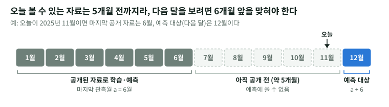
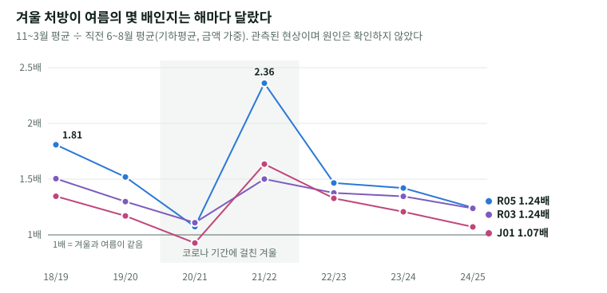

::: {.callout-note}
## 이 글에 대해 (2판, 2026-11-27)
1판(2026-11-24)은 "예측 방법 네 가지를 비교한 결과"를 중심으로 썼다. 2판은 약국이 약을 제때 구하지 못하는 고충에서 출발하도록 새로 썼다. 분석·숫자·그림은 1판과 같다.

약가인하는 [한 달 전에 알 수 있었던 약가인하는 2024년뿐이었다](../2026-11-benefit-change-lead/index.qmd)에, 시리즈 전체는 [시리즈 안내](../2026-11-pharm-data-series/index.qmd)에, 검증 방식과 모델 명세는 [기술 노트](../2026-11-drug-demand-tech-note/index.qmd)에 있다.
:::

::: {.leaflet .report-overview}
::: {.leaflet-row}
[고충]{.k}

::: {.v}
필요한 약을 제때, 필요한 만큼 구하지 못한다. 약국 고충 가운데 지금 체감이 가장 큰 문제다.
:::
:::

::: {.leaflet-row}
[묻는 것]{.k}

::: {.v}
① 공개 데이터로 이 고충의 어느 부분을 볼 수 있나 ② 성분별 처방량을 얼마나 맞힐 수 있나 ③ 어디서 크게 빗나가나 ④ 약 종류마다 예측 방법을 나누면 나아지나
:::
:::

::: {.leaflet-row}
[쓴 자료]{.k}

::: {.v}
건보공단 의약품 사용통계 2018-01~2025-12, 잠정 평가용 2026-01~06. 약 종류(분류군)를 붙이는 데 심평원 급여목록의 약효분류와 2026 약가정보의 ATC 코드를 썼다. 모두 공개 자료다.
:::
:::

::: {.leaflet-row .caution}
[주의]{.k}

::: {.v}
이 자료에는 품절·재고·배분이 없다. 예측은 전국 성분 단위라 특정 약국이나 제품의 발주량으로 쓰지 않는다.
:::
:::
:::

## 한 쪽 요약

**공개 데이터로는 품절을 볼 수 없지만, 수요가 크게 흔들리는 성분은 미리 가려낼 수 있다. 그 성분들은 겨울 호흡기·항생제에 몰려 있었다.**

| 약국이 겪는 일 | 공개 데이터로 본 것 |
|---|---|
| "필요한 약을 제때 구하지 못한다" | **품절 자체는 이 자료에 없다.** 사용통계는 처방된 양만 보여 준다. 대신 처방이 갑자기 흔들리는 성분을 가려낼 수 있다 |
| 겨울마다 감기약·항생제가 모자란다 | **예측이 가장 크게 빗나간 약 종류가 기침감기약·항생제·호흡기약이었다**(16~22%). 겨울 처방이 여름의 몇 배인지가 해마다 달랐다 |

| 수요 기준선을 만드는 쪽이 묻는 것 | 데이터로 본 것 |
|---|---|
| 다음 달 처방량을 얼마나 맞히나 | **전국 성분 처방량은 평균 6~7% 빗나갔다.** 공개가 5개월 늦어 "다음 달"은 자료 기준 6개월 앞이다 |
| 어떤 방법을 쓸까 | **단순한 통계 모형(ETS)으로 충분했다.** 기계학습이 숫자로는 조금 나았지만 우연과 구분되지 않았다. "작년 같은 달만큼"은 둘 다보다 나빴다 |
| 오차는 어디서 나오나 | **흔들리는 성분 59개가 금액으로는 5.3%인데 오차의 24.4%를 만들었다.** 절반 이상이 호흡기·항감염 계열이다 |
| 약 종류마다 방법을 나누면 나아지나 | **아니다.** 두 방식 모두 0.12%p 차이로, 낫다는 근거가 없었다 |

**그래서 약국을 돕는 쪽이 할 수 있는 것**: 단순한 모형으로 성분 수요의 기준선을 만들고, 흔들리는 성분(특히 겨울 호흡기·항생제)은 따로 표시해 사람이 본다. 이 기준선을 자체 주문·재고 자료와 합치면 약국 단위로 내려갈 수 있다([7장](#implications)).

## 1. 관점: 누구의 문제를, 누가 덜어 주나 {#perspective}

이 글은 약국의 고충을 다루되, **주문·재고·반품 정보로 그 고충을 덜어 줄 수 있는 쪽**(의약품 유통, 약국 지원 서비스)의 관점에서 본다([시리즈 안내](../2026-11-pharm-data-series/index.qmd#why), 조사 원문은 [약국 고충 시장조사](../../subjects/drug_store.md)).

| 단계 | 질문 | 무엇이 새는가 | 이 글 |
|---|---|---|---|
| **A. 들여오기** | **필요한 약을 제때, 필요한 만큼 구할 수 있는가** | **시간, 조제 기회** | **여기** |
| B. 쌓아두기 | 이미 사둔 약의 가치가 지켜지는가 | 돈 | [약가인하 편](../2026-11-benefit-change-lead/index.qmd) |
| C. 내주기 | 조제 과정이 감당 가능한가 | 시간, 소모품, 분쟁 | — |
| D. 벌기 | 매출과 마진이 유지되는가 | 매출 | — |

들여오기는 지금 약국이 가장 크게 체감하는 고충이다. 약사 대부분이 품절약으로 고통을 겪는다고 답했고, 약사들이 많이 신고한 품절 품목과 정부의 공식 집계 사이에 차이가 크다고 보도됐다.

## 2. 현장의 사정과 공개 데이터로 볼 수 있는 것 {#case}

약업 전문지 보도에 나온 사례를 보면, 약을 구하지 못하는 이유는 여러 겹이다.

* 출고 기록은 있는데 동네약국 온라인몰 재고는 0이다. 약국마다 배분이 다르다.
* 품절약이 들어오면 주문 수량을 1개로 묶거나 최소 주문금액을 정해 다른 약까지 사게 한다.
* 제약사가 거래 도매를 줄이거나 도매가 배송을 쉬면 며칠씩 약이 끊긴다. 약국은 바뀐 뒤에야 안다.

| 사정 | 공개 데이터로 볼 수 있나 |
|---|---|
| 수요가 갑자기 늘거나 흔들린다 | **있다.** 성분별 처방량이 매달 공개된다 → [3장](#q1), [4장](#q2) |
| 공급·배분·재고가 모자라거나 고르지 않다 | **없다.** 생산·출고·도매 재고·약국 재고는 공개되지 않는다 |
| 유통 정책이 바뀐다 | **없다** |
| 자료가 늦게 나온다 | 사용통계는 약 5개월 늦게 공개된다. 그래서 "다음 달"을 보려면 6개월 앞을 맞혀야 한다 |

그래서 이 글은 들여오기 고충 가운데 **수요 쪽**만 다룬다. 품절을 예측하지 않는다. "어느 성분의 수요가 믿을 만하게 예측되고, 어느 성분은 그렇지 않은가"를 가려 공급 계획과 알림의 기준선을 만드는 것이 목표다.

## 자료

| 항목 | 내용 |
|---|---|
| 자료 | 건보공단 **의약품 사용통계**. 성분별 처방 수량·청구건수·청구금액 |
| 단위 | 성분(같은 성분을 가진 여러 회사 제품을 묶은 단위, 코드 4자리) × 월 |
| 쓴 기간 | 2018-01 \~ 2025-12, 잠정 평가용 2026-01 \~ 06 |
| 공개 시차 | 약 4 \~ 5개월 뒤 공개. 최근 달은 뒤 판에서 늘 수 있다 |
| 범위 | 병원 밖 약국에서 조제된 처방(원외 처방). 원외 청구금액의 93.8%를 차지하는 성분 501개 |
| 주의 | 업체·품목이 2개 이하인 칸은 공개되지 않는다. 0이 아니라 "모름"이다 |

**약 종류(분류군)**: 성분마다 두 가지 분류를 붙였다. 급여목록의 국내 약효분류 앞 2자리, 그리고 국제 표준 분류인 ATC 코드(예: C10 고지혈증약, J01 항생제, R05 기침감기약). 성분 501개 모두 연결됐고, 성분이 3개보다 적은 군은 상위 분류의 "기타"로 합쳤다.

**이 자료에 없는 것**: 품절·공급, 제품별 판매량, 약국별 구매·재고, 도매 유통, 지역별 수요(예측은 전국 합계만 썼다).

## 3. 다음 달 처방량을 얼마나 맞히나 {#q1}

**성분별 전국 처방량을 다음 달 기준으로 예측하면 평균 약 6~7% 빗나간다. 기본 방법으로는 단순한 통계 모형(ETS)을 권한다.**

{fig-alt="2025년 1월부터 12월까지 12칸. 1~6월은 공개된 자료(마지막 관측월 a = 6월), 7~11월은 아직 공개 전이라 예측에 쓸 수 없음, 오늘은 11월, 예측 대상은 12월(a + 6)."}

오늘 볼 수 있는 마지막 달이 5개월 전이므로, 다음 달을 보려면 자료 기준으로 6개월 앞을 맞혀야 한다. 2023-01 \~ 2025-12의 36개월 동안 매달 그 시점의 자료만으로 다시 예측해 네 방법을 비교했다.

| 방법 | 쉬운 설명 | 평균 오차 | 판정 |
|---|---|---|---|
| 작년 같은 달 값 | "작년 7월만큼 올해 7월에도 나간다" | 9.76% | 기계학습보다 나쁨 (우연으로 보기 어려움) |
| 작년 × 최근 증감률 | 작년 값에 최근 1년 증감률을 곱함 | 45.30% | 한 성분에서 크게 빗나감([6장](#case-flu)) |
| ETS | 최근 흐름과 계절 패턴을 함께 반영하는 통계 모형 | 7.11% | 기계학습과 구분 안 됨 |
| 기계학습 (LightGBM) | 성분 501개를 함께 학습하는 모델 | 6.46% | — |

* 평균 오차는 "빗나간 양의 합 ÷ 실제량의 합"이다. 6.5%면 100개를 예상했을 때 평균 6.5개쯤 빗나간다는 뜻이다.
* 기계학습의 오차가 숫자로는 가장 작다. 하지만 ETS와의 차이 0.65%p는 36개월 자료로는 우연과 구분되지 않았다. 처음 보는 2026-01 \~ 06 자료(잠정)에서는 오히려 ETS가 6개월 합으로 0.25%p 작았다. 더 복잡한 모델이 낫다는 근거가 없으므로, 설명과 점검이 쉬운 ETS를 기본으로 둔다.
* "작년 같은 달 값"을 쓰고 있다면 바꾸는 편이 낫다. 기계학습은 이 방법보다 3.30%p 작았고, 2026년 6개월에서도 매달 작았다. 성분별로는 85%에서 오차가 작았다.

{fig-alt="1~12개월 앞 예측 오차 선그래프. 기계학습은 2~7개월 앞에서 ETS보다 낮고, 1개월과 8개월 이상에서는 비슷하다. 작년 같은 달 값은 약 9%로 가장 높다."}

선이 낮을수록 잘 맞힌 것이다. 1개월 앞에서는 ETS와 기계학습이 같고, 8개월 이상에서도 다시 비슷해진다. 해마다 나눠 본 결과와 자료 판본의 영향은 [부록 A](#appendix-a)에 있다.

### 달력을 보정하면 조금 더 나아졌다 (다음 후보) {#calendar}

**ETS를 그대로 두고 달마다 다른 근무일수(공휴일을 뺀 평일 수)만 보정하면 평균 오차가 7.11%에서 6.19%로 0.92%p 작아졌다.** 차이의 90% 구간은 −1.59 ~ −0.25%p로, 우연으로 보기 어려웠다. 근무일수가 많은 달에 처방이 많아지는 만큼을 미리 빼 주는 것이라, 모델을 바꾸지 않고 자료 처리만 더하는 가장 가벼운 개선이다.

* **같은 방식으로 예측 범위도 만들었다.** "90% 범위"로 잡은 구간에 실제값이 들어간 비율이 90.77%였고, 2023·2024·2025년 각각 89.87%, 91.37%, 91.14%였다. 기준선과 함께 "얼마나 빗나갈 수 있나"를 성분마다 줄 수 있다.
* **다만 기본값으로 바꾸기에는 이르다.** 이 보정은 이미 본 2023 \~ 2025년 오차에서 착안해 같은 기간으로 평가했다(맹검이 아님). 그리고 호흡기·항생제 성분 61개에서는 오히려 오차가 16.07%에서 16.82%로 커졌고, 그 성분의 90%에서 함께 나빠졌다. 그래서 지금은 ETS를 기본으로 두고, 이 보정을 2026년 이후 자료로 확인할 첫 후보로 둔다.

## 4. 어디서 크게 빗나가나 {#q2}

**대부분의 성분은 매달 처방량이 크게 흔들리지 않는다. 예측이 크게 틀리는 곳은 일부 성분, 특히 겨울 호흡기·항생제다.**

* 성분 501개의 2018 \~ 2025년 월 처방량을 보면, 가장 많은 달과 가장 적은 달의 차이가 절반의 성분에서 2.3배 이하다. 상위 5% 성분은 17배를 넘고, 가장 큰 성분은 약 7만 3천 배다.
* 해마다 같은 달 처방량이 ±30% 이상 흔들린 성분 59개는 금액 비중이 5.3%인데 전체 오차의 24.4%를 만든다. 이 성분들의 평균 오차는 29.6%, 나머지는 4.6%다(기계학습 기준). 절반 이상이 호흡기(16개)·항감염(15개) 계열이다.
* 호흡기 계열 성분 62개의 오차는 ETS 16.05%, 기계학습 18.63%로, 전체와 달리 기계학습이 더 크다.

{fig-alt="분류군 8개의 오차. 기계학습·ETS 순으로 C10 2.4%·3.4%, B01 2.5%·3.9%, C08 2.6%·3.4%, C09 2.7%·3.9%, S01 11.1%·9.6%, R03 14.5%·16.1%, J01 18.8%·16.4%, R05 21.7%·17.5%."}

* **잘 맞는 약**: 고지혈증약(C10)·항혈전제(B01) 같은 만성질환·순환계 약은 오차 2~4%다.
* **크게 빗나가는 약**: 호흡기약(R03)·항생제(J01)·기침감기약(R05)은 14~22%다. 안과용제(S01)는 두 성분에 오차가 몰려 있다.

**겨울 처방의 크기가 해마다 달랐다.** 아래 그림은 겨울 처방이 여름의 몇 배였는지를 겨울마다 보여 준다. 이렇게 해마다 다른 겨울이 호흡기·항생제 예측을 어렵게 만드는 모습과 함께 나타난다. 관측된 연관이며 원인은 확인하지 않았다.

{fig-alt="겨울 일곱 번의 배수. R05 1.81, 1.52, 1.07, 2.36, 1.47, 1.42, 1.24. R03 1.50, 1.30, 1.11, 1.50, 1.38, 1.35, 1.24. J01 1.35, 1.17, 0.93, 1.64, 1.33, 1.21, 1.07."}

약국 현장의 "겨울마다 감기약·항생제가 모자란다"는 말과 같은 약 종류다. 다만 이 자료로 알 수 있는 것은 **수요 쪽이 예측하기 어렵다**는 데까지다. 그때 공급이 얼마나 모자랐는지는 알 수 없다. 이런 겨울을 몇 달 앞서 알려 주는 공개 신호가 있는지는 [다음 글](../2026-11-winter-leading-signals/index.qmd)에서 찾았다.

## 5. 약 종류마다 방법을 나누면 나아지나 {#q3}

**나아지지 않았다.** 약 종류마다 기계학습과 ETS를 섞는 비율을 달리하는 방식, 기계학습에 약 종류 정보를 더하는 방식 두 가지를 결과를 보기 전에 정한 기준으로 시험했다. 두 방식 모두 평균 오차 6.34%로 기존 기계학습(6.46%)과 0.12%p 차이였고, 낫다는 근거가 없었다.

그래서 약 종류별 오차는 **"이 예측을 얼마나 믿을지"**를 정하는 데 쓰고, 약 종류마다 예측 방법을 바꾸지 않는다. 실험 설계와 판정은 [기술 노트](../2026-11-drug-demand-tech-note/index.qmd#class-test)에 있다.

## 6. 사례: 독감 치료제와 "작년 × 증감률"의 함정 {#case-flu}

독감 치료제 oseltamivir의 원외 처방량은 2022-01 약 4,900에서 2023-01 약 415만으로 늘었다.

1. "작년 × 최근 증감률"은 작년 값에 이미 급증이 들어 있는데, 증감률에도 같은 급증이 또 들어간다.
2. 그래서 늘어난 폭이 두 번 곱해져, 2024-05 예측이 실제의 약 1,143배가 됐다.
3. 이 한 성분이 이 방법 전체 오차의 79.1%를 차지했다. 계산 실수가 아니라 식의 성질이다.

**교훈**: 수요가 급변한 성분에는 증감률을 곱하는 방식을 쓰지 않는다. 예측값이 작년의 몇 배가 되면 사람이 확인하는 장치를 둔다(시험하지 않은 제안).

## 7. 이 관점에서 할 수 있는 것 {#implications}

공개 데이터로 품절을 막을 수는 없다. 줄일 수 있는 것은 **수요 변화를 늦게 알아채서 생기는 손실**이다. 아래는 모두 이 분석에서 시험하지 않은 제안이다.

| 할 것 | 내용 |
|---|---|
| 성분 수요 기준선 | ETS로 전국 성분 처방량의 다음 달 기준선을 만든다. 근무일수 보정은 새 자료로 확인되면 더한다([3장](#calendar)). 기준선의 신뢰 범위는 그 성분이 속한 약 종류의 오차로 정한다(만성질환 약 3~4%, 호흡기·항생제 16~18%, ETS 기준) |
| 흔들리는 성분 표시 | 해마다 같은 달 처방량이 ±30% 이상 흔들리거나 급등 이력이 있는 성분을 따로 표시해 사람이 본다. 표시 기준은 예측 시점 이전 자료로 정해야 한다 |
| 겨울 앞 점검 | 호흡기·항생제는 겨울 전에 예측 범위를 넓게 잡고 공급 계획을 따로 본다 |
| 5개월 공백 메우기 | 사용통계가 나오지 않은 최근 5개월을 자체 주문·거래 자료로 메운다. 자체 거래량 ÷ 전국 처방량으로 점유율 변화와 시장 변화를 나눌 수 있다 |

| 하지 말 것 | 이유 |
|---|---|
| "작년 × 최근 증감률"로 예측한다 | 급변 성분에서 수백~수천 배 빗나간다 |
| 이 예측을 약국 발주량으로 그대로 쓴다 | 전국 성분 단위다. 약국·제품 단위가 아니다 |
| 약 종류마다 따로 예측 모델을 만든다 | 나아진다는 근거가 없었다 |

* 약국 단위의 수요와 재고는 이 기준선을 약국의 주문·재고 기록과 합쳐야 계산할 수 있다. 그 단계는 공개 데이터 밖이다.
* 가격 알림 쪽은 [약가인하 편 7장](../2026-11-benefit-change-lead/index.qmd#implications)에 있다.

## 8. 이 숫자를 어떻게 확인했나 {#checks}

* **결과를 보기 전에 기준을 정했다.** 비교할 방법과 판정 기준을 미리 고정했다(사전등록).
* **그때 볼 수 있던 자료만 썼다.** 2023 \~ 2025년 36개월 동안 매달, 그 시점에 공개됐을 자료만으로 예측하고 실제값과 맞췄다(백테스트). 미래 자료가 섞이지 않는지 따로 시험했다.
* **처음 보는 자료로도 채점했다.** 방법을 정할 때 보지 않은 2026-01 \~ 06 자료로 다시 채점했다(잠정 판).
* **차이가 우연인지 검정했다.** 36개월의 월별 오차 차이를 한 줄의 자료로 보고 검정했다. 성분별로 검정하지는 않았다.

검정 방법, 모델 설정, 입력 특징은 [기술 노트](../2026-11-drug-demand-tech-note/index.qmd#model-spec)에 있다.

## 9. 한계 {#limits}

| 한계 | 무엇을 조심해야 하나 |
|---|---|
| 현장 사례의 근거 | 대부분 약업 전문지 보도와 약사 단체 설문이다. 피해를 호소하는 설문은 응답이 피해 쪽으로 쏠릴 수 있다 |
| 품절·공급은 보지 못한다 | 사용통계는 처방된 양만 담는다. 약이 없어 처방이 바뀌었다면 그 변화도 수요처럼 보인다 |
| 2026년 평가는 잠정이다 | 최근 달 사용통계는 뒤 판에서 늘 수 있다. 2027-11 이후 판으로 다시 채점한다 |
| 처음 보는 기간이 6개월뿐이다 | 2023 \~ 2025는 이전 분석에서 이미 본 기간이다 |
| 약 종류별 진단은 사후 탐색이다 | 이미 본 기간을 다시 나눠 본 것이고 원인을 밝히지 않았다. 코로나 뒤 완전한 겨울은 두 번뿐이라 다음 겨울로 일반화하지 않는다 |
| 약 종류 배정은 2026 자료다 | ATC 코드를 2026 약가정보에서 가져왔다. 평가 시점에도 같은 배정을 알 수 있었다고 가정했다 |
| 수정된 자료로 평가했다 | 그 달에 실제로 볼 수 있었던 첫 공개본으로 예측하면 오차가 더 클 수 있다 |
| 모델 설정을 조정하지 않았다 | 기계학습 설정은 고정했다. 결과는 그 설정에 한정된다 |

약 종류와 오차의 관계는 연관이다. 약효가 오차를 만든다는 뜻이 아니다.

## 용어 {#glossary}

| 용어 | 한 줄 풀이 |
|---|---|
| 의약품 사용통계 | 건보공단이 성분별 처방 수량·청구금액을 매달 공개하는 표. 약 5개월 늦게 나온다 |
| 원외 처방 | 병원 밖 약국에서 조제되는 처방 |
| 성분(코드 4자리) | 같은 성분을 가진 여러 회사 제품을 묶는 단위 |
| 약 종류(분류군) | 약효나 부위가 비슷한 성분끼리의 묶음. 약효분류와 ATC 두 가지를 썼다 |
| ATC 코드 | 국제 표준 의약품 분류. 예: C10 고지혈증약, J01 항생제, R03 호흡기약, R05 기침감기약, S01 안과용제 |
| 평균 오차(WAPE) | 빗나간 양의 합 ÷ 실제량의 합 |
| %p | 비율끼리의 차. 7.11%와 6.46%의 차는 0.65%p |
| ETS | 최근 값에 더 큰 무게를 주고 계절 패턴을 더해 앞을 내다보는 통계 모형 |
| 기계학습(LightGBM) | 여러 결정 트리를 쌓아 예측하는 모델 |
| 백테스트 | 과거 시점으로 돌아가 그때 자료만으로 예측하고 실제값과 맞춰 보는 검증 |
| 사전등록 | 결과를 보기 전에 분석 방법과 판정 기준을 고정해 두는 것 |
| 사후 탐색 | 결과를 본 뒤 더 해 본 분석. 판정에 쓰지 않고 가설로만 남긴다 |

더 자세한 용어(EWC 검정, Holm 보정, SHAP 값 등)는 [기술 노트](../2026-11-drug-demand-tech-note/index.qmd)에 있다.

## 부록

### A. 해마다 나눠 본 결과와 자료 판본 {#appendix-a}

**"작년 같은 달 값"보다 앞선 차이는 세 해에 고르게 나뉜다.** 2023년 상반기는 코로나 회복기 직후라 작년 같은 달 값이 크게 빗나간 시기다. 차이가 이 구간에 몰렸다면 결론이 그 한 시기의 일일 수 있어 따로 나눠 봤다. 미리 정하지 않은 추가 분석이라 판정에는 쓰지 않는다.

{fig-alt="36개월 막대 두 단. 위 단(기계학습 − 작년 같은 달)은 35개월이 0 아래로 기계학습이 작고 합은 −3.26%p. 아래 단(기계학습 − ETS)은 23개월이 0 아래, 합은 −0.63%p이고 2023 상반기와 2024년에는 ETS가 작은 달이 여럿 있다."}

* 작년 같은 달 값보다 앞선 차이의 비중은 2023년 40%, 2024년 31%, 2025년 29%다. 2023년 상반기만 보면 23%다.
* ETS와는 달마다 엇갈렸다. 2023년 상반기에는 오히려 기계학습 오차가 0.13%p 컸다.
* 기계학습 모델의 코로나 표시는 2020~2021년만 덮는다. 이전 판(2026-11-19) 분석에서는 기계학습이 앞선 차이가 거의 2023년 상반기에서 나왔지만, 이번 판에서는 23%였다.
* 이 그림은 평가에 쓴 성분·월을 조금 단순하게 잡아 계산했다. 그래서 합계가 공식 값(−3.30%p, −0.65%p)과 조금 다르다.

**자료 판본**: 2023 \~ 2025년 평가에는 수정이 끝난 사용통계(2026-11 받은 판)를 썼다. 2026년 정답은 첫 공개 후 12개월이 지나지 않은 잠정 판이라 처방량이 뒤 판에서 더 늘 수 있다. 정답이 나중에 늘어나면 지금 낮게 예측한 모델의 오차가 실제보다 작아 보인다. 그래서 2026년 결과는 확정 판으로 다시 채점한다.

**연령·지역·의원 비중 같은 처방 구성의 변화로 오차를 설명할 수 있나**도 사후 탐색으로 봤다. 미리 정한 기준(여러 비교 보정 뒤 유의, 세 해 부호 같음)을 만족한 특징이 없었고, 구성 변화로 오차를 보정하면 모든 경우에 오히려 나빠졌다. 그래서 이 방향은 닫았다.

**급여목록 가격 정보를 넣어 본 실험**은 [시리즈 안내](../2026-11-pharm-data-series/index.qmd#list-price)와 [기술 노트](../2026-11-drug-demand-tech-note/index.qmd#list-price-test)에 있다. 나아졌다는 근거는 없었다.

자료 출처: 국민건강보험공단 의약품 사용통계 2018-01 \~ 2025-12와 2026-01 \~ 06(2026-10-28 공개본), 건강보험심사평가원 급여목록 2022-07판(약효분류 번호, 속성으로만), 2026 약가정보(ATC 코드, 속성으로만). 현장 사례는 약업 전문지 보도. 숫자는 분석 코드의 결과 파일에서 왔다(2026-11-24 판). 첫 판은 2026-11-19, 분류군 분석과 모델 명세를 더한 판은 2026-11-24에 냈고, 2026-11-27에 약국 고충에서 출발하도록 새로 썼다.
