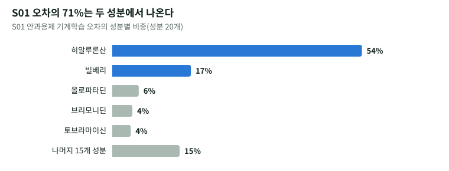
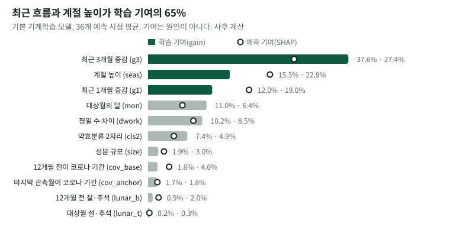

::: {.callout-note}
## 이 노트에 대해
[수요 보고서](../2026-11-drug-demand-forecast/index.qmd)의 부록 A \~ D를 옮긴 것이다. 숫자는 2026-11-24 판과 같다. 결론과 실무 권장안은 수요 보고서에, 용어 풀이는 [수요 보고서의 용어집](../2026-11-drug-demand-forecast/index.qmd#glossary)에 있다. 시리즈 전체는 [시리즈 안내](../2026-11-pharm-data-series/index.qmd)에서 본다.
:::

## 분류군마다 무엇이 다른가 {#class-diff}

**분류군 사이에 예측 오차, 계절 패턴, 잘 맞는 방법이 크게 다르다. 하지만 ETS가 모든 해에 꾸준히 이기는 군은 없었다.** 아래는 [수요 보고서](../2026-11-drug-demand-forecast/index.qmd)의 백테스트 예측(2023-01 \~ 2025-12, 6개월 앞)을 분류군별로 다시 나눠 본 것이다.

성분 10개 이상인 ATC 2단계 군 19개를 기계학습 오차 순으로 세우면, 오차가 작은 4개 군과 큰 4개 군의 패턴이 다르다. 큰 쪽 4개 가운데 S01은 나머지와 달라 따로 적는다.

### 오차가 가장 작은 4개 군: 만성질환·순환계

매일 꾸준히 먹는 장기 유지 치료제다. 계절 변동이 거의 없고(겨울/여름 비 0.99 \~ 1.00), 해마다 같은 달 처방량의 흔들림이 ±4 \~ 5%라 오차가 2.4 \~ 2.7%다.

::: {.wide-table}
| ATC 군 | 분석에 든 주요 성분 (금액 상위 5) | 성분 수 | 금액 비중 | 기계학습 오차 | ETS 오차 | 겨울/여름 비 | 전년 같은 달 대비 흔들림 |
|---|---|---|---|---|---|---|---|
| **C10** 지질조절제 (Lipid modifying agents) | atorvastatin, rosuvastatin, pitavastatin, fenofibrate, simvastatin | 23 | 13.2% | 2.4% | 3.4% | 1.00 | ±5% |
| **B01** 항혈전제 (Antithrombotic agents) | clopidogrel, sarpogrelate, limaprost, cilostazol, aspirin | 10 | 6.7% | 2.5% | 3.9% | 0.99 | ±5% |
| **C08** 칼슘채널차단제 (Calcium channel blockers) | amlodipine, S-amlodipine, diltiazem, lercanidipine, felodipine | 10 | 2.1% | 2.6% | 3.4% | 1.00 | ±5% |
| **C09** 레닌-안지오텐신계 작용제 (Agents acting on the renin-angiotensin system) | telmisartan, losartan, valsartan, candesartan, olmesartan | 34 | 9.4% | 2.7% | 3.9% | 1.00 | ±4% |
:::

### 오차가 큰 군: 호흡기·항생제 (성분 10개 이상 군 중 기계학습 기준)

**겨울 높이(겨울 처방이 여름의 몇 배인지)가 해마다 달랐다.** R03·J01·R05는 해마다 같은 달 처방량이 ±27 \~ 33% 흔들렸고, 겨울 처방은 2023 \~ 2025년 기준 여름의 1.20 \~ 1.40배다. 이 비는 해마다 다른 겨울들의 요약값이다. R05와 J01은 ETS가, R03은 기계학습이 오차가 작다.

::: {.wide-table}
| ATC 군 | 분석에 든 주요 성분 (금액 상위 5) | 성분 수 | 금액 비중 | 기계학습 오차 | ETS 오차 | 겨울/여름 비 | 전년 같은 달 대비 흔들림 |
|---|---|---|---|---|---|---|---|
| **R03** 폐쇄성 기도질환용제 (Drugs for obstructive airway diseases) | montelukast, pranlukast, acebrophylline, tulobuterol, salmeterol | 12 | 2.0% | 14.5% | 16.1% | 1.32 | ±33% |
| **J01** 전신용 항균제 (Antibacterials for systemic use) | cefaclor, clarithromycin, clavulanate, levofloxacin, cefpodoxime | 38 | 6.0% | 18.8% | 16.4% | 1.20 | ±27% |
| **R05** 기침 및 감기 제제 (Cough and cold preparations) | erdosteine, DL-methylephedrine, levodropropizine, acetylcysteine, ivy leaf | 12 | 2.4% | 21.7% | 17.5% | 1.40 | ±32% |
:::

겨울별 배수는 [수요 보고서의 '오차가 큰 분류군' 그림](../2026-11-drug-demand-forecast/index.qmd#class-error)에 있다. 코로나 기간인 2020/21 겨울에는 높이가 크게 줄었고 2021/22에 다시 커졌으며 그 뒤 세 겨울은 차례로 낮아졌다. 이는 관측된 현상이다. 왜 달라졌는지는 이 자료로 확인하지 않았다.

### 별도 성분군: S01 안과용제

S01은 위 세 군과 묶지 않는다. 겨울이 높지 않고(겨울/여름 비 0.95), 흔들림의 성분 중앙값은 ±7%인데 군 오차는 11.1%다. 군 전체의 움직임이 아니라 **두 성분에 몰려 있다**: 기계학습 오차의 54%가 히알루론산(sodium hyaluronate), 17%가 빌베리(bilberry fruit ext.)다.

{fig-alt="S01 오차의 성분별 비중. 히알루론산 54%, 빌베리 17%, 올로파타딘 6%, 브리모니딘 4%, 토브라마이신 4%, 나머지 15개 성분 15%."}

::: {.wide-table}
| ATC 군 | 분석에 든 주요 성분 (금액 상위 5) | 성분 수 | 금액 비중 | 기계학습 오차 | ETS 오차 | 겨울/여름 비 | 전년 같은 달 대비 흔들림 |
|---|---|---|---|---|---|---|---|
| **S01** 안과용제 (Ophthalmologicals) | sodium hyaluronate, olopatadine, cyclosporin, latanoprost, bilberry fruit ext. | 20 | 4.8% | 11.1% | 9.6% | 0.95 | ±7% |
:::

오차는 군 안 금액 가중 WAPE, 패턴은 군 안 성분의 중앙값이다. 주요 성분은 이 분석의 성분 501개 중 그 군에 배정된 것이고, 복합제 때문에 다른 군의 성분이 들어오기도 한다(예: C10의 telmisartan). 나머지 15군과 약효분류 기준 표는 분석 산출 파일에 있다.

해석(시험하지 않음): 장기 유지 치료제는 처방 패턴이 안정적이라 과거 흐름만으로도 잘 맞는다. 급성기 치료제는 겨울 높이가 해마다 달라 과거 처방량만으로는 다음 겨울의 크기를 잡기 어렵다.

### 시사점: 성분군마다 변동의 특성이 다르다

이 분석은 예측 오차를 잰 데 그치지 않는다. **성분군마다 처방량이 변하는 방식이 다르다는 것을 관측했다.** 아래는 사후 탐색에서 본 현상과 연관이고 원인이 아니다.

| 성분군 | 관측된 특성 | 예측을 쓰는 사람에게 뜻하는 것 (시험하지 않은 제안) |
|---|---|---|
| R05 | 성분들이 함께 틀린다. 한 달 앞 예측도 오차가 13%다 | 점 예측 하나보다 범위로 본다. 한 성분이 빗나가면 같은 군도 점검한다 |
| J01 | 성분들이 함께 틀린다. 10세 미만이 청구 건수의 24%, 전년 대비 변동의 48%다 | 군 공통 움직임과 성분별 수준 변화를 함께 확인하고, 소아 비중이 큰 성분을 따로 본다 |
| R03 | 10세 미만이 청구 건수의 50%, 변동의 64%다. 멀리 볼수록 오차가 커진다(1개월 8%, 6개월 17%) | 6개월 앞 값은 여유 있게 해석한다. 짧은 거리 예측은 공개 시차 때문에 지금은 쓸 수 없다 |
| S01 | 두 성분이 기계학습 오차의 71%다 | 군 평균 대신 히알루론산·빌베리를 성분별로 확인한다 |

| 성분군 | 후속 분석 방향 | 필요한 자료 |
|---|---|---|
| R05 | 감염병 유행 및 계절별 사용량 자료 연결 | 유행 자료(지금 없음) |
| J01 | 소아 연령대별 항생제 사용량 분석 | 사용통계 연령 구분(있음) |
| R03 | 소아 호흡기약 수요 및 계절성 분석 | 사용통계 연령 구분(있음) |
| S01 | 히알루론산·빌베리 개별 성분 분석 | 사용통계(있음) |

**'함께 틀린다'의 크기**: 같은 군 다른 성분들의 공통 오차를 빼면 오차가 R05는 36 \~ 38%, J01은 20 \~ 25% 줄어든다. 변동이 비슷한 다른 약의 공통 오차를 빼도 R05는 27 \~ 34%, J01은 10 \~ 15% 줄어 그 군만의 특성이라고는 못 한다.

'공통 오차를 빼면'은 정답을 알고 난 뒤의 계산이라, 실제 예측에서 줄일 수 있는 오차가 아니다. 줄어든 비율의 범위는 기계학습과 ETS 두 모델 각각의 값이다. '다른 약'은 변동성과 금액이 비슷한 성분을 무작위로 뽑아 평균 낸 것이다. 거리별 오차는 평일 수 차이를 반영한 ETS(수요 보고서 ETS의 변형)로 대상월 2023-07 \~ 2025-06에서 잰 값이며, 비교 기준으로 이 네 군과 R01(코 질환용제)을 뺀 나머지 성분은 1개월 앞 2.6%, 6개월 앞 4.7%다. **사용통계는 약 5개월 뒤에 공개되므로 1개월 앞 예측은 지금 실제로 쓸 수 있는 예측이 아니다.**

* **6개월 전에 알 수 있는 정보로 오차가 10% 이상 줄어든 군은 없었다.** 미리 정한 개선 기준을 넘지 못했으므로 모델 개선 성과로 보지 않는다. 월별 유행 정보를 확보하면 다시 검증할 가설로만 남긴다.
* **추가 자료 없이 원인 규명까지 나아가지 않는다.** 유행·알레르기·품절 자료가 없고, 코로나 뒤 완전한 겨울도 두 번뿐이다.
* **판단**: 모델을 더 복잡하게 만들 근거가 아니다. **ETS를 기본으로 유지하면서 성분군별 특성을 따로 모니터링할 근거다.**

### 군 사이 비교

* **오차 수준은 어느 군인지가 크게 좌우한다.** 성분끼리 오차 차이(로그 기준)의 약 60%(약효분류 22군) \~ 67%(ATC 54군)가 군 차이로 설명된다. 같은 군의 성분끼리는 오차 수준이 비슷하다는 뜻이다.
* **오차와 가장 강하게 연관된 것은 '해마다 같은 달의 처방량이 얼마나 달라지나'다.** 성분을 이 흔들림 순으로 세운 순서와 오차 순으로 세운 순서가 거의 같다(순위 상관 0.94, 1이면 완전히 같음). 계절성이 강한 것 자체는 약하게만 연관되고(0.17), 규모가 큰 성분일수록 오차가 작다(−0.45). 계절이 있어도 해마다 똑같이 반복되면 잘 맞는다.
* **어느 방법이 나은지도 군마다 다르다.** ATC 54군 중 15군(금액 비중 23.0%)에서 ETS 등 다른 방법이 기계학습보다 나았다. 주로 항생제·호흡기·안약 계열이다. 비중이 큰 순환계 군(C09·C10·C08 등)은 기계학습이 나았다.
* **하지만 꾸준한 군은 없었다.** 성분 5개 이상인 ATC 33군·약효분류 17군에서, 2022 \~ 2023과 2024 \~ 2025, 그리고 2023·2024·2025 해마다 ETS가 이긴 군은 0개다. R05는 2022년만(기계학습 17.4%p 우세), J01은 2023년만(0.4%p) 뒤집혔다. ETS의 우위는 2024년에 가장 컸고, 여러 군이 같은 해에 함께 움직여 군의 성질인지 한 시즌의 사건인지 가르지 못했다.
* **묶는 방식도 비교했다.** 같은 군 수라면 ATC 분류가 사용 패턴(계절성·추세)으로 묶은 것보다 군 차이를 더 잘 남겼다. 성분이 충분한 군은 그대로 두고 작은 군만 가까운 군에 붙이는 방식(23 \~ 37군)과, 작은 군일수록 상위 분류 쪽으로 당겨 쓰는 방식이 가장 나았다.

이 절의 모든 비교는 같은 평가 기간을 다시 본 서술이다. 분류군과 오차의 관계는 연관이고, 약효가 오차를 만든다는 뜻이 아니다.

## 분류군 차이를 예측에 쓰면 나아지나 {#class-test}

**분류군 차이를 예측에 넣은 두 방식 모두 기존 기계학습 모델보다 낫다는 근거가 없었다. 군 정보를 더한 방식은 기존 모델과 사실상 같았다.** 기존 모델은 이미 약효분류 앞 2자리를 포함한 특징 11개를 입력으로 쓴다(아래 '예측 모델 명세'). 이 11개가 비교의 기준 특징 집합이다. 그래서 질문은 "그 밖의 분류군 정보가 더 보탤 것이 있는가"였다. 방법과 판정 기준은 결과를 보기 전에 잠갔다.

::: {.wide-table}
| 방식 | 무엇을 했나 | 평균 오차(WAPE) | 기계학습 대비 | 90% 구간 | 판정 |
|---|---|---|---|---|---|
| 기계학습 (기준) | 수요 보고서의 모델 그대로 | 6.46% | — | — | — |
| 군별로 섞기 | 분류군마다 기계학습과 ETS를 섞는 비율을 직전 12개월 성적으로 정함. 성분이 적은 군은 상위 분류 비율 쪽으로 당김 | 6.34% | −0.12%p | −0.81 \~ +0.57%p | 판단 보류 |
| 군 정보 더하기 | 기계학습에 ATC 분류, 군의 계절 패턴, 같은 군 다른 성분의 최근 흐름을 입력으로 더함 | 6.34% | −0.12%p | −0.37 \~ +0.14%p | 동등 |
| (참고) 한 비율로 섞기 | 군 없이 기계학습과 ETS를 한 비율로 섞음 | 6.24% | −0.21%p | −0.72 \~ +0.29%p | 판정 대상 아님 |
:::

성분 501개, 2023-01 \~ 2025-12, 6개월 앞. '동등'은 90% 구간이 미리 정한 실무 허용폭 ±0.5%p 안이라는 뜻이다. 두 비교를 함께 했으므로 우연히 나오는 유의를 막는 보정을 했다.

* **군별로 섞기의 이득은 '군 차이'에서 오지 않았다.** 미리 정한 성공 조건은 군 없이 한 비율로 섞은 것보다도 나아야 한다는 것이었다. 결과는 오히려 0.09%p 컸다.
* **군별로 갈렸다.** ETS가 잘 맞는 호흡기(R) −1.07%p, 안과·감각기(S) −1.51%p, 근골격(M) −0.80%p는 나아졌지만 항감염(J)은 +1.31%p 나빠졌다. 직전 12개월 성적이 다음 해를 잘 예고하지 못한 경우다.
* **군 정보는 모델이 실제로 썼지만 오차는 거의 같았다.** ATC 2단계 분류가 학습 기여의 14.0%를 차지했다. 분류·패턴·흐름을 하나씩만 더하면 차이가 −0.01 \~ +0.03%p였다.
* **군마다 모델을 따로 학습시키는 방식은 오차가 더 컸다**(아래 '되돌린 첫 설계').
* '한 비율로 섞기'의 −0.21%p는 결과를 보고 눈에 띈 값이다. 확인하려면 새 자료가 필요해 결론으로 쓰지 않는다. 2026년 자료는 이 용도로 열지 않았다.

**실무에 주는 뜻**: 분류군별 오차는 "이 예측을 얼마나 믿을지"를 정하는 데 쓴다. 군마다 예측 방법을 바꿀 근거는 아직 없다.

## 급여목록 가격 정보 실험 {#list-price-test}

**예측 시점에 목록에 보이던 가격 변화를 넣어도 나아졌다는 근거는 없었다.** 판정 기준은 결과를 보기 전에 정했다.

| 질문 | 결과 | 판정 |
|---|---|---|
| 성분 단가 예측: 목록의 가격 변화를 쓰면 사용통계 추세만 쓸 때보다 나은가 | 단가 예측 오차 0.0186 대 0.0217(약 15% 작음), p = 0.252 | 판단 보류(우연과 구분 안 됨) |
| 그 차이가 가격 변화 시점을 맞춘 덕분인가 | 시점을 일부러 7개월·17개월 어긋나게 넣은 예측과 구분되지 않음 | 시점 덕분이라고 볼 수 없음 |
| 제 성분의 가격 정보여야 하는가 | 다른 성분의 가격 변화를 넣으면 나빠짐, p = 0.001 | 제 성분의 가격 변화는 단가와 연관 있음 |
| 처방량 예측에 목록 정보를 보정으로 더하면 나아지나 | 일부러 넣은 20% 효과도 찾지 못함 | 이 시험으로는 효과를 잴 수 없음 |

* 목록 가격이 바뀐 만큼 실제 청구 단가가 바뀐 비율은 중앙값 0.55다. 목록 가격 변화를 단가에 그대로 옮기면 과하다.
* 처방량 쪽 결과는 "효과가 없다"가 아니라 "이 시험으로는 잴 수 없었다"는 뜻이다.
* 급여목록 정보는 수요 예측보다 가격·급여정지 알림에 맞는 정보다.

## 이 숫자를 믿을 수 있는 이유 {#trust}

**결과를 보기 전에 채점 규칙을 잠갔고, 그 규칙이 낸 답을 그대로 적었다.** 분석자가 유리한 숫자만 고르는 일을 막기 위해서다. 분류군 실험도 같은 방식으로 했다.

1. **사전등록**: 시험 보기 전에 채점 기준을 공개하는 것과 같다. 대상 성분, 오차 지표, 통계 검정, "나음" 판정 조건을 문서로 먼저 정하고 분석 코드와 함께 잠갔다. 코드가 바뀌면 주 결과를 내지 않는다. 분류군 실험은 목적·성공 기준·예상 결과("개선은 0.5%p 미만일 것")까지 먼저 적었고, 결과는 그 예상대로였다.
2. **과거로 돌아가 예측하기(백테스트)**: 매달 그때 볼 수 있던 자료만으로 예측했다. 미래 자료가 섞이지 않게 하는 자동 시험을 두었다(시험 내용은 아래 '미래 자료 차단 시험'). 분류군 실험의 섞는 비율도 그 시점에 이미 정답이 나온 직전 12개월로만 정했고, 같은 군 다른 성분의 흐름은 그 성분 자신을 뺀 값이다.
3. **예측 봉인**: 2026년 1 \~ 6월 예측은 정답을 열기 전에 파일 지문(SHA-256)을 찍어 고정했다. 뒤에서 고칠 수 없다.
4. **재현 확인**: 분류군 실험에서 다시 돌린 기계학습·ETS 예측이 앞 분석의 예측과 유효숫자 15자리까지 같았다(상대 차이 3×10⁻¹⁶ 이하).
5. **실수도 공개**: 잠긴 코드에서 나온 버그를 숨기지 않고, 무엇을 어떻게 우회했는지 보고서에 적었다.

### 되돌린 첫 설계

분류군 실험의 첫 설계는 군마다 모델을 따로 학습시키거나(군 54·23·14개) 군별 평균 치우침을 고치는 것이었다. 네 방식 모두 기존 모델보다 오차가 0.46 \~ 0.93%p 컸다(판단 보류). 그런데 이 설계는 분석에서 찾은 차이(군마다 잘 맞는 방법·패턴·함께 움직임)를 쓰지 않고 자료만 나눴다. 그래서 결과를 결론으로 쓰지 않고 되돌린 뒤, 목적과 예상 결과를 먼저 적은 두 번째 설계로 다시 잠갔다(위 '분류군 차이를 예측에 쓰면 나아지나'의 결과).

### '판단 보류'는 '차이 없음'이 아니다

동전을 10번 던져 앞면이 6번 나왔다고 이 동전이 기울었다고 말할 수는 없다. 기계학습과 ETS의 차이도 같다. 36개월 자료로는 1%p 안팎의 차이를 가려낼 힘이 약하다. 그래서 결론은 "ETS가 낫다"가 아니라 **"기계학습이 낫다는 근거가 없다"**이고, 그렇다면 더 단순한 쪽을 고른다. 반대로 '동등'은 차이가 있더라도 실무 허용폭(±0.5%p) 안이라는 적극적 결론이다.

가격 예고 쪽의 자동 판정 확인은 [급여 변동 편](../2026-11-benefit-change-lead/index.qmd#checks)에 있다.

## 예측 모델 명세 {#model-spec}

**[수요 보고서](../2026-11-drug-demand-forecast/index.qmd)의 예측을 다시 만들 수 있도록 대상, 입력, 학습, 평가를 적는다.** 모든 설정은 결과를 보기 전에 사전등록 문서와 코드로 잠갔다.

### 대상 성분과 빠진 달

* **대상 501개**: 2018-01 \~ 2022-07 원외 관측이 1개월 이상인 성분 800개 중, 55개월 모두 관측되고 2018-12 \~ 2019-11 원외 청구금액이 0보다 큰 성분이다. 평가 기간 자료를 보지 않고 골랐다.
* **가중치**: 2018-12 \~ 2019-11 원외 청구금액 비중으로 고정했다. 성분마다 수량 단위(정·mL·g)가 달라 수량으로는 무게를 줄 수 없기 때문이다.
* **쓸 수 있는 칸**: 관측됐고, 값이 0보다 크고, 비공개였다가 다시 나타난 첫 달이 아닌 칸이다. 비공개 칸은 0으로 채우지 않았다. 뺀 칸은 사유와 함께 파일로 남겼다.

### 예측 방식

* **"6개월 앞" = 다음 달**: 마지막 관측월이 a이면 예측하는 날은 그 자료가 공개되는 a + 5월이고, 예측 대상 a + 6월은 그날 기준으로 다음 달이다. 주 결과는 이 6개월 앞 모델이다. 1 \~ 12개월 앞 모델은 [수요 보고서의 예측 거리별 비교 그림](../2026-11-drug-demand-forecast/index.qmd#forecast)에만 쓴다.
* **한 번에 6개월 앞**: 1개월씩 이어 예측하지 않고, a에서 a의 6개월 뒤 달을 바로 예측한다.
* **예측 시점마다 새로 학습**: 대상월 2023-01 \~ 2025-12(마지막 관측월 2022-07 \~ 2025-06)의 36개 예측 시점마다 모델을 처음부터 다시 학습한다. 예측 거리마다 모델도 따로다. 학습 행은 예측 시점마다 17,535 \~ 33,897행이다.
* **성분 501개를 한 모델로**: 목표를 "전년 같은 달 대비 로그 증감" log y(t) − log y(t−12)로 두어 성분 사이 규모 차이를 없앴다. 예측값은 y(t−12) × exp(예측 증감)으로 되돌린다.
* **성분 ID는 넣지 않았다**: 성분은 아래 특징(규모, 분류, 자기 과거 흐름)으로만 구분된다.
* **학습과 평가의 무게가 다르다**: 학습은 로그 증감의 절대오차를 줄이고, 행마다 같은 무게다. 그래서 작은 성분과 큰 성분이 같은 무게로 상대 오차를 줄인다. 평가(WAPE)는 금액 비중이 큰 성분에 무게가 실린다. 학습 가중치는 결과를 보기 전에 넣지 않기로 정했다.
* **급여목록 정보는 넣지 않았다**: 기본 모델의 특징에 급여목록의 가격·등재 정보는 없다. 넣었을 때의 결과는 위 '급여목록 가격 정보 실험'에 따로 적었다.

### 예측할 수 없는 행과 0인 달

* **특징이 없는 예측 행은 채우지 않았다**: 예측 대상 성분·월에서 특징이 하나라도 계산되지 않으면 기계학습 예측을 내지 않고, 다른 방법으로 채우지도 않았다.
* **네 방법은 같은 행으로 평가했다**: 평가 대상은 정답을 쓸 수 있고 네 방법이 모두 예측한 성분·월뿐이다. 평가 기간에 정답을 쓸 수 있는 16,591개 중 105개(0.6%)는 한 방법이라도 예측이 없어 빠졌고, 남은 16,486개로 네 방법을 똑같이 채점했다.
* **0인 달은 없었다**: 처방량이 0인 달은 '쓸 수 없는 칸'으로 빼도록 했지만, 대상 501개의 2018 \~ 2025년 관측 달에는 0인 달이 없었다. 그래서 로그 증감은 관측된 달에서 항상 계산된다. 빠진 것은 비공개 달과, 비공개였다가 다시 나타난 첫 달 13개다.

### 입력 특징과 중요도

모든 특징은 마지막 관측월 a까지의 값으로만 만든다. 사용통계가 약 5개월 늦게 나오므로 a 뒤 5개월의 값은 특징에 들어가지 않는다. 특징 하나라도 계산되지 않는 행은 학습에 쓰지 않았다.

| 특징 | 뜻 |
|---|---|
| g3 | 최근 3개월 합의 전년 대비 로그 증감 |
| seas | 12개월 전 같은 달 ÷ a에서 끝나는 최근 12개월 평균(로그), 계절 높이 |
| g1 | 마지막 관측월의 전년 대비 로그 증감 |
| mon | 대상월의 달(1 \~ 12), 범주형 |
| dwork | 대상월과 12개월 전의 평일 수 차이. 평일은 주말과 공휴일을 뺀 날이라, 설·추석이 든 달은 평일이 줄어 아래 설·추석 표시와 일부 겹친다 |
| cls2 | 약효분류 앞 2자리, 범주형(번호 크기를 순서로 쓰지 않음) |
| size | a에서 끝나는 최근 12개월 청구금액 합(로그), 성분 규모. 수량은 성분마다 단위가 달라 규모 비교에 금액을 썼다 |
| cov_base | 12개월 전 같은 달이 코로나 기간(2020-01 \~ 2021-12)인가 |
| cov_anchor | 마지막 관측월이 코로나 기간인가 |
| lunar_b | 12개월 전 같은 달에 설·추석이 있었나 |
| lunar_t | 대상월에 설·추석이 있나 |

{fig-alt="특징 11개의 학습 기여와 예측 기여. 최근 3개월 증감 37.6%·27.4%, 계절 높이 15.3%·22.9%, 최근 1개월 증감 12.0%·19.0%, 대상월의 달 11.0%·6.4%, 평일 수 차이 10.2%·8.5%, 약효분류 7.4%·4.9%, 성분 규모 1.9%·3.0%, 12개월 전 코로나 1.8%·4.0%, 마지막 관측월 코로나 1.7%·1.8%, 12개월 전 설·추석 0.9%·2.0%, 대상월 설·추석 0.2%·0.3%."}

* 주 결과인 6개월 앞 모델의 중요도다. 36개 예측 시점(대상월 2023-01 \~ 2025-12)의 평균이다.
* **학습 기여**는 트리가 갈라질 때 오차를 줄인 양의 특징별 비중이다.
* **예측 기여**는 각 시점의 예측 대상월에서 특징이 계산된 성분 행마다, 각 특징이 예측값을 움직인 크기(SHAP 값의 절대값 평균)의 비중이다. SHAP 값은 목표와 같은 로그 증감 단위다.
* **최근 흐름(g3, g1)과 계절 높이(seas)가 학습 기여의 65%**를 차지한다. 순위는 예측 시점에 따라 거의 바뀌지 않았다. g3의 비중은 시점별로 35 \~ 41%다.
* 코로나 표시 두 개의 학습 기여는 합쳐 3.5%다.
* 중요도는 모델이 무엇에 기댔는지를 보여줄 뿐, 그 특징이 처방량을 움직였다는 뜻이 아니다.
* 사후 계산이다. 잠긴 학습 코드로 36개 시점을 다시 학습했고, 다시 만든 예측은 주 결과와 상대 차이 3×10⁻¹⁶ 이하로 같았다.

### 학습 설정

* **학습 기간**: 2018-01부터 마지막 관측월까지. 특징에 24개월 이력이 필요해, 6개월 앞 기준으로 학습 대상월은 2019-09부터다.
* **코로나 기간**: 빼지 않았다. 대신 위의 코로나 표시 특징 두 개로 그 기간임을 알렸다.
* **코로나 표시가 덮지 못하는 구간**: 표시는 2020-01 \~ 2021-12만 덮는다. 목표가 "12개월 전 대비 증감"이라 기준 해가 이례적이면 목표 자체가 커지는데, 처방이 덜 회복된 2022년을 기준 해로 삼는 2023년 예측은 표시되지 않는다. [수요 보고서의 "기계학습이 앞선 차이는 어느 해에서 나왔나"](../2026-11-drug-demand-forecast/index.qmd#by-year)에서 이 구간을 따로 봤다.
* **LightGBM 설정(조정 없이 고정)**: 손실 L1(절대오차), 트리 500개, 학습률 0.03, 잎 15개, 잎당 최소 표본 100, 깊이 제한 없음, 표본·특징 추출 없음, L2 규제 1, 학습 행 가중치 없음, 결정론 모드, 시드 20261114.

### 비교 방법의 정의

| 방법 | 정의 |
|---|---|
| 작년 같은 달 값 | y(t−12) |
| 작년 × 최근 증감률 | y(t−12) × (마지막 관측월까지 12개월 합 ÷ 그 전 12개월 합). 24개월이 모두 있을 때만 |
| ETS | 성분마다 따로 적합. 로그 수량, 오차·계절 가법(주기 12), 추세는 "없음"과 "감쇠 가법" 중 AICc가 작은 쪽. 마지막 관측월에서 끝나는 가장 긴 연속 구간이 36개월 이상일 때만. 적합에 실패하면 "작년 × 증감률"로 대신했다(평가 대상 2개 칸, 금액 비중 0.01%) |

### 평가와 검정

* **WAPE를 합치는 방식**: 성분마다 WAPE(오차 합 ÷ 실제 합)를 내고, 위 금액 비중으로 가중합했다. 성분 안에서는 수량으로, 성분 사이는 금액 비중으로 더한 것이다.

```{=html}
<p style="text-align:center">WAPE = Σ<sub>i</sub> w<sub>i</sub> × Σ<sub>t</sub>|y<sub>it</sub> − ŷ<sub>it</sub>| ÷ Σ<sub>t</sub> y<sub>it</sub></p>
```

* **평가 대상**: 정답을 쓸 수 있고 네 방법이 모두 예측한 성분·월(16,486개)만 셌다.
* **검정 단위는 월**: 위 식을 대상월별로 나눈 36개월 차이 계열을 한 계열로 보고 검정했다. 짧고 서로 상관된 계열에 맞춘 EWC 검정을 썼고, 세 방법과의 비교라 Holm 보정을 했다.
* **'나음'의 조건**: p < 0.05이면서, 전체 기간과 두 부분 기간(2024-01 \~ 2025-12, 2023-01 \~ 2024-10) 모두에서 오차 차이가 음수여야 한다.
* **성분별 수치는 검정이 아니다**: 수요 보고서의 "성분별 85%"는 기술 통계다. 성분별로 검정하면 표본이 커져 쉽게 유의해지지만, 성분들이 같은 달에 함께 틀리므로 독립 표본이 아니다.

### 자료 판본

* 학습과 2023 \~ 2025 평가에는 2026-11에 받은 수정본 하나를 썼다. 그 달에 실제로 볼 수 있었던 첫 공개본의 정확도는 재지 못했다.
* 2026-01 \~ 06 정답은 2026-10-28 공개 판이다. 첫 공개 후 12개월이 지나지 않아 뒤 판에서 늘 수 있으므로 잠정 채점으로만 쓴다.

### 미래 자료 차단 시험

합성 자료로 만든 자동 시험이다. 실제 평가 기간 정답은 읽지 않는다.

1. 마지막 관측월 뒤의 사용통계를 바꿔도 네 방법의 예측이 같은지 확인한다.
2. 예측 시점 뒤의 급여목록을 지우거나 바꿔도 목록 정보와 특징이 같은지 확인한다.
3. 일부러 미래 값을 쓰게 만든 함수를 넣으면 시험이 잡아내는지 확인한다.
4. 사후에 고친 칸에 엉터리 값을 넣어도 결과가 같은지 확인한다.
5. 같은 입력이면 같은 출력이 나오는지 확인한다.

