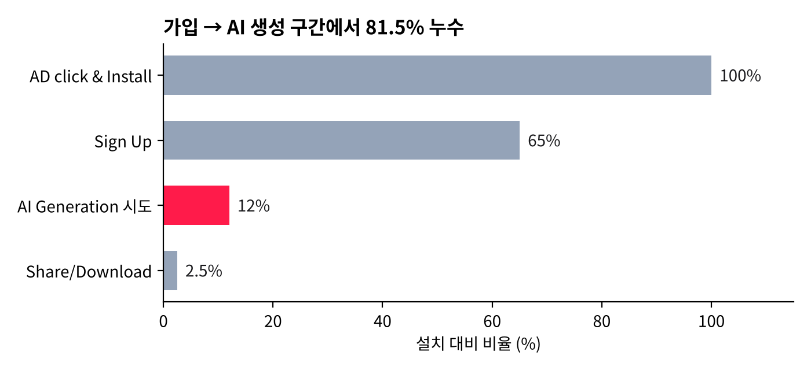
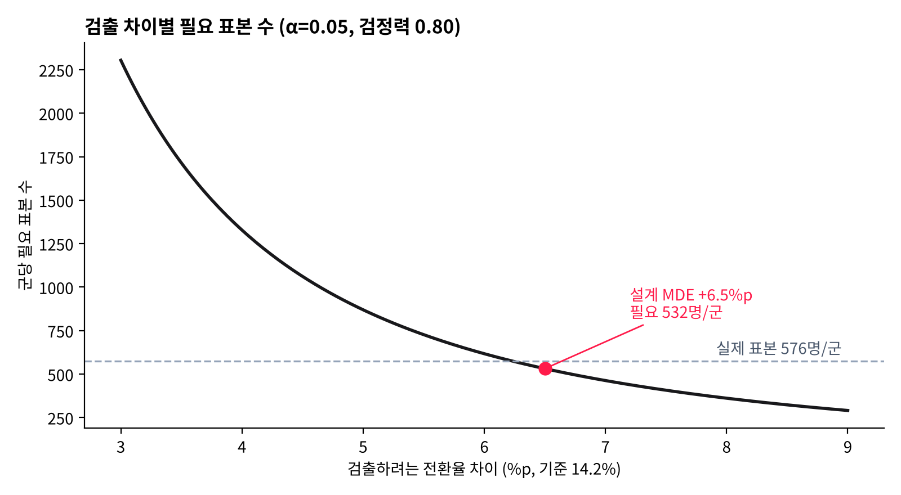
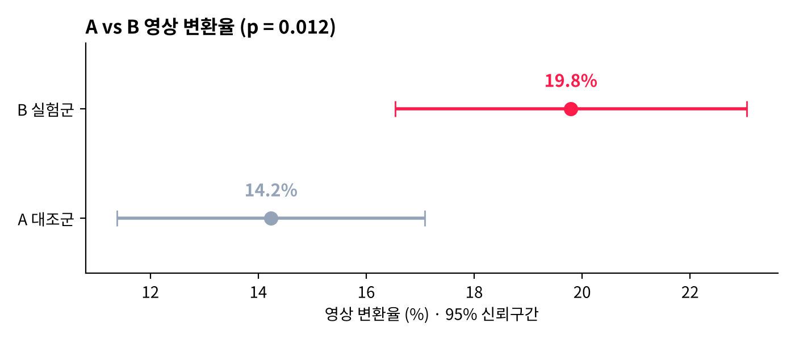

::: {.callout-note}
## 읽기 전 안내
이 글의 설계·결과 수치는 [Project A](../../projects/project-a.qmd)와 동일합니다. 군별 전환 수(A 82명, B 114명 / 군당 576명)는 보고된 전환율(14.2%, 19.8%)과 p-value(0.012)에 맞춰 정리한 값이므로, 실제 로그로 재집계한 값이 있다면 그 값으로 교체해야 합니다.
:::

## 1. 분석 배경 및 목적

UA 광고로 대규모 유입이 발생했지만 가입 후 AI 생성 체험 단계에서 이탈이 급증했습니다. 콘텐츠 노출 방식을 **랜덤 콘텐츠(A) → 장르 기획 콘텐츠(B)** 로 바꾸면 영상 변환율이 개선된다는 가설을 검증합니다.

* **H0:** 두 군의 영상 변환율은 같다 ($p_A = p_B$)
* **H1:** 두 군의 영상 변환율은 다르다 ($p_A \neq p_B$), 유의수준 $\alpha = 0.05$

## 2. 문제 진단: 어디서 새는가

{fig-alt="퍼널 막대 차트"}

AD click & Install(100%) → Sign Up(65%) → AI Generation(12%) → Share/Download(2.5%) 중 **가입 → AI 생성 시도** 구간에서 약 80% 이상이 이탈합니다. 이 구간이 가장 큰 누수이므로 실험의 대상 지표를 영상 변환율로 정했습니다.

## 3. 실험 설계와 표본 산정

| 구분 | 내용 |
|---|---|
| 대조군 (Group A) | 기존 랜덤 콘텐츠 (80% 개인 업로드, 20% 내부) |
| 실험군 (Group B) | 장르 기획 콘텐츠 (시네마틱, Y2K, 만화, 병맛 등) |
| 주지표 | 영상 변환율 (노출 유저 중 AI 영상 생성 성공 비율), 기준 14.2% |
| 배정 / 기간 | Firebase Remote Config(A/B Testing)로 신규 유저 무작위 50:50, 14일 |
| 유의수준 / 검정력 | $\alpha = 0.05$ / $1-\beta = 0.80$ |
| 최소 검출 효과 (MDE) | +6.5%p (14.2% → 20.7%) |

**군 배정 방식:** Remote Config 파라미터(콘텐츠 노출 정책)를 군별로 다르게 내려주고, 앱이 값을 적용(activate)한 시점의 노출 이벤트에 군 정보를 user property로 남깁니다. 이 로그가 Firebase → BigQuery / Amplitude로 연동되어 군별 퍼널과 변환율을 집계합니다. Firebase의 무작위 배정은 앱 설치(instance) 단위이므로, 재설치나 다기기 사용 유저는 다른 군에 배정될 수 있어 분석 시 확인이 필요합니다.

두 비율 비교의 군당 필요 표본 수는 다음과 같습니다.

$$n = \frac{(z_{1-\alpha/2}+z_{1-\beta})^2\,[p_1(1-p_1)+p_2(1-p_2)]}{(p_2-p_1)^2}$$

```python
from scipy import stats

def n_per_group(p1, p2, alpha=0.05, power=0.80):
    k = (stats.norm.ppf(1 - alpha/2) + stats.norm.ppf(power)) ** 2
    return k * (p1*(1-p1) + p2*(1-p2)) / (p2 - p1) ** 2

n_per_group(0.142, 0.142 + 0.065)   # 531.3 -> 군당 최소 532명
```

군당 최소 **532명**, 14일 기준 **일일 세그먼트당 최소 38명**입니다. 실제 수집된 표본은 군당 576명(일일 약 41명)으로 설계 기준을 충족했습니다.



## 4. 검정 결과

| 항목 | 대조군 A | 실험군 B |
|---|---|---|
| 표본 수 | 576 | 576 |
| 영상 생성 성공 | 82 | 114 |
| 영상 변환율 | 14.2% | 19.8% |
| 차이 | +5.6%p (상대 약 +39%) | |

```python
import numpy as np
from scipy import stats

n, a, b = 576, 82, 114
chi2, p_chi, *_ = stats.chi2_contingency([[a, n-a], [b, n-b]], correction=False)
t, p_t = stats.ttest_ind(np.r_[np.ones(b), np.zeros(n-b)],
                         np.r_[np.ones(a), np.zeros(n-a)])
```

| 검정 | 통계량 | p-value |
|---|---|---|
| 카이제곱 검정 | χ² = 6.30 (df=1) | 0.012 |
| 독립표본 t-검정 | t = 2.51 (df=1150) | 0.012 |

차이의 95% 신뢰구간은 **+1.2 ~ +9.9%p**로 0을 포함하지 않습니다.



**결론:** p-value 0.012 < 0.05이므로 H0를 기각합니다. 장르 기획 콘텐츠를 정식 롤아웃하기로 결정했습니다.

## 5. 핵심 요약

* **인사이트 1:** 장르 기획 콘텐츠(B)의 영상 변환율은 19.8%로 대조군(14.2%)보다 5.6%p(상대 약 +39%) 높고, 5% 유의수준에서 유의합니다 (p = 0.012).
* **인사이트 2:** 관측 차이(+5.6%p)는 설계 MDE(+6.5%p)보다 작아 이 표본에서의 검정력은 약 71%입니다. 방향은 신뢰할 수 있으나 효과 크기의 신뢰구간(+1.2 ~ +9.9%p)이 넓어, 롤아웃 후 모니터링으로 재추정이 필요합니다.
* **후속 액션:** 장르별(시네마틱, Y2K 등) 효과 분해, 7-day 잔존율 및 GPU cost를 함께 보는 proxy LTV/CAC ≥ 3.0 검증.

## 6. 한계

* 배정이 설치 단위이므로 재설치·다기기 유저의 군 이탈 가능성은 로그의 user_id 매핑으로 점검해야 합니다.
* 단일 기간·단일 지표 검정이므로 신기성 효과(novelty effect)는 롤아웃 후 모니터링으로 확인합니다.
* 장르별 하위 그룹 효과는 다중 비교 보정이 필요해 이번 검정에서 다루지 않았습니다.
