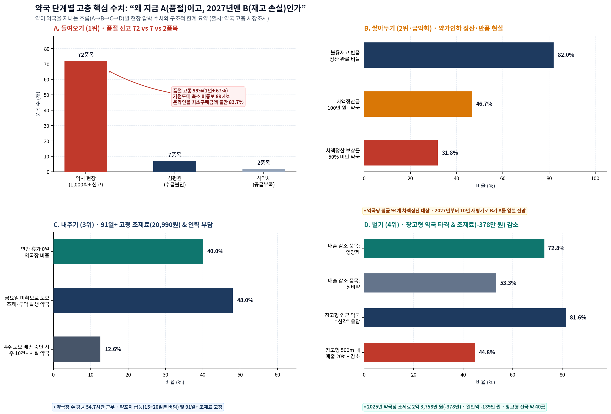

## 0. 관점 주체 

 고충은 "약국이 겪는 문제"이면서, 동시에 "이 주체가 주문·재고·반품 정보로 덜어줄 수 있는지"를 기준으로 봅니다.

## 1. 분류 방식

약국의 고충을 **약이 약국을 지나가는 순서**로 나눴습니다. 네 단계는 서로 겹치지 않고, 합치면 약국 운영 전체를 덮습니다.

| 단계 | 질문 | 무엇이 새는가 |
|---|---|---|
| A. 들여오기 (조달) | 필요한 약을 제때, 필요한 만큼 구할 수 있는가 | 시간, 조제 기회 |
| B. 쌓아두기 (재고 가치) | 이미 사둔 약의 가치가 지켜지는가 | 돈 |
| C. 내주기 (조제 운영) | 처방을 받아 약을 내주는 과정이 감당 가능한가 | 시간, 소모품, 분쟁 |
| D. 벌기 (수익 구조) | 약국의 매출과 마진이 유지되는가 | 매출 |

우선순위는 네 가지 기준으로 매겼습니다.
- **범위:** 얼마나 많은 약국이 겪는가
- **크기:** 금액이나 시간이 얼마나 되는가
- **추세:** 앞으로 나빠지는가
- **통제 불가성:** 약국 혼자 해결할 수 없는가

## 2. 우선순위 요약

| 순위 | 고충 | 범위 | 크기 | 추세 | 근거 요약 |
|---|---|---|---|---|---|
| 1 | A. 약을 구하지 못함 | 거의 모든 약국 | 큼 | 계속됨 | 약사 99%가 고통 호소, 정부 집계와 큰 차이 |
| 2 | B. 재고 가치 손실 (약가인하·불용재고) | 대부분의 약국 | 약국당 수십만~수백만원 | **크게 악화될 예정** | 2027년부터 10년 동안 이미 등재된 약 재평가 |
| 3 | C. 조제 운영 부담 | 장기처방이 많은 약국 중심 | 중간 | 계속됨 | 91일 넘는 처방이 늘어도 조제료는 고정 |
| 4 | D. 수익 구조 악화 | 지역에 따라 다름 | 지역에 따라 큼 | 악화 | 창고형 약국 인근 매출 감소 |

1위와 2위는 근소한 차이입니다. 현재 체감은 1위가 가장 크지만, 2027년 4월부터는 2위가 1위를 앞지를 가능성이 높습니다.

{fig-alt="네 칸 그림. A 들여오기: 약사가 1,000회 이상 품절을 신고한 품목 72개, 같은 시기 심평원 수급불안 신고 7품목, 식약처 공급부족 신고 2품목. B 쌓아두기: 불용재고 반품 정산 완료 82.0%, 차액정산금 100만 원 이상 약국 46.7%, 차액정산 보상률 50% 미만 약국 31.8%. C 내주기: 연간 휴가 0일 약국장 40.0%, 금요일 미확보로 토요일 조제·투약이 생기는 약국 48.0%, 넷째 주 토요일 배송 중단 시 주 10건 이상 차질 12.6%. D 벌기: 매출 감소 품목 영양제 72.8%, 상비약 53.3%, 창고형 인근 약국 '심각' 응답 81.6%, 창고형 500m 안 매출 20% 이상 감소 44.8%."}

## 3. 단계별 고충과 구체적 사례

### A. 들여오기: 약을 구하지 못함 (1위)

**왜 1위인가**
- **범위:** 2023년 조사에서 약사 99%가 품절약으로 고통을 겪는다고 답했고, 67%는 1년 이상 겪고 있다고 답했습니다.
- **정부와의 인식 차이:** 약사들이 2025년 1~8월에 1000회 이상 품절을 신고한 의약품은 72개 품목이었지만, 같은 시기 심평원에 신고된 수급불안 의약품은 7품목, 식약처에 공급부족이 신고된 의약품은 2품목뿐이었습니다. 공식 집계에 잡히지 않으니 정부 대책도 현장보다 늦게 나옵니다.

**사례 A-1. 출고 기록은 있는데 동네약국에는 재고가 없다**
- **상황:** 2026년 10월 서울 강서구약사회장은 이모튼, 릭시아나, 레가론 같은 품목이 약국마다 다르게 배분된다고 문제를 제기했습니다. 출고 내역은 있는데 온라인몰 재고는 '0'이어서 동네약국은 약을 구할 수 없다는 것입니다.
- **제약조건 1 (대체 불가):** 대체할 수 있는 약이 없는 품목도 있습니다. 처방전에 적힌 제품을 구하지 못하면 약사는 의사에게 처방 변경을 요청하거나 환자를 다른 약국으로 보내야 합니다.
- **제약조건 2 (정보 불신):** 재고 정보를 믿을 수 없습니다. 한 약국 관계자는 재고가 실시간이 아니어서 실제로 확보할 수 있는지 다시 확인해야 하는 경우가 많고, 전화로 묻는 게 더 빠르다는 인식이 아직 남아 있다고 말했습니다.
- **제약조건 3 (법):** 약국끼리 약을 맞바꾸는 교품이 현실적인 해결책이지만, 약사법은 약국 간 거래를 폐업이나 긴급한 의약품의 경우에만 허용합니다. 그런데도 현장에서는 교품이 아니면 이모튼, 듀락칸이지, 직듀오를 구할 수 없다고 말합니다. 약사는 조제를 위해 법적으로 애매한 거래를 감수하는 셈입니다.

**사례 A-2. 몇천 원짜리 약을 사려고 20만 원어치를 주문한다**
- **상황:** 일부 도매업체는 품절약이 들어오면 한 약국이 주문할 수 있는 수량을 1개로 묶고, 최소 주문금액을 정해 다른 약까지 사게 만들었습니다. 경기도약사회 설문에서도 온라인몰의 불편으로 83.7%가 높은 최소 구매금액을, 40.2%가 구매 수량 제한을 꼽았습니다.
- **제약조건:** 공급이 부족할 때 협상력은 도매업체에 있습니다. 약국은 필요 없는 약을 같이 사면서 재고 부담을 늘리게 되고, 이 부담은 다시 B단계의 불용재고 문제로 이어집니다.

**사례 A-3. 유통 구조가 바뀌면서 배송이 끊긴다**
- **상황 1 (거점도매):** 대웅제약은 2026년 3월 거래 도매업체를 40곳에서 5곳으로 줄였습니다. 그 뒤 약사 678명을 조사한 결과 89.4%가 이 정책을 사전에 전혀 통보받지 못했다고 답했습니다. 제주에서는 거점도매 재고가 떨어져 3~5일 동안 배송이 끊겼고, 서울에서는 하루 2회이던 배송이 1회로 줄어 당일 투약을 못 한 사례가 있었습니다.
- **상황 2 (토요일 배송 휴무):** 주요 도매업체가 넷째 주 토요일 배송을 일괄로 쉬기로 하자 부산시약사회가 의견을 조사했습니다. 응답자의 48%는 금요일에 약을 구하지 못해 토요일에 조제·투약하는 일이 매주 1~2건 생긴다고 답했고, 10건 이상 차질이 생긴다는 약국도 12.6%였습니다.
- **제약조건:** 약국은 제약사의 유통 정책 결정에 참여할 수 없고, 바뀐 뒤에야 알게 됩니다.

### B. 쌓아두기: 재고 가치 손실 (2위, 가장 빠르게 악화)

**왜 2위인가**
- **크기:** 개국약사 512명 조사에서 약가인하로 차액정산을 받아야 하는 품목은 약국당 평균 94품목이었고, 46.7%의 약국은 차액정산금이 100만원 이상이었습니다.
- **손실:** 그런데 실제로 보상받은 비율이 50% 미만이라는 응답이 31.8%로 가장 많았습니다.
- **추세:** 앞으로 크게 나빠집니다. 내년부터 이미 등재된 의약품을 10년에 걸쳐 재평가하기 때문에, 해마다 현장에서 약가인하 대란이 벌어질 것으로 보입니다.

**사례 B-1. 며칠 전에야 알게 된 약가인하를 대조하다 포기한다**
- **상황:** 한 약사는 약가인하 대상 품목을 시행 며칠 전에야 알 수 있고, 약국 일을 하면서 며칠 동안 대조해 차액정산을 하기는 너무 힘들어 포기하고 있다고 말했습니다. 1원 단위로 내려가는 품목은 그냥 손해를 안고 간다는 것입니다.
- **제약조건 1 (시간):** 약가인하를 미리 알 시간이 부족합니다. 인하 폭이 작은 품목일수록 정산하는 데 드는 시간이 받을 돈보다 커서 약국은 손해를 감수합니다.
- **제약조건 2 (보상 축소):** 보상 조건이 점점 나빠지고 있습니다. 한 제약사는 약가인하 때 통상 200% 해주던 재고 보상을 절반으로 줄이겠다고 공지했습니다. 반품할 때 B제약사는 정산액의 절반을 폐기 비용으로 빼고, 대형 제약사 C사도 10%를 폐기 비용으로 빼기로 한 것으로 알려졌습니다.

**사례 B-2. 반품한 약이 몇 달 뒤 다시 돌아온다**
- **상황:** 대한약사회가 진행한 불용재고 반품사업에는 약국 1만2000여 곳이 참여해 274억원어치 반품을 신청했고, 그중 82%가 정산을 마쳤습니다. 다음 회차는 3월 정산을 목표로 했지만, 반품이 안 된다며 약국으로 되돌아온 사례가 확인됐고, 약사회가 알린 협조 제약사 명단과 도매업체가 확인한 명단이 서로 달라 혼선이 생겼습니다.
- **제약조건:** 반품이 되는지는 제약사가 결정합니다. 도매업체도 그 약을 그 약국에 팔았다는 거래 기록이 없으면 반품을 받지 않습니다. 약국은 정리하고 입력하는 수고를 들이고도 돈을 돌려받지 못할 수 있습니다.

### C. 내주기: 조제 운영 부담 (3위)

**사례 C-1. 1년 치 처방은 늘어나는데 조제료는 그대로다**
- **상황:** 비수도권 2차 병원 앞 약국의 처방을 분석해 보니 하루 조제의 절반이 91일을 넘는 장기처방이었습니다. 그런데 2026년 기준 내복약의 91일 이상 조제료는 2만990원으로 고정되어 있습니다. 120일 처방이든 1년 처방이든 약포지와 노동은 더 드는데 받는 돈은 같습니다.
- **분쟁:** 장기처방은 환자와의 분쟁으로도 번집니다. 약을 잃어버리거나 보관을 잘못한 환자가 약국이 약을 덜 줬다고 항의하는 일이 잇따르고, CCTV를 확인하거나 다시 조제해 달라는 요구까지 나옵니다.
- **제약조건:** 처방 일수는 의사가 정하고, 조제료는 제도가 정합니다. 약국은 둘 다 바꿀 수 없습니다.

**사례 C-2. 약포지가 떨어져 자동조제기가 멈출 위기에 처한다 (2026년 3~4월)**
- **상황:** 미국-이란 전쟁으로 원료 공급이 불안해지자 여러 업체가 약포지 판매를 중단하거나 이미 받은 주문을 일방적으로 취소했고, 판매가격이 며칠 사이 2배 가까이 뛰었습니다. 장기처방이 많은 병원 앞 약국의 약사는 지금 롤지 재고로는 15~20일 정도 버틸 수 있고, 더 길어지면 자동조제기가 멈출 수밖에 없다고 말했습니다.
- **이후:** 4월 말 정부가 원료를 우선 공급하면서 공급은 안정됐지만, 오른 가격은 약국의 부담으로 남았습니다.
- **제약조건:** 이 문제는 장기처방(C-1)과 맞물려 있습니다. 처방 일수가 길수록 소모품이 더 많이 들기 때문입니다.

**사례 C-3. 약국장은 쉬지 못한다**
- **상황:** 약국장은 주 평균 54.7시간 일하고, 10명 중 4명 이상은 연간 휴가를 하루도 쓰지 못했습니다.
- **제약조건:** A~C의 모든 일(재고 확인, 차액 대조, 반품 정리, 환자 응대)이 결국 약국장 한 사람의 시간에서 나옵니다.

### D. 벌기: 수익 구조 악화 (4위)

**사례 D-1. 근처에 창고형 약국이 생기면 영양제부터 안 팔린다**
- **상황:** 창고형 약국 인근 535개 약국을 조사한 결과 81.6%가 창고형 약국 문제를 '심각하다'고 답했고, 매출이 줄어든 품목은 영양제(72.8%), 상비약(53.3%) 순이었습니다. 창고형 약국에서 500m 안에 있는 약국은 44.8%가 매출이 20% 넘게 줄었다고 답했습니다. 2026년 3월에는 창고형 약국 때문에 문을 닫은 첫 폐업 사례도 나왔습니다.
- **순위가 4위인 이유:** 피해는 크지만, 창고형 약국은 2026년 6월 기준 전국 약 40곳이어서 영향을 받는 약국이 일부 지역에 몰려 있습니다.

**사례 D-2. 조제 건수는 늘어도 약국당 조제료는 줄었다**
- **상황:** 2025년 약국당 조제료는 2억3758만원으로 전년보다 378만원 줄었고, 일반약 매출도 139만원 줄었습니다. 장기처방이 늘고 전체 약국 수가 늘어난 것이 원인으로 꼽힙니다.
- **제약조건:** 수입이 줄어드니 A~C에서 새는 시간과 돈을 견딜 여유도 줄어듭니다.

## 4. 고충들의 연결 구조

네 단계는 서로 겹치지 않지만, 원인과 결과로 이어져 있습니다.

1. 약을 구하지 못하면(A) 약국은 불안해서 필요보다 많이 사둡니다.
2. 사둔 약은 약가인하나 처방 변경을 만나면 가치가 떨어집니다(B).
3. 장기처방은 한 번에 많은 재고를 요구해 품절(A)과 소모품 부족(C)을 함께 키웁니다.
4. 수익이 줄면(D) 이런 손실을 견딜 여유가 줄어듭니다.

가장 바깥의 원인은 대부분 약국이 통제할 수 없는 곳에 있습니다. 처방은 의사가, 약가는 정부가, 공급과 반품 조건은 제약사와 도매업체가 정합니다.

## 5. 이 주체 입장에서의 시사점

이 주체는 처방, 약가, 생산을 바꿀 수는 없습니다. 대신 **약국이 늦게 알거나 혼자 계산하느라 생기는 손실**은 줄일 수 있습니다. A단계와 B단계가 여기에 해당하고, 우선순위 1·2위와도 겹칩니다.

- **A단계:** 신뢰할 수 있는 재고 정보, 공급 불안을 미리 알리는 신호.
- **B단계:** 약가인하가 예고된 시점에 약국별 보유 재고와 예상 손실을 미리 계산해 주는 기능.

C·D단계는 제도와 상권의 문제여서 이 주체가 직접 줄일 수 있는 부분이 작습니다.

**근거의 한계:** 근거 대부분은 약업 전문지 보도와 약사 단체 설문입니다. 피해를 호소하려는 목적의 설문은 응답이 피해 쪽으로 쏠릴 수 있습니다. 2023년 차액정산 조사처럼 시점이 오래된 숫자도 섞여 있습니다. 실제 약국 인터뷰나 주문·반품 기록으로 다시 확인하는 단계가 필요합니다.

## 6. 분석 로드맵

분석 로드맵과 진행 상황은 [시리즈 안내](../posts/2026-11-pharm-data-series/index.qmd#next)의 「다음 분석」에 있습니다. 완료한 분석은 [쌓아두기: 약가인하](../posts/2026-11-benefit-change-lead/index.qmd), [들여오기: 처방 수요](../posts/2026-11-drug-demand-forecast/index.qmd)입니다.
